[Họ tên — MSSV]

[Lớp]

[Giảng viên]

[Ngày nộp]

[[TOC]]

# Bảng đối chiếu yêu cầu đề bài

Báo cáo trình bày việc thu thập và chuẩn hoá dữ liệu tuyển sinh, xây dựng mạng quan hệ giữa trường và ngành, áp dụng thuật toán mạng và đưa kết quả vào ứng dụng EduRadar. Kết quả xử lý ngày 25/10/2026 gồm 71.011 dòng điểm chuẩn của 292 trường; bốn mô hình mạng được khảo sát riêng cho từng năm 2024–2026. Mạng biểu diễn quan hệ đào tạo và cạnh tranh theo điểm, không biểu diễn quan hệ bạn bè hoặc hành vi đăng ký nguyện vọng của từng thí sinh.

Nguồn: `docs/TONG_KET_DU_LIEU.md`; `data/clean/quality_report.md`; `data/network/summary.csv`.

**Bảng ĐC.1. Đối chiếu các yêu cầu của đề bài.**

| Yêu cầu | Mục báo cáo | Bằng chứng chính |
| --- | --- | --- |
| (1) Chọn chủ đề, lấy được dữ liệu | Chương 1 | 292 trường, ba năm; câu hỏi nghiên cứu; Hình 2.1 |
| (2) Crawl ít nhất 20.000 record; mô tả làm sạch và chuẩn hoá | 2.1–2.6; Phụ lục A–C | 921 request; 76.726 dòng thô → 71.011 dòng sạch; log, DB; Hình 2.1–2.4 |
| (3) Tính các độ đo SNA | 3.1–3.4; bảng ĐC.2 dưới đây | `summary.csv` đủ bốn mạng × ba năm; `metrics/*.csv`; Hình 3.1–3.7, 5.1–5.4 |
| (3') Chọn thuật toán áp dụng | 4.1–4.6 | Louvain, Girvan–Newman, HITS, PageRank, Adamic–Adar; kiểm chứng thời gian và độ nhạy |
| (4) Trực quan và mô phỏng | Chương 5 | NetworkX, Matplotlib; sơ đồ, phân bố, mạng tương tác; Hình 5.1–5.7; vị trí chèn hình Gephi đánh dấu rõ |
| (5) Ứng dụng minh hoạ | Chương 6 | Web GitHub Pages đang hoạt động; FastAPI; năm tab; Hình 6.1–6.8; kịch bản demo |

Nguồn: đối chiếu đề bài với các tệp kết quả nêu trong từng chương. Hai hình Gephi là phần người thực hiện cần bổ sung trước khi nộp.

**Bảng ĐC.2. Đối chiếu riêng từng độ đo bắt buộc và bổ sung.**

| Độ đo | Tiểu mục | Bảng và hình đối chiếu |
| --- | --- | --- |
| Degree centrality và Degree distribution | 3.2.1 | Bảng kết quả trong 3.2.1; Hình 3.2–3.7 |
| Betweenness centrality | 3.2.2 | Bảng top 10 trong 3.2.2; Hình 5.3 |
| CC = Closeness centrality | 3.2.3 | Bảng top 10 trong 3.2.3; mạng G3 Hình 5.2 |
| Eigenvector centrality | 3.2.4 | Bảng top 10 trong 3.2.4; cấu trúc clique giải thích kèm Hình 5.2 |
| PageRank | 3.2.5 | Bảng top 10 trong 3.2.5; bảng Spearman ở 4.3; Hình 5.4 |
| HITS hub và authority | 3.2.6 | Bảng top 10 trong 3.2.6; bảng 4.3; Hình 5.6 |
| Density | 3.2.7 | Bảng ba năm tại 3.2.7 và 3.3; Hình 5.5–5.6 |
| Average shortest path length | 3.2.8 | Bảng ba năm tại 3.2.8 và 3.3; phân tích LCC ở 4.5 |
| Diameter | 3.2.9 | Bảng ba năm tại 3.2.9 và 3.3 |
| Clustering coefficient và Transitivity | 3.2.10 | Bảng kết quả cục bộ/toàn cục tại 3.2.10; bảng 3.3 |
| Modularity | 3.2.11 | Bảng ba năm tại 3.2.11 và 3.3; cộng đồng 4.1; Hình 5.1–5.2, 5.5 |
| Thành phần liên thông, LCC, assortativity, reciprocity | 3.2.12 | Bảng ba năm tại 3.2.12 và 3.3; Hình 5.5 |

Nguồn: `sna/build.py` cho cách tính; `data/network/summary.csv`, `data/network/metrics/*.csv` cho kết quả; `docs/do_nhay_sna.md` cho độ nhạy. Mỗi tiểu mục 3.2 tách định nghĩa, công thức, cách tính, kết quả và ý nghĩa.

# Chương 1. Chủ đề và mục tiêu

## 1.1. Bối cảnh và lý do chọn đề tài

Thông tin tuyển sinh đại học được công bố theo trường, năm, phương thức xét tuyển, chương trình và tổ hợp. Vì vậy, một mức điểm chỉ có ý nghĩa khi đi cùng đúng bối cảnh. So sánh trực tiếp điểm THPT với điểm đánh giá năng lực, hoặc dùng học phí của một chương trình cho toàn bộ trường, có thể dẫn đến nhận định sai. Đề tài chọn dữ liệu điểm chuẩn công khai vì có cấu trúc lặp theo thời gian, có thể thu thập bằng chương trình và phục vụ nhu cầu tra cứu thực tế.

Góc nhìn SNA bổ sung cho các bảng tra cứu: hai trường có thể giống nhau về danh mục ngành dù nằm ở hai địa phương khác nhau; một ngành có thể nối các khối đào tạo vốn tách biệt; các trường có cùng ngành và mức điểm gần nhau tạo thành một mạng cạnh tranh có hướng. Từ đó, đề tài nghiên cứu một mạng tổ chức và lĩnh vực đào tạo. Các quan hệ là quan hệ được suy ra từ dữ liệu công bố, cần được diễn giải theo quy tắc xây dựng mạng.

## 1.2. Mục tiêu và câu hỏi nghiên cứu

Mục tiêu thứ nhất là tạo một tập dữ liệu đủ lớn và có thể truy nguồn: làm sạch điểm, chuẩn hoá mã ngành, phương thức và tổ hợp, đồng thời giữ thông tin điểm gốc, điểm quy đổi, năm và cờ chất lượng. Mục tiêu thứ hai là áp dụng các độ đo và thuật toán SNA để diễn giải cấu trúc tuyển sinh. Mục tiêu thứ ba là xây dựng một ứng dụng để giảng viên và người dùng có thể kiểm tra kết quả bằng thao tác trực tiếp.

Các câu hỏi nghiên cứu được trả lời ở Chương 7:

1. Trường nào có danh mục ngành giống nhau và tạo thành những cộng đồng đào tạo nào?
2. Ngành nào phổ biến, ngành nào đóng vai trò cầu nối giữa các nhóm ngành?
3. Trường nào nhận nhiều quan hệ cạnh tranh trực tiếp; HITS và PageRank khác nhau như thế nào?
4. Cấu trúc mạng thay đổi ra sao từ 2024 đến 2026, và kết luận nào bền vững khi đổi tham số?
5. Kết quả SNA có thể hỗ trợ tư vấn ngành và tìm lựa chọn tương tự như thế nào?

## 1.3. Phạm vi và sản phẩm

Phạm vi thực nghiệm gồm 292 mã trường có điểm trong ít nhất một năm thuộc giai đoạn 2024–2026. Danh mục nguồn chọn được 307 trường đại học, trong đó 15 trường chưa có dòng điểm. Số trường có điểm theo năm lần lượt là 279, 278 và 276; đây là các tập giao nhau, không cộng thành tổng trường. Có 472 mã ngành khác nhau trong toàn kỳ; mạng từng năm chỉ dùng các dòng map được mã ngành.

Nguồn: `docs/TONG_KET_DU_LIEU.md`, mục Điểm chuẩn và tổ hợp; `data/eduradar.db`, bảng `admissions`.

Sản phẩm gồm dữ liệu chuẩn hoá trong SQLite, các tệp độ đo và GEXF, các biểu đồ, báo cáo và ứng dụng EduRadar. Bản công khai tại [EduRadar trên GitHub Pages](https://tiennguyen2406.github.io/Tuyensinhdaihoc/) phục vụ tra cứu bằng dữ liệu tĩnh; bản FastAPI phục vụ trực tiếp từ dữ liệu trên máy. Phạm vi này phản ánh mẫu đã thu thập, không được xem là điều tra toàn bộ hệ thống đại học hay xác suất trúng tuyển.


# Chương 2. Thu thập và xử lý dữ liệu

## 2.1. Nguồn dữ liệu và phạm vi thu thập

Bộ dữ liệu của EduRadar V2 được xây dựng để tra cứu điểm chuẩn các năm 2024–2026, tư vấn theo điểm và tạo mạng phục vụ phân tích SNA. Nguồn chính là API công khai của Tuyensinh247; các thông tin bổ trợ gồm danh mục tổ hợp, xếp hạng VNUR 2026, đề án tuyển sinh HOCMAI, học phí và địa bàn của trường. Đây là tập dữ liệu đã thu thập phục vụ đồ án, không đại diện cho toàn bộ cơ sở giáo dục hoặc mọi thông báo tuyển sinh đang tồn tại trên Internet.

Mốc thu thập phải phân biệt với mốc xử lý. Điểm chuẩn được tải ngày **23/10/2026**. Lần chạy lại pipeline dùng dữ liệu thô đã có diễn ra ngày **25/10/2026**, với `meta.updated_on = 2026-10-25` theo tài liệu tổng kết. Mốc xử lý này không chứng minh các trang học phí, đề án hoặc bảng xếp hạng đều vừa được tải trong ngày 25/10.

**Bảng 2.1. Danh mục nguồn, cách truy cập và khả năng truy nguyên**

| Nhóm dữ liệu và quy mô | URL hoặc vị trí URL nguồn | Cách truy cập và đơn vị thu thập | Ngày thu thập được ghi nhận | Robots.txt và Content-Signal |
| --- | --- | --- | --- | --- |
| Danh mục trường: 587 mục; chọn 307 trường đại học | `https://diemthi.tuyensinh247.com/api/school/search` | GET API JSON; lọc `level = 2` | Chưa có nhật ký riêng cho request danh mục trong các nguồn kiểm chứng của chương | Crawler hiện có kiểm tra `https://diemthi.tuyensinh247.com/robots.txt`; chưa ghi nhận bản nội dung robots hoặc Content-Signal tại thời điểm tải |
| Điểm chuẩn: 76.726 dòng thô → 71.011 dòng sạch | `https://diemthi.tuyensinh247.com/api/common/cutoff-score?school_id=…&year=…`; trang dẫn nguồn, thí dụ `https://diemthi.tuyensinh247.com/diem-chuan/dai-hoc-bach-khoa-ha-noi-BKA.html` | GET API JSON; một trường × một năm là một tác vụ tải | 23/10/2026; nhật ký từ 13:51:00 đến 14:20:33 | Như trên; không suy diễn quyền sử dụng từ việc endpoint truy cập được |
| Tổ hợp: 298 mã có tên môn; 385 mã dùng trong điểm | `https://diemthi.tuyensinh247.com/api/common/blocks` | GET API JSON; tách mã tổ hợp, giữ các định nghĩa của nguồn | Chưa ghi nhận ngày riêng trong nguồn kiểm chứng | Chưa ghi nhận bản robots/Content-Signal lịch sử |
| VNUR 2026: 149 mã trường gồm 95 trực tiếp, 54 kế thừa | Các URL `universities.vnur_url`, thí dụ `https://vnur.vn/dai-hoc-bach-khoa-ha-noi/` và `https://vnur.vn/dai-hoc-quoc-gia-ha-noi-3/` | Tra cứu và ánh xạ thủ công qua `vnur_2026.csv`, `vnur_map.csv`; giữ hạng, tên đơn vị và quan hệ kế thừa | Năm bảng xếp hạng là 2026; chưa ghi nhận ngày tải riêng | Chưa ghi nhận trong bộ bằng chứng của chương |
| HOCMAI: 271 bài nguồn, ghép vào 267 trường | URL bài gốc được giữ trong trường `source_url` của dữ liệu đề án; tài liệu tổng kết không liệt kê toàn bộ URL bài | Đọc dữ liệu bài viết có nội dung HTML, bóc tách theo heading; quyết định ghép trường ở `dean_map.csv` | Chưa ghi nhận ngày tải riêng trong các nguồn kiểm chứng của chương | Chưa ghi nhận bản robots/Content-Signal; không đồng nhất khả năng đọc bài với cấp phép tái sử dụng |
| Học phí bộ đầu: 203 trường có mức | `tuition.source_url` trong SQLite; thí dụ [Đại học Đông Á](https://donga.edu.vn/tuyensinh/ts-chi-tiet/dai-hoc-dong-a-cong-bo-hoc-phi-nam-2026-bac-dai-hoc-chinh-quy-44617), [Báo Nhân Dân](https://nhandan.vn/hoc-phi-dai-hoc-tang-theo-lo-trinh-tu-chu-post978685.html), [Tuyensinhso](https://tuyensinhso.vn/chua-phan-loai/hien-co-gan-120-truong-dai-hoc-cong-bo-hoc-phi-nam-2026-c430564.html) | Tổng hợp thủ công từ website chính thức, báo chí, trang tổng hợp; lưu khoảng học phí và loại bằng chứng | Chưa có mốc tải thống nhất; năm học được giữ riêng theo từng mục | Chưa ghi nhận bản robots/Content-Signal của từng URL |
| Học phí bổ sung: 89 trường, 82 có mức tiền | Danh sách nguồn theo từng mục trong `data/manual/hoc_phi_bo_sung_89_truong_20261024.md`; tài liệu tổng kết không chép toàn bộ URL | Nhập ghi chú nghiên cứu thủ công; `tuition_import.py` giữ đơn vị của từng khoản | Tên hồ sơ mang mốc 24/10/2026, không dùng thay ngày truy cập từng URL | Chưa ghi nhận trong bộ bằng chứng của chương |
| Tỉnh/thành: 292 trường sau hợp lớp; 185 trong DB nền | URL trong `universities.province_url`, thí dụ `https://www.is.vnu.edu.vn/`, `https://sao.agu.edu.vn/`, `https://vju.ac.vn/`; kết hợp VNUR, HOCMAI | Đối chiếu địa chỉ trường/phân hiệu; quy về tên tỉnh sau sắp xếp hành chính 2025 | Chưa ghi nhận ngày tải riêng của từng địa chỉ | Chưa ghi nhận trong bộ bằng chứng của chương |
| Danh mục tỉnh: tập trường thu thập có 30 tỉnh/thành | [Danh mục tỉnh trên Cổng Chính phủ](https://xaydungchinhsach.chinhphu.vn/bang-danh-muc-va-ma-so-cua-34-tinh-thanh-moi-cac-don-vi-hanh-chinh-cap-xa-moi-11925070418263625.htm) | Tài liệu tham chiếu cho chuẩn hóa tên địa bàn | Chưa ghi nhận ngày truy cập; mốc danh mục 2025 | Chưa ghi nhận trong bộ bằng chứng của chương |

Nguồn: `docs/TONG_KET_DU_LIEU.md`, `data/raw/fetch_log.csv`, các cột URL trong `data/eduradar.db`; `crawler/fetch.py`, `pipeline/dean.py`, `pipeline/tuition_import.py` chỉ dùng để mô tả cơ chế truy cập và xử lý. Dấu `…` thể hiện tham số thay đổi theo trường/năm, không phải URL của một lần tải cụ thể.

Bảng 2.1 liệt kê mọi **nhóm nguồn** tham gia hệ thống. Với các nguồn có URL theo từng trường, báo cáo chỉ đưa ví dụ có thể đối chiếu trong SQLite; danh sách đầy đủ phải lấy từ cột URL hoặc hồ sơ thủ công tương ứng. Trong bộ đầu học phí, SQLite có **58 URL phân biệt** cho 203 mã trường, nên số URL không bằng số trường. Script `scripts/report_data_evidence.py` truy vấn toàn bộ URL học phí, URL VNUR và URL địa chỉ đang có trong DB. Các nguồn kiểm chứng được chốt cho chương này không chứa đầy đủ URL bài HOCMAI hoặc URL của 89 mục học phí bổ sung; do đó chưa thể trình bày một danh sách URL hoàn chỉnh đến từng bài cho hai nhóm này. Đây là giới hạn hồ sơ nguồn, không được thay bằng URL tự suy đoán.

Crawler hiện kiểm tra robots trước khi gọi API và dừng nếu `can_fetch` trả về không cho phép. Tuy nhiên, mã chương trình hiện hành chỉ cho biết cách thực hiện, không thay thế bản chụp robots ở ngày thu thập. Nhật ký hiện có không lưu response header hay Content-Signal. Vì vậy, báo cáo ghi **chưa ghi nhận bằng chứng** cho các nội dung này, không kết luận trang cho phép mọi hình thức thu thập hoặc tái sử dụng. Phạm vi sử dụng của đồ án là học tập phi thương mại, có dẫn nguồn khi hiển thị.

**Bảng 2.2. Quy mô các lớp dữ liệu sau xử lý**

| Lớp dữ liệu | Số lượng và cách hiểu |
| --- | --- |
| Danh mục trường API | 587 mục mọi loại hình; chọn 307 trường `level = 2`; 292 trường có ít nhất một dòng điểm, 15 trường chưa có điểm ở cả ba năm |
| Điểm chuẩn | 76.726 dòng thô; 71.011 dòng sạch; 472 mã ngành được sử dụng; 69.276 dòng có mã ngành |
| Tổ hợp | 385 mã xuất hiện trong điểm; 264.630 lượt gắn dòng–tổ hợp; danh mục nguồn có tên môn cho 298 mã; giao giữa hai tập là 253 mã |
| VNUR 2026 | 149/292 trường có hạng: 95 hạng trực tiếp và 54 đơn vị kế thừa; 143 chưa gắn hạng |
| Đề án HOCMAI | 271 bài nguồn; 268 bài ghép vào 267 mã trường; 3 bài chưa ghép; 1.190 mục phương thức và 8.208 gạch đầu dòng dữ kiện |
| Học phí bộ đầu | 203 trường: 17 nguồn chính thức, 30 báo chí, 156 trang tổng hợp |
| Học phí bổ sung | 89 trường: 53 nguồn chính thức, 4 văn bản chính thức lưu ở bên thứ ba, 25 nguồn thứ cấp, 7 chưa xác minh được mức tiền |
| Học phí hợp hai bộ | Hai bộ không trùng mã trường; 285/292 trường có mức tiền tham khảo; 7 trường chỉ có thông báo chưa xác minh |
| Địa bàn | Theo lớp hợp cuối trong tổng kết: 292/292 trường, 30 tỉnh/thành; nguồn gồm 90 địa chỉ chính thức, 95 VNUR, 107 HOCMAI. DB nền mới lưu tỉnh rõ cho 185 trường; phân biệt này được giải thích ở mục 2.6 |

Nguồn: `docs/TONG_KET_DU_LIEU.md`, `data/clean/quality_report.md`; đối chiếu số điểm, tổ hợp và hạng với `data/eduradar.db` ngày 25/10/2026.

## 2.2. Kiến trúc và quy trình crawler

Luồng xử lý được giữ đơn giản: `crawler/fetch.py` → `data/raw/` → `pipeline/clean.py` → `data/eduradar.db` → web và `sna/build.py` → `data/network/`. Các quyết định sửa tay đặt tại `data/manual/`, sau đó chạy lại pipeline để tái tạo kết quả; không sửa trực tiếp bảng sạch hoặc DB. Hình 2.1 mô tả luồng này.

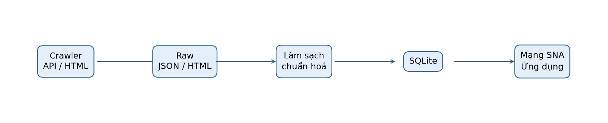

Hình 2.1. Luồng thu thập, làm sạch và sử dụng dữ liệu EduRadar V2.

Nguồn: tổng hợp từ cấu trúc xử lý của dự án.

`crawler/fetch.py` sử dụng thư viện chuẩn Python: `urllib.request` gửi HTTP, `urllib.parse` tạo query string, `json` đọc phản hồi, `csv` ghi nhật ký và `urllib.robotparser` kiểm tra robots. Danh mục trường được lấy một lần hoặc đọc lại từ cache. Mỗi trường đại học được tạo ba tác vụ với tham số `school_id` của nguồn và `year ∈ {2024, 2025, 2026}`. Đoạn mã rút gọn sau phản ánh cách gọi endpoint, không được chạy lại khi lập báo cáo:

```python
data = get_json(
    "/api/common/cutoff-score",
    {"school_id": school["id"], "year": year},
)
rows = data.get("data") or []
out = RAW / "cutoff" / str(year) / f"{school['code']}.json"
```

Phản hồi được giữ cùng đối tượng trường, năm, `fetched_at`, `source_url` và `response`. Địa chỉ `source_url` trỏ tới trang điểm chuẩn của trường trên Tuyensinh247; nó không phải đường dẫn tới quyết định tuyển sinh chính thức. Mỗi tác vụ ghi một dòng vào `fetch_log.csv` với các cột `time`, `school_id`, `code`, `year`, `rows`, `error`. Nhật ký được flush sau mỗi tác vụ để giảm nguy cơ mất dấu khi bị ngắt.

**Bảng 2.3. Kết quả đợt tải điểm chuẩn từ nhật ký**

| Chỉ tiêu | Giá trị |
| --- | ---: |
| Tác vụ trường × năm | 307 × 3 = 921 |
| Dòng nhật ký / khóa trường–năm phân biệt | 921 / 921 |
| Bắt đầu / kết thúc nhật ký | 23/10/2026 13:51:00 / 14:20:33 |
| Khoảng thời gian giữa hai mốc nhật ký | 1.773 giây = 29 phút 33 giây |
| Trung vị khoảng cách giữa các mốc ghi log | 2 giây |
| Tác vụ rỗng | 88: năm 2024 có 28; 2025 có 29; 2026 có 31 |
| Dòng có thông báo lỗi | 0 |
| Tổng số dòng trả về | 76.726 |

Nguồn: tổng hợp trực tiếp `data/raw/fetch_log.csv`; script tái lập `scripts/report_data_evidence.py`.

Số 921 chỉ đếm các tác vụ **điểm chuẩn** trong log; không bao gồm request danh mục trường, danh mục tổ hợp hoặc robots. Không có khóa trường–năm lặp trong log này. Kết quả cho thấy không có lỗi được ghi ở cấp tác vụ, nhưng log không lưu từng lần thử HTTP, vì vậy không dùng nó để khẳng định chắc chắn rằng chưa từng có retry nội bộ.

Crawler hiện đặt khoảng nghỉ tối thiểu `DELAY = max(1.5, args.delay)` trước request mạng, đồng thời nghỉ `args.delay + random.uniform(0, 0.5)` giữa các tác vụ điểm. Khi lỗi kết nối, timeout hoặc JSON không hợp lệ, `get_json` thử tối đa ba lần, tăng thời gian chờ theo `5 × attempt` giây. Thời điểm log chỉ chính xác đến giây; một số hai mốc liên tiếp chênh một giây không phải bằng chứng rằng thời gian nghỉ thực dưới 1,5 giây. Ngược lại, trung vị hai giây cũng không đủ để kiểm chứng riêng từng khoảng nghỉ. Trong phiên lập báo cáo không chạy crawler, và nguyên tắc vận hành là không crawl khi đang mở web.

Các file đã tồn tại được bỏ qua khi chạy lại; chỉ dùng `--force` khi chủ động tải lại. Tác vụ thất bại vẫn ghi lỗi rồi chuyển sang tác vụ tiếp theo. Nếu API trả `success = false`, phản hồi vẫn được lưu kèm thông báo trong log; khi cần tải lại các trường hợp đã có file phải dùng `--force` có chọn mã/năm. Trang trả mảng rỗng được xem là thiếu dữ liệu ở nguồn, không tạo bản ghi điểm giả. Đối với lần tải đang dùng, có 88 tác vụ rỗng và không có dòng lỗi; không thực hiện tải lại để lấp các khoảng trống này.

## 2.3. Định nghĩa record và quy mô tập dữ liệu

Một record trong `admissions` là **một mức điểm chuẩn của một chương trình tại một trường, trong một năm, theo một phương thức và phương thức con, với một nhóm tổ hợp và ghi chú như nguồn công bố**, sau khi ghép điểm gốc/quy đổi và loại dòng trùng. Record không phải một thí sinh, một hồ sơ đăng ký hoặc một ngành duy nhất. Cùng `major_code` có thể xuất hiện ở nhiều trường, chương trình và năm; một chương trình có nhiều nhóm tổ hợp hoặc mức điểm khác nhau vẫn có thể tạo nhiều dòng.

Khóa nghiệp vụ dùng khi phát hiện trùng là `(uni_code, year, method, sub_method, program_code, program_name, combos, note)`. Khi loại trùng hoàn toàn, pipeline bổ sung `score` vào khóa này. Các dòng cùng khóa nghiệp vụ nhưng khác điểm được giữ để tránh tự chọn một giá trị không có căn cứ. `id` là số thứ tự sinh lại sau làm sạch, không phải định danh bền vững do API cung cấp.

**Bảng 2.4. Các trường thông tin của một record sạch**

| Nhóm | Cột | Nội dung |
| --- | --- | --- |
| Định danh | `id`, `uni_code`, `year` | Khóa kỹ thuật của lần xuất, mã trường, năm tuyển sinh |
| Phương thức | `method`, `method_name`, `sub_method` | Mã chuẩn, tên hiển thị, phương thức con của nguồn |
| Chương trình | `program_code`, `program_name`, `program_type` | Mã, tên chương trình và loại chương trình suy từ tên/mã |
| Ngành | `major_code`, `match_how` | Mã ngành chuẩn hóa và quy tắc đã gán; có thể chưa gán |
| Tổ hợp | `combos` | Danh sách mã ngăn bởi `;`, đồng thời tách sang `admission_combos` |
| Điểm | `score`, `scale_max`, `score_equiv` | Điểm, thang điểm suy ra, điểm quy đổi nếu ghép được |
| Chất lượng | `note`, `flag` | Ghi chú nguồn và cảnh báo dữ liệu |
| Truy nguyên | `source_url`, `crawled_at` | Trang điểm chuẩn và thời điểm thu thập |

Nguồn: schema và dữ liệu `admissions` trong `data/eduradar.db`; định nghĩa khóa từ `pipeline/clean.py`.

Hình 2.2 thể hiện sự giảm số dòng: 76.726 → 76.657 sau lọc điểm → 71.696 sau ghép điểm gốc/quy đổi → **71.011** sau loại trùng. Như vậy tập sạch đạt hơn 3,5 lần yêu cầu tối thiểu 20.000 record; chênh lệch với raw là 5.715 dòng, không phải 5.715 lỗi độc lập vì phần lớn là hai biểu diễn của cùng một record được ghép lại.

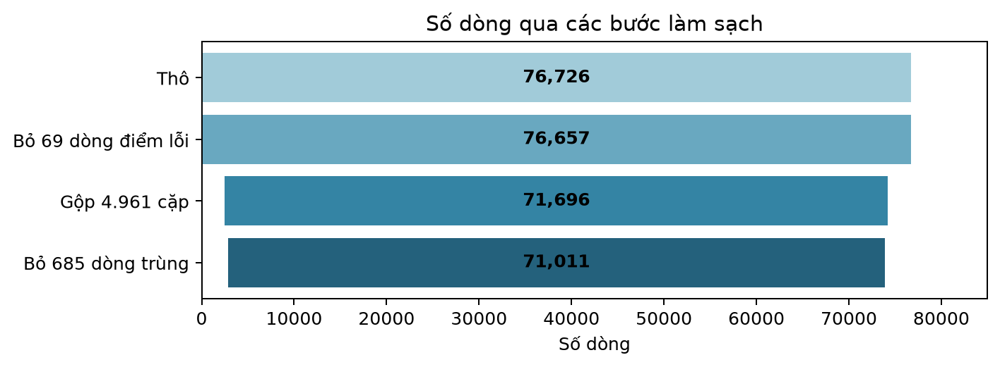

Hình 2.2. Số dòng qua các bước làm sạch.

Nguồn: `data/clean/quality_report.md`.

**Bảng 2.5. Số dòng sạch theo năm và phương thức**

| Phương thức | 2024 | 2025 | 2026 | Tổng |
| --- | ---: | ---: | ---: | ---: |
| THPT | 5.988 | 7.910 | 6.763 | 20.661 |
| HOCBA | 5.539 | 5.227 | 4.518 | 15.284 |
| DGNL_HCM | 2.422 | 2.672 | 3.000 | 8.094 |
| DGNL_HN | 1.035 | 1.594 | 2.008 | 4.637 |
| DGTD | 712 | 1.021 | 1.306 | 3.039 |
| DGNL_SPT | 231 | 803 | 903 | 1.937 |
| KETHOP | 1.124 | 1.887 | 7.053 | 10.064 |
| CCQT | 512 | 984 | 700 | 2.196 |
| UTXT | 670 | 655 | 284 | 1.609 |
| KHAC | 357 | 1.481 | 1.652 | 3.490 |
| **Dòng sạch** | **18.590** | **24.234** | **28.187** | **71.011** |
| Dòng thô từ log | 18.757 | 25.758 | 32.211 | 76.726 |
| Trường có dữ liệu sạch | 279 | 278 | 276 | 292 trường phân biệt |
| Mã ngành được dùng | 428 | 434 | 429 | 472 mã phân biệt |

Nguồn: `data/clean/quality_report.md`, `data/raw/fetch_log.csv`, truy vấn nhóm `year`, `method` từ `data/eduradar.db`. Hai hàng cuối là số phần tử phân biệt, không cộng dọc thành tổng ba năm.

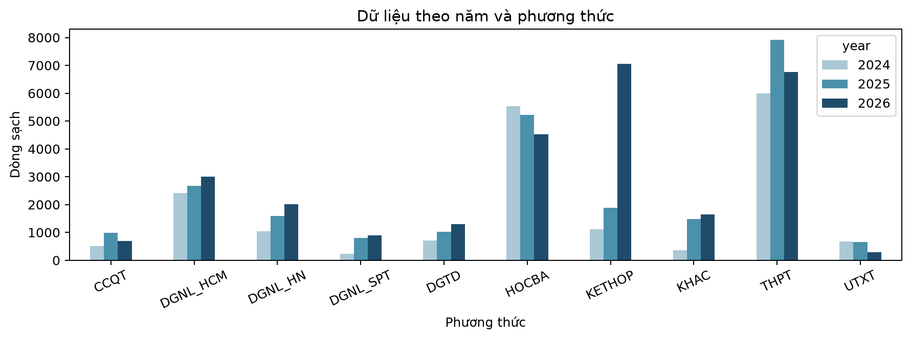

Hình 2.3. Phân bố số record theo năm và phương thức.

Nguồn: Bảng 2.5.

KETHOP tăng mạnh về số dòng trong năm 2026. Đây là thay đổi về số dòng dữ liệu nguồn sau chuẩn hóa, chưa đủ để kết luận số người sử dụng phương thức hoặc mức độ phổ biến xã hội tăng tương ứng. Số record của trường cũng phụ thuộc việc nguồn tách tổ hợp, phương thức con, chương trình và ghi chú. Do đó, bảng xếp theo số dòng chỉ đo quy mô dữ liệu của trường trong bộ thu thập.

**Bảng 2.6. Mười trường có nhiều record sạch nhất**

| Mã | Tên theo danh mục nguồn | 2024 | 2025 | 2026 | Tổng |
| --- | --- | ---: | ---: | ---: | ---: |
| DTT | Trường Đại Học Tôn Đức Thắng | 517 | 598 | 1.139 | 2.254 |
| KHA | Đại Học Kinh Tế Quốc Dân | 460 | 529 | 937 | 1.926 |
| HHA | Trường Đại Học Hàng Hải Việt Nam | 281 | 868 | 699 | 1.848 |
| SPK | Trường Đại Học Công nghệ Kỹ thuật TP HCM | 648 | 526 | 243 | 1.417 |
| DAD | Trường Đại Học Đông Á | 214 | 228 | 883 | 1.325 |
| SPS | Trường Đại Học Sư Phạm TPHCM | 133 | 524 | 426 | 1.083 |
| TCT | Đại Học Cần Thơ | 309 | 363 | 381 | 1.053 |
| PKA | Đại Học Phenikaa | 220 | 320 | 510 | 1.050 |
| QSX | Trường Đại Học Khoa Học Xã Hội và Nhân Văn TPHCM | 363 | 409 | 162 | 934 |
| TMU | Trường Đại Học Thương Mại | 264 | 225 | 407 | 896 |

Nguồn: `admissions` JOIN `universities` theo `uni_code`, GROUP BY mã trường, ORDER BY số dòng giảm dần trong `data/eduradar.db`. Truy vấn toàn bộ 292 trường được lưu trong `scripts/report_data_evidence.py`, khóa kết quả `schools_292`, và trình bày đầy đủ tại Phụ lục A.3.

## 2.4. Các bước làm sạch và xử lý vấn đề dữ liệu

### 2.4.1. Trình tự xử lý và số dòng ảnh hưởng

Pipeline đọc toàn bộ phản hồi đã lưu, gắn thông tin trường, năm, URL và thời điểm thu thập. Nếu trường `year` của dòng thiếu, chương trình dùng năm của file rồi ép về số nguyên. Cột `mark` được ép sang kiểu số; giá trị không chuyển được thành số trở thành thiếu. Các bước tiếp theo được thực hiện theo thứ tự cố định trong Bảng 2.7.

**Bảng 2.7. Nhật ký làm sạch của lần chạy 25/10/2026**

| Bước | Vấn đề và quy tắc | Dòng bị giảm hoặc được ghi nhận | Số dòng còn lại |
| --- | --- | ---: | ---: |
| Đọc raw | Hợp nhất phản hồi của 921 tác vụ điểm | 76.726 dòng vào | 76.726 |
| Lọc điểm | Loại `mark` thiếu, không ép được số hoặc ≤ 0 | −69 | 76.657 |
| Chuẩn văn bản, lọc tên | NFC, bỏ ký tự thay thế, tiền tố đánh số, gộp khoảng trắng; bỏ tên ngành rỗng | 0 dòng bị loại do tên rỗng | 76.657 |
| Phương thức và tổ hợp | Chuẩn mã phương thức, tách/chuẩn mã tổ hợp | Không giảm dòng; số ô văn bản bị sửa chưa thống kê riêng trong nguồn hiện hành | 76.657 |
| Ghép điểm gốc/quy đổi | Ghép theo khóa không gồm ghi chú, đưa điểm quy đổi vào `score_equiv` | −4.961 dòng biểu diễn quy đổi | 71.696 |
| Thang điểm và cờ | Gán thang theo phương thức hoặc suy từ giá trị; gắn cảnh báo | Không loại dòng ở bước này | 71.696 |
| Loại trùng hoàn toàn | Trùng khóa nghiệp vụ và cùng `score` thì giữ một | −685 | 71.011 |
| Phát hiện mâu thuẫn | Cùng khóa nghiệp vụ nhưng khác điểm | 631 dòng được giữ, không phải 631 khóa | 71.011 |
| Loại chương trình, map ngành | Phân loại chương trình; gán mã ngành và cách gán | 69.276 dòng có mã, 1.735 dòng chưa có mã | 71.011 |

Nguồn: `data/clean/quality_report.md`; thứ tự và khóa xử lý đối chiếu `pipeline/clean.py`. Báo cáo hiện hành không có thống kê riêng số ô sửa Unicode, tiền tố hoặc khoảng trắng trong mã, nên không dùng các số thống kê của lần chạy cũ.

### 2.4.2. Điểm số, văn bản và tổ hợp

Việc bỏ 69 dòng điểm không hợp lệ nhằm bảo đảm `score` dùng được cho tra cứu và tính toán. Trái lại, điểm lớn bất thường hoặc thấp nhưng vẫn là số dương không bị tự sửa hoặc xóa: pipeline giữ giá trị và gắn cờ để người dùng nhận biết. Chẳng hạn DB còn dòng KHA, năm 2024, KETHOP, chương trình `EP15` Khoa học dữ liệu có `score = 2600`, thang không xác định, cờ `outlier`. Báo cáo không tự kết luận giá trị đúng phải là 26,00 vì chưa có bằng chứng từ văn bản gốc.

Văn bản được chuẩn Unicode NFC, xóa ký tự thay thế `U+FFFD`, gộp khoảng trắng và bỏ khoảng trắng đầu/cuối. Tên chương trình được bỏ tiền tố đánh số dạng `(1)`, `(2)` ở đầu; mã chương trình được bỏ dấu cách. Tên gốc sau làm sạch vẫn được lưu ở `program_name`, tách khỏi khóa so khớp `name_key`. Các nguồn hiện hành không lưu cặp trước/sau của từng ô đã sửa; vì vậy không coi một ví dụ giả định là bằng chứng một dòng raw cụ thể đã xảy ra lỗi này, và không gán số dòng ảnh hưởng riêng cho từng phép biến đổi.

Với tổ hợp, mã được viết hoa, bỏ khoảng trắng và sửa chữ `O` thành số `0` ở phần số của mã. Tổng kết dữ liệu xác nhận các dạng `BO3 → B03`, `BO0 → B00`, `AO1 → A01`. DB xác nhận B03 là “Toán, Ngữ văn, Sinh học”, B00 là “Toán, Hóa học, Sinh học” và A01 là “Toán, Vật lí, Tiếng Anh”. Các mã sau chuẩn hóa được loại lặp trong một record, sắp xếp và nối bằng `;`; bảng `admission_combos` tách mỗi cặp `(admission_id, combo)` để truy vấn. Quy tắc này tạo **264.630 lượt gắn**, không phải 264.630 record điểm mới.

Có 385 mã được sử dụng nhưng chỉ 253 mã trong số đó có tên môn ở danh mục. **132 mã còn thiếu tên môn vẫn được giữ trong dữ liệu**; hệ thống không tự đặt tên môn. Danh mục API có 298 mã được đặt tên, nên còn các mã có định nghĩa nhưng không xuất hiện trong tập điểm. Nếu cùng mã có nhiều định nghĩa, chọn định nghĩa có `school_count` lớn nhất để hiển thị; vẫn giữ các định nghĩa và số trường theo nguồn trong dữ liệu giải thích. Đây là cách chọn đại diện từ nguồn, không phải xác nhận một định nghĩa là đúng cho mọi trường.

### 2.4.3. Ghép điểm gốc và điểm quy đổi

Nguồn có thể trả hai biểu diễn điểm cho một chương trình. Theo cách dùng của pipeline, `is_converted_score == 1` là dòng điểm gốc; các giá trị khác, kể cả thiếu hoặc giá trị bất thường, được đưa về nhánh còn lại. Dòng nhánh còn lại có khóa ghép trùng với dòng gốc được chuyển thành `score_equiv`; nếu không có cặp gốc thì vẫn giữ làm dòng đơn. Khóa ghép gồm trường, năm, phương thức, phương thức con, mã/tên chương trình và nhóm tổ hợp, **không gồm ghi chú**. Điều này cần được lưu ý vì hai dòng khác ghi chú vẫn có thể được coi là một cặp.

Nhờ ghép, số dòng giảm 4.961; trong bảng cuối có **4.940 dòng** mang `score_equiv`. Hai số không nhất thiết bằng nhau vì sau đó còn bước loại trùng, và một khóa ghép có thể có nhiều biểu diễn quy đổi. Mã hiện hành loại trùng theo khóa ghép trong bảng quy đổi trước khi merge; khi có nhiều điểm quy đổi cho cùng khóa, chỉ giữ dòng đầu tiên. Đây là giới hạn của cách ghép hiện tại, cần thận trọng nếu dùng điểm quy đổi cho phân tích sâu.

Báo cáo làm sạch trước đây ghi nhận trường hợp bất thường `is_converted_score = 26` ở SP2, năm 2026, Sư phạm Khoa học tự nhiên và đã sửa điều kiện phân nhánh để mọi giá trị khác 1 không bị bỏ âm thầm. Con số “ba dòng raw” trong ghi chép lịch sử chưa được tái kiểm ở đây vì phạm vi bằng chứng không bao gồm nội dung raw điểm. Bằng chứng hiện tại trong DB là chương trình `7140247`, năm 2026 có hai dòng KHAC: `score = 21,27` và `19,69`, đều mang `score_equiv = 25,57`, cùng một dòng THPT có `score = 25,57`. Không được hiểu ba dòng kết quả này là ba dòng raw bất thường, hoặc suy ra mỗi dòng raw bất thường đều trở thành một record sạch độc lập.

### 2.4.4. Dòng trùng và dòng mâu thuẫn

Sau ghép, 685 dòng trùng khóa và cùng điểm được bỏ. Việc bỏ trùng không dựa riêng vào mã ngành vì như vậy sẽ làm mất các chương trình, phương thức hoặc nhóm tổ hợp có ý nghĩa khác nhau. Với cùng khóa nhưng khác điểm, pipeline giữ toàn bộ 631 dòng liên quan và xuất danh sách vào `data/interim/conflicts.csv`. Số này đếm dòng tham gia mâu thuẫn, không phải số cặp và cũng không phải số trường sai dữ liệu.

Ví dụ kiểm chứng được trong DB là hai dòng KHAC của SP2 nêu trên: trường, năm, phương thức, mã/tên chương trình, nhóm tổ hợp và ghi chú giống nhau, nhưng điểm lần lượt 21,27 và 19,69. Pipeline không tự chọn số cao hơn hoặc lấy trung bình vì đó là quyết định cần thông tin nguồn bổ sung. Các dòng này có thể vẫn không mang `flag`, do kiểm tra trùng khóa được lưu riêng với bộ cờ về thang/giá trị điểm.

## 2.5. Chuẩn hóa và bổ sung thông tin phục vụ phân tích

### 2.5.1. Phương thức và thang điểm

**Bảng 2.8. Ánh xạ phương thức của nguồn sang mã sử dụng trong hệ thống**

| `mark_type` nguồn | Mã chuẩn | Tên hiển thị | Thang mặc định |
| --- | --- | --- | ---: |
| 1 | THPT | Điểm thi THPT | 30 |
| 2 | DGNL_HCM | ĐGNL ĐHQG-HCM (V-ACT) | 1.200 |
| 3 | HOCBA | Học bạ | 30 |
| 5 | DGNL_HN | ĐGNL ĐHQG-HN (HSA) | 150 |
| 6 | DGTD | Đánh giá tư duy (TSA) | 100 |
| 7 | DGNL_SPT | ĐGNL ĐHSP HN (SPT) | 30 |
| 10 | KETHOP | Xét tuyển kết hợp | Suy từ giá trị |
| 12 | CCQT | Chứng chỉ quốc tế | Suy từ giá trị |
| 11 | UTXT | Ưu tiên / xét tuyển thẳng | Suy từ giá trị |
| 4, 8, 9 và mã chưa nhận diện | KHAC | Khác | Suy từ giá trị |

Nguồn: bảng `METHODS` trong `pipeline/clean.py`; mã thực sự xuất hiện và số dòng sau chuẩn hóa tại Bảng 2.5 được kiểm chứng bằng SQLite.

Khi điểm không vượt thang mặc định, pipeline giữ thang mặc định. Nếu vượt thang hoặc phương thức chưa có thang, chọn mức nhỏ nhất chứa được điểm trong `{30, 40, 100, 150, 1200, 1600}`. Nếu không mức nào chứa được điểm, thang để thiếu và gắn `outlier`. Không có phép quy mọi phương thức về thang 30. Các phương thức có thang khác nhau phải được lọc trước khi so sánh; `score_equiv` là giá trị lấy từ biểu diễn của nguồn, không phải kết quả tự nhân chia theo thang.

Hai ví dụ trong DB cho thấy giới hạn của suy thang. NTS, học bạ 2024, `KDQS2.1`, có điểm 31 được gán thang 40 và cờ `thang_khac_30`, trong khi cùng chương trình còn điểm 30 và 29 ở thang 30. Không đủ bằng chứng xác định 31 là thang 40 hay điểm có cộng ưu tiên. DDT, năm 2026, KHAC, `7510205_11`, có điểm 225 được gán thang 1.200 do không có thang 300 trong tập ứng viên. Đây là kết quả thuật toán, không phải nguồn xác nhận rằng bài thi tương ứng dùng thang 1.200.

### 2.5.2. Chuẩn hóa mã ngành

Danh mục ngành được dựng từ chính dữ liệu điểm: lấy tiền tố bảy chữ số bắt đầu bằng 7 trong mã chương trình, chọn tên phổ biến nhất cho từng mã, ưu tiên các dòng loại CHUAN. Do vậy, thuật ngữ “mã ngành chuẩn hóa” trong báo cáo chỉ nói về danh mục thống nhất nội bộ; chưa thể coi đây là danh mục chính thức đã đối chiếu toàn bộ với Bộ GD&ĐT.

Với dòng chưa nhận diện được mã bảy số, pipeline tạo `name_key` bằng cách bỏ dấu, viết thường, bỏ phần trong ngoặc và một số từ chỉ chương trình, gộp dấu cách. Các từ như “quốc tế” hoặc “tiếng Anh” không bị xóa như những từ đơn lẻ không có nghĩa; tuy nhiên một số cụm mô tả chương trình đã quy định trong biểu thức chuẩn hóa vẫn có thể bị loại. Việc giữ nội dung phân biệt ngành giúp tránh gộp “Kinh doanh quốc tế” vào một ngành kinh doanh khác chỉ vì cùng có phần tên chung.

Thứ tự thực hiện là **`ma_7_so` → `thu_cong` → `ten_khop` → `dau_ten_chuan` → `ten_gan_dung` → `chua_ten_chuan`**. Dừng ở quy tắc khớp đầu tiên. `thu_cong_bo` là nhánh của bước thủ công: dấu `-` trong bảng map yêu cầu để trống mã, ngăn những phép gán tự động chưa đáng tin. Các số liệu và tỉ lệ ở Bảng 2.9 lấy trực tiếp từ DB, tính trên mẫu số 71.011 và làm tròn hai chữ số thập phân.

**Bảng 2.9. Kết quả gán mã ngành theo quy tắc**

| Thứ tự | Cách gán | Quy tắc | Số dòng | Tỉ lệ |
| --- | --- | --- | ---: | ---: |
| 1 | `ma_7_so` | Dùng tiền tố `7\d{6}` của mã chương trình | 56.418 | 79,45% |
| 2 | `thu_cong` | Tra `name_key` trong bảng map thủ công | 2.055 | 2,89% |
| 2b | `thu_cong_bo` | Chủ động để trống mã theo dấu `-` | 55 | 0,08% |
| 3 | `ten_khop` | Khớp `name_key` với tên đã biết mã | 9.425 | 13,27% |
| 4 | `dau_ten_chuan` | Bắt đầu bằng tên chuẩn có ít nhất hai từ | 1.182 | 1,66% |
| 5 | `ten_gan_dung` | `difflib` có độ giống tối thiểu 0,9 | 83 | 0,12% |
| 6 | `chua_ten_chuan` | Chứa cụm tên chuẩn, đủ điều kiện và chiếm ít nhất 60% số từ cốt lõi | 113 | 0,16% |
| — | Chưa khớp | Không có kết quả từ các quy tắc trên | 1.680 | 2,37% |
| | **Có mã** | Không tính `thu_cong_bo` và chưa khớp | **69.276** | **97,56%** |
| | **Chưa có mã** | 1.680 chưa khớp + 55 chủ động bỏ | **1.735** | **2,44%** |

Nguồn: `SELECT match_how, COUNT(*) FROM admissions GROUP BY match_how` và kiểm tra `major_code` trong `data/eduradar.db`; mô tả quy tắc từ `pipeline/clean.py`. Các tỉ lệ thành phần có thể không cộng đúng 100,00% do làm tròn.

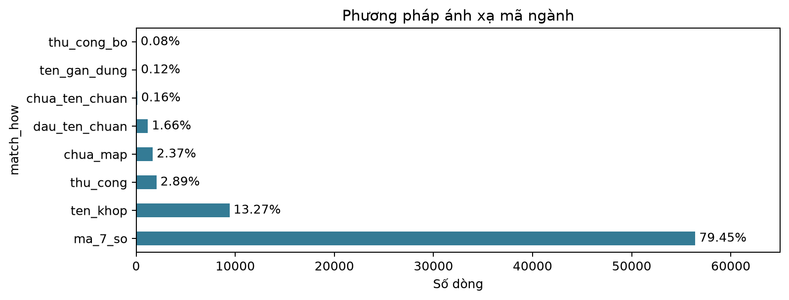

Hình 2.4. Cơ cấu các cách gán mã ngành.

Nguồn: Bảng 2.9.

**Bảng 2.10. Ví dụ có thể truy vấn trong dữ liệu sạch cho từng cách gán**

| Cách gán | Trường / mã chương trình | Tên chương trình đang lưu | Kết quả |
| --- | --- | --- | --- |
| `ma_7_so` | ANH / `7480201_Nam` | Ngành Công nghệ thông tin | `7480201` — Công nghệ thông tin |
| `thu_cong` | BKA / `ET-LUH` | Điện tử - Viễn thông - ĐH Leibniz Hannover (CHLB Đức) | `7520207` — Kỹ thuật điện tử - viễn thông |
| `thu_cong_bo` | BKA / `MS5` | Kỹ thuật in | Để trống mã |
| `ten_khop` | ANH / `DS7480201` | Công nghệ thông tin (Hệ dân sự) | `7480201` — Công nghệ thông tin |
| `dau_ten_chuan` | BKA / `ET-E16` | Truyền thông số và Kỹ thuật đa phương tiện (CT tiên tiến) | `7320111` — Truyền thông số |
| `ten_gan_dung` | BKA / `CH-E11` | Kỹ thuật Hóa dược (CT tiên tiến) | `7520301` — Kỹ thuật hóa học |
| `chua_ten_chuan` | BKA / `IT1` | CNTT: Khoa học Máy tính | `7480101` — Khoa học máy tính |
| Chưa khớp | BKA / `BF-E19` | Kỹ thuật sinh học (CT tiên tiến) | Để trống mã |

Nguồn: truy vấn `admissions` LEFT JOIN `majors` trong `data/eduradar.db`. Đây là ví dụ quy tắc trên các giá trị sạch có chứng thực, không phải cặp chụp raw trước/sau và không phải kết luận mọi phép map đều chính xác.

Lỗi đã được sửa trong cách dựng từ điển tên là chọn **mã xuất hiện trội** thay cho mã gặp đầu tiên. Nếu nhiều mã dùng cùng một tên, `key_to_code` đếm lượt xuất hiện của cặp tên–mã; khi dựng tên danh mục và cụm từ chuẩn, hàm `dominant` ưu tiên mã có nhiều dòng sử dụng. Ví dụ DB đồng thời có `7310120` và `7340120` mang tên Kinh doanh quốc tế; `7340002` và `7340101` cùng mang tên Quản trị kinh doanh. Quy tắc đa số giảm sự phụ thuộc thứ tự đọc dữ liệu, nhưng không xác thực được mã ít gặp là sai hay mã trội là mã pháp lý đúng. Những trường hợp bất định cần sửa qua `data/manual/major_map.csv`.

Ví dụ `CH-E11` cho thấy khớp gần đúng có thể gộp một tên chuyên biệt vào ngành rộng hơn. Các phép khớp tên, đặc biệt tiền tố, gần đúng và chứa cụm, là heuristic. Tỉ lệ 97,56% vì vậy là **độ phủ gán mã**, không phải độ chính xác 97,56%. Báo cáo hiện hành ghi 175 khóa tên chưa map; tổng số dòng chưa có mã là 1.735, trong đó đã bao gồm nhánh bỏ map có chủ đích.

### 2.5.3. Loại chương trình và địa bàn

Loại chương trình được nhận diện trên tên cộng mã sau bỏ dấu, theo thứ tự: tiên tiến, chất lượng cao, liên kết, tiếng Anh, phân hiệu/cơ sở, tài năng; không khớp thì gán CHUAN. Mỗi record chỉ nhận một nhãn theo quy tắc đầu tiên khớp. Vì tên chương trình có thể đồng thời chứa nhiều đặc điểm, nhãn này là phân loại tiện ích cho bộ lọc, không phải phân loại chương trình đã được trường xác nhận đầy đủ.

**Bảng 2.11. Số dòng theo loại chương trình**

| Nhãn | Số dòng |
| --- | ---: |
| CHUAN | 62.618 |
| TIENG_ANH | 3.111 |
| LIEN_KET | 1.510 |
| TIEN_TIEN | 1.290 |
| CLC | 1.287 |
| PHAN_HIEU | 1.079 |
| TAI_NANG | 116 |
| **Tổng** | **71.011** |

Nguồn: `data/clean/quality_report.md`, đối chiếu GROUP BY `program_type` trong SQLite.

Địa bàn được gán theo địa chỉ trường hoặc phân hiệu cụ thể; không lấy tỉnh đại học mẹ áp cho mọi thành viên. Các địa chỉ cũ được chuẩn hóa về tên sau sắp xếp năm 2025. Theo tổng kết, VJU/QHQ/QHY thuộc Hà Nội, QSA thuộc An Giang; phân hiệu ĐHTN tại Hà Giang được quy về Tuyên Quang, phân hiệu ĐH Đà Nẵng tại Kon Tum về Quảng Ngãi, phân hiệu ĐHQG-HCM tại Bến Tre về Vĩnh Long. Với một mã có nhiều cơ sở, bộ lọc chỉ biểu diễn một tỉnh theo địa chỉ chính đã đối chiếu; dữ liệu không mô tả đầy đủ mạng lưới cơ sở.

Tài liệu tổng kết ghi lớp hợp cuối có 90 địa chỉ chính thức, 95 VNUR và 107 HOCMAI. Tuy nhiên DB nền đang lưu `province = 'Khác'` cho 107 mã và `province_source` rỗng ở các mã này. Vì vậy khi sử dụng DB riêng cho phân tích địa bàn, cần hợp phần HOCMAI hoặc ghi nhận các trường chưa xác định; không được dùng độ phủ cuối của web thay cho kết quả truy vấn DB nền.

### 2.5.4. VNUR 2026 và quan hệ kế thừa

Hạng VNUR được nhập thủ công và ghép theo mã trường. Pipeline kiểm tra mã trường có trong danh mục và không được gán hai hạng cho cùng một mã. Các trường có ghi chú bắt đầu bằng “thuộc …” được đánh dấu quan hệ kế thừa, lưu tên đại học mẹ ở `vnur_parent`. Có **95 trường có hạng trực tiếp, 54 đơn vị kế thừa**, tổng cộng 149/292 trường, tương ứng 51,03%.

Hạng kế thừa chỉ là thông tin tham khảo theo đơn vị mẹ; không được diễn giải rằng VNUR đã xếp hạng riêng từng phân hiệu hoặc trường thành viên. Trên giao diện phải giữ nhãn tên đại học mẹ. Hạng VNUR 2026 được dùng tham khảo cho cả ba năm của bộ điểm, nên không phù hợp để suy luận thứ hạng trường đã thay đổi thế nào từ 2024 đến 2026.

### 2.5.5. Đề án HOCMAI: bóc tách HTML theo heading

`pipeline/dean.py` dùng BeautifulSoup đọc phần HTML trong nội dung bài, bỏ `style`, `script`, `noscript` và các bảng danh sách ngành. Bộ trích xuất duyệt H2/H3/H4 cùng đoạn văn, mục danh sách và hàng bảng; H2 xác định nhóm phương thức hoặc thời gian/hồ sơ, H3 tạo từng phương thức, H4 định hướng các trường như đối tượng, điều kiện, chỉ tiêu, điểm cộng và quy tắc. Các đoạn được tách thành dữ kiện ngắn, loại lặp; dữ kiện xuất hiện ở nhiều phương thức được đưa sang phần dùng chung. Thời gian và hồ sơ chỉ được hiển thị khi nội dung nguồn có căn cứ.

Kết quả có **267/292 trường (91,44%)** có đề án. Trong 271 bài nguồn, 268 bài ghép vào 267 mã trường, tức có một mã nhận hai bài; ba bài ngoài danh mục điểm được để chưa ghép. Dữ liệu có 1.190 mục phương thức và 8.208 gạch đầu dòng dữ kiện, không phải 8.208 thông báo độc lập. Quyết định ghép bài với mã trường nằm ở `data/manual/dean_map.csv`; đầu ra chỉ giữ dữ kiện cấu trúc và URL bài gốc.

Có **91 bài** mà năm ở tiêu đề khác năm trong H2 phương thức. Bộ xử lý giữ cả `year` và `methods_year`, đồng thời ghi chú để người đọc thấy sự khác biệt; không đổi mọi đề án cũ thành năm 2026 chỉ vì bài xuất hiện trong trang tổng hợp hiện tại. Đây là giới hạn về tính đồng nhất thời gian của nguồn, không được giải quyết bằng cách ghi đè năm.

### 2.5.6. Học phí hai tầng, đơn vị và mức độ bằng chứng

Học phí được trình bày thành hai bộ có cách biểu diễn khác nhau. Bộ đầu có 203 trường, lưu khoảng triệu đồng/năm và ghi rõ các trường hợp ước tính quy đổi. Bộ bổ sung có 89 trường, giữ nguyên đơn vị theo nguồn: đồng/tín chỉ, học kỳ, tháng, năm, toàn khóa hoặc từng khoản thu; không tự nhân chia về học phí năm. Hai bộ không trùng mã nên độ phủ hợp không bị đếm hai lần.

**Bảng 2.12. Học phí theo loại bằng chứng và bộ dữ liệu**

| Loại bằng chứng | Bộ đầu | Bộ bổ sung | Tổng mã trường |
| --- | ---: | ---: | ---: |
| Nguồn chính thức | 17 | 53 | 70 |
| Văn bản chính thức, bản lưu bên thứ ba | 0 | 4 | 4 |
| Báo chí | 30 | 0 | 30 |
| Trang tổng hợp | 156 | 0 | 156 |
| Tham khảo thứ cấp trong bộ bổ sung | 0 | 25 | 25 |
| Chưa xác minh được mức tiền | 0 | 7 | 7 |
| **Tổng mã trường được lập mục** | **203** | **89** | **292** |
| **Có mức tiền tham khảo** | **203** | **82** | **285** |

Nguồn: `docs/TONG_KET_DU_LIEU.md`; bộ đầu đối chiếu bảng `tuition` trong `data/eduradar.db`.

`tuition_import.py` nhận diện số tiền cùng đơn vị, tách mức theo nhóm ngành/chương trình khi đủ thông tin và giữ câu giới hạn. Các mức không rõ đơn vị không được tùy ý coi là triệu đồng/năm. Mỗi mục cần giữ nguồn, năm học, khóa, phạm vi áp dụng, học bổng hoặc điều kiện thanh toán nếu có. Loại nguồn chính thức hay thứ cấp mô tả xuất xứ bằng chứng, không bảo đảm mọi mức đều áp dụng cho mọi sinh viên năm 2026.

Theo tổng kết, đã ghi overrides cho đủ **32 mục** trong `data/manual/tuition_extra_overrides.json`, dựa trên phần Mức học phí và Giới hạn của hồ sơ nhập. Sau import còn 0 mục trong danh sách cần xem tay; điều này chỉ nói danh sách chờ của importer đã được xử lý. Vẫn còn 13 mục khác chưa tách được bảng theo ngành nên giữ tóm tắt. Không được coi “0 cần xem tay” là học phí đã đầy đủ hoặc đã xác minh hết ở nguồn chính thức.

Các ví dụ có bằng chứng trong tổng kết minh họa lý do phải giữ đơn vị và giới hạn: HHA giữ “gần 700.000 đồng/tín chỉ” và tách chương trình tiếng Việt/Anh; KTA, DVB, TDB giữ đơn vị riêng cho từng dòng để không cộng hoặc nhân hai cách thu; NTS chỉ gán đơn vị năm cho mức tiêu chuẩn 28–32 triệu đồng/năm, các khoảng viết tắt thiếu đơn vị được ghi rõ chưa có đơn vị trong nguồn; SIU ghi biểu phí đã bao gồm ưu đãi học bổng và giảm theo cách thanh toán. Không dùng một mức i-Hons của bảng chung FTU làm trần cho mọi chương trình tại NTS.

Bảy mã **DBH, DKT, DNB, HFH, NHP, NLG, SDU** chưa xác minh được mức tiền. Các mục này giữ thông báo giới hạn và không hiển thị số tiền. Độ phủ học phí có mức là **285/292 = 97,60%**, không đồng nghĩa 97,60% trường đã có học phí chính thức 2026 theo cùng một đơn vị.

## 2.6. Đánh giá chất lượng, độ phủ và giới hạn

### 2.6.1. Cờ chất lượng và độ phủ theo trường–năm

**Bảng 2.13. Cờ chất lượng trong bảng điểm sạch**

| Cờ | Ý nghĩa của quy tắc | Số dòng |
| --- | --- | ---: |
| Rỗng (`ok` khi thống kê) | Không vi phạm ba quy tắc cờ hiện có | 69.893 |
| `thang_khac_30` | THPT/học bạ được suy ra thang khác 30, chưa có cờ khác ưu tiên | 1.113 |
| `diem_thap_bat_thuong` | THPT có điểm dưới 12 | 3 |
| `outlier` | Điểm vượt mọi thang ứng viên, không xác định được thang | 2 |
| **Tổng** | | **71.011** |

Nguồn: `data/clean/quality_report.md`, GROUP BY `flag` trong `data/eduradar.db`.

Ba điểm THPT thấp là DNC/2024, Kỹ thuật y sinh và Kiến trúc, cùng 6 điểm; GNT/2024, Diễn viên Kịch - Điện ảnh liên thông, 5 điểm. Hai outlier là KHA/2024/KETHOP/EP15 với 2.600 điểm và PKA/2025/HOCBA/FBE8 với 2.333 điểm. Các dòng này vẫn được giữ để người dùng thấy giá trị nguồn; cần lọc cờ khi tạo tập phân tích yêu cầu điểm tin cậy hơn. Cờ rỗng chỉ có nghĩa không trúng ba quy tắc trên, không chứng minh record chính xác hoặc không trùng khóa.

**Bảng 2.14. Độ phủ điểm theo năm và tính liên tục của trường**

| Chỉ tiêu | 2024 | 2025 | 2026 |
| --- | ---: | ---: | ---: |
| Trường có ít nhất một record | 279 | 278 | 276 |
| Thiếu dữ liệu so với 292 trường có điểm ở ít nhất một năm | 13 | 14 | 16 |
| Thiếu dữ liệu so với 307 trường được chọn để crawl | 28 | 29 | 31 |
| Số record sạch | 18.590 | 24.234 | 28.187 |

Nguồn: `data/eduradar.db`, `data/raw/fetch_log.csv`. Có **259/292 trường** có dữ liệu đủ cả ba năm; tập ba năm không phải panel cân bằng.

**Bảng 2.15. Độ phủ các lớp thông tin bổ trợ và giới hạn của mẫu số**

| Lớp thông tin | Độ phủ | Điều kiện diễn giải |
| --- | --- | --- |
| Gán mã ngành | 69.276/71.011 dòng = 97,56% | Độ phủ tự động/thủ công, chưa phải độ chính xác đã kiểm tay |
| Đề án HOCMAI | 267/292 trường = 91,44% | Còn 25 trường chưa có; năm trong bài có thể không đồng nhất |
| Học phí có mức tiền | 285/292 trường = 97,60% | Nguồn, năm và đơn vị khác nhau; 7 mục không có mức đã xác minh |
| VNUR, gồm kế thừa | 149/292 trường = 51,03% | Chỉ 95 hạng trực tiếp; 54 đơn vị dùng quan hệ với đại học mẹ |
| Tỉnh trong DB nền | 185/292 trường = 63,36% | 90 địa chỉ chính thức + 95 VNUR; còn 107 `Khác` |
| Tỉnh sau hợp lớp HOCMAI theo tổng kết | 292/292 trường = 100,00% | Thêm 107 từ HOCMAI; 30 tỉnh/thành được biểu diễn |
| Mã tổ hợp đang dùng có tên môn | 253/385 mã = 65,71% | 132 mã thiếu tên môn vẫn nằm trong dữ liệu |

Nguồn: `docs/TONG_KET_DU_LIEU.md` và truy vấn `data/eduradar.db`. Mẫu số điểm là dòng; các lớp bổ trợ là mã trường; tổ hợp là mã phân biệt, không so trực tiếp các tỉ lệ này với nhau.

Lược đồ SQLite hiện có bốn bảng lõi `universities`, `majors`, `admissions`, `admission_combos`, cùng hai bảng tra cứu/bổ trợ `combos`, `tuition`. Việc mô tả bốn bảng lõi không có nghĩa file DB chỉ chứa bốn bảng. Đề án và học phí bổ sung được xuất ở lớp JSON riêng của pipeline. Tương tự, độ phủ tỉnh 100% trong tổng kết là kết quả hợp cuối; nếu chỉ cấp DB nền cho một phép phân tích khác thì vẫn phải xử lý 107 mã chưa có địa bàn tại đó.

### 2.6.2. Kiểm chứng 20 dòng và các giới hạn còn lại

Hồ sơ kiểm chứng trước đây đề xuất chọn 20 dòng, phân tầng hai dòng cho mỗi trong mười phương thức và dùng seed 42. Tuy nhiên kết quả số dòng khớp trong báo cáo làm sạch vẫn để **\_\_/20**; các nguồn kiểm chứng được chốt cho chương này chưa cung cấp kết quả đối chiếu hoàn tất với trang nguồn. Vì vậy, báo cáo **chưa công bố tỉ lệ chính xác của mẫu 20 dòng**, không tự điền 20/20. Đếm số record, tính độ phủ và kiểm tra quy tắc trong DB là kiểm chứng tính nhất quán nội bộ; chúng không thay cho việc xác minh giá trị với thông báo tuyển sinh gốc.

Các giới hạn chính gồm: (i) phụ thuộc một trang tổng hợp cho điểm chuẩn, có thể kế thừa thiếu hoặc sai từ nguồn; (ii) thang điểm một phần là suy luận từ giá trị, chưa bao quát mọi bài thi; (iii) 631 dòng cùng khóa khác điểm chưa được phân xử; (iv) danh mục ngành dựng từ dữ liệu có mã đồng tên, và các phép map tên chưa đo độ chính xác riêng; (v) 1.735 dòng chưa gán mã sẽ không tạo quan hệ trường–ngành ở bước cần mã ngành; (vi) thiếu trường–năm làm thay đổi tập nút giữa các năm; (vii) học phí, đề án và VNUR không đồng nhất về mốc thời gian hoặc phạm vi; (viii) chưa có hồ sơ URL/ngày truy cập đầy đủ đến từng bài cho mọi nguồn bổ trợ trong bộ bằng chứng của chương.

Với các giới hạn đó, tập dữ liệu vẫn đạt các kết quả đo được cho đồ án: **71.011 record sạch, 292 trường, 472 mã ngành, 97,56% dòng được gán mã**; dữ liệu đủ để xây mạng và hỗ trợ tra cứu. Các kết quả SNA ở chương sau cần được diễn giải là cấu trúc của tập dữ liệu đã thu thập, không là bức tranh đầy đủ về hành vi chọn trường, chỉ tiêu hoặc xác suất trúng tuyển của thí sinh.


# Chương 3. Mô hình mạng và các độ đo SNA

## 3.1. Xây dựng bốn mạng trường – ngành

Đầu vào của phân tích là các dòng trong bảng `admissions` đã có `major_code`, tách theo năm 2024, 2025 và 2026. Việc chưa có mã ngành khiến một dòng không tham gia cả bốn mạng; vì vậy độ phủ mạng khác với độ phủ toàn bộ dữ liệu điểm chuẩn. Dữ liệu sạch có 71.011 dòng, trong đó 69.276 dòng được map ngành (97,56%), còn 1.735 dòng chưa map. Đây là cấu trúc của tập điểm đã thu thập, không phải toàn bộ hệ thống giáo dục đại học.

**G1 — Trường – Ngành.** Đây là đồ thị hai phía vô hướng $G_1=(U\cup M,E)$; cạnh $(u,m)$ tồn tại nếu trường $u$ có ít nhất một dòng tuyển ngành $m$ trong năm, với bất kỳ phương thức nào. Trọng số $w_{um}$ bằng số dòng điểm của cặp trường–ngành; nhiều phương thức/chương trình có thể làm trọng số tăng nhưng không tạo thêm cạnh. G1 giữ quan hệ gốc để đo số ngành một trường mở và số trường mở một ngành. Hàm `g1_bipartite` dùng `groupby(["uni_code", "major_code"]).size()`.

**G2 — Trường – Trường.** Chiếu G1 lên phía trường: mỗi trường $u$ có tập ngành $N(u)$. Với hai trường có ít nhất một ngành chung, tính

$$J(u,v)=\frac{|N(u)\cap N(v)|}{|N(u)\cup N(v)|}.$$

Giữ cạnh khi $J\ge0{,}25$; `weight` là Jaccard làm tròn bốn chữ số, `shared` là số ngành chung. Phép chiếu chỉ dùng tập hàng xóm của G1, không dùng số dòng điểm làm trọng số đầu vào. Sau khi lọc, loại đỉnh bậc 0. Một trường có trong G1 nhưng không xuất hiện ở G2 nghĩa là không còn quan hệ vượt ngưỡng, không có nghĩa là trường không tuyển sinh.

**G3 — Ngành – Ngành.** Chiếu lên phía ngành, thay tập ngành của trường bằng tập trường mở ngành. Giữ cạnh khi Jaccard của hai tập trường đạt 0,25, rồi bỏ đỉnh cô lập. G3 đo sự cùng xuất hiện trong danh mục đào tạo. Hai ngành có quan hệ mạnh trong G3 chưa chắc gần nhau về nội dung môn học.

Hàm `jaccard_projection` sinh các cặp ứng viên qua hàng xóm chung ở phía đối diện và dùng `seen` để không xét lại một cặp. Cách này tránh duyệt mọi cặp hoàn toàn không có giao nhau, nhưng chi phí vẫn tăng nếu nhiều ngành hoặc trường có bậc lớn.

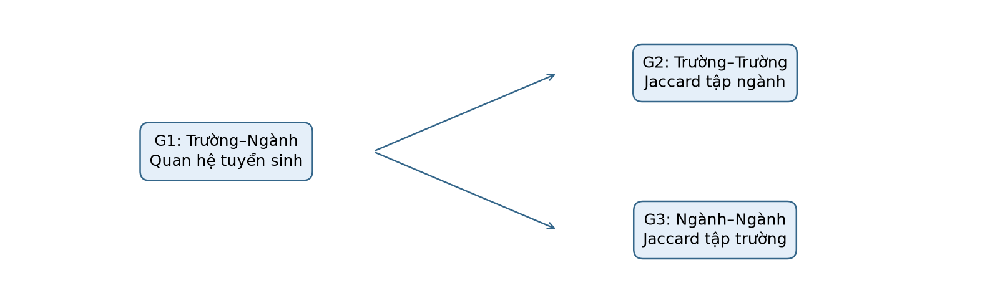

*Hình 3.1. Nguyên lý chiếu mạng hai phía; sơ đồ chỉ mô tả quan hệ giữa ba mô hình, không đưa thêm dữ liệu trường giả định. Nguồn phương pháp: `sna/build.py`, hàm `g1_bipartite` và `jaccard_projection`.*

**G4 — Mạng cạnh tranh.** Đây là đồ thị có hướng trên các trường. Chỉ nhận các dòng `method='THPT'`, `scale_max=30`, `flag=''`, đã có mã ngành; lấy `MAX(score)` theo từng cặp trường–ngành. Với mỗi ngành, nếu $0<s_{B,m}-s_{A,m}\le2$, tạo $A\to B$. Trọng số là số ngành thỏa điều kiện ấy:

$$w_{AB}=\sum_m\mathbf1\{0<s_{B,m}-s_{A,m}\le2\}.$$

Điểm bằng nhau không tạo cạnh; hai trường có thể có cạnh hai chiều khi thứ tự điểm đảo giữa các ngành. Sau dựng mạng cũng bỏ đỉnh cô lập. Cạnh biểu diễn khả năng lựa chọn gần nhau theo điểm trong mô hình, chưa phải hành vi chuyển nguyện vọng đã quan sát. `g4_competition` không tách tổ hợp hay chương trình, nên `MAX` có thể đại diện chương trình cao điểm nhất của cùng ngành.

**Bảng 3.1. Quy mô bốn mạng qua ba năm**

| Mạng | Năm | Số đỉnh | Số cạnh | Diễn giải đỉnh |
| --- | --- | --- | --- | --- |
| g1_uni_major | 2024 | 707 | 4.447 | 279 trường + 428 ngành |
| g2_uni_uni | 2024 | 251 | 2.566 | trường |
| g3_major_major | 2024 | 387 | 1.360 | ngành |
| g4_competition | 2024 | 259 | 10.541 | trường |
| g1_uni_major | 2025 | 712 | 4.680 | 278 trường + 434 ngành |
| g2_uni_uni | 2025 | 250 | 2.455 | trường |
| g3_major_major | 2025 | 387 | 1.431 | ngành |
| g4_competition | 2025 | 260 | 10.789 | trường |
| g1_uni_major | 2026 | 705 | 5.058 | 276 trường + 429 ngành |
| g2_uni_uni | 2026 | 249 | 2.531 | trường |
| g3_major_major | 2026 | 377 | 1.412 | ngành |
| g4_competition | 2026 | 226 | 9.215 | trường |

*Nguồn: `data/network/summary.csv`; phạm vi dữ liệu: `docs/TONG_KET_DU_LIEU.md`.*

## 3.2. Định nghĩa, cách tính và diễn giải các độ đo

Ký hiệu $n=|V|$, $m=|E|$, $k_v$ là bậc không trọng số, $s_v=\sum_u w_{vu}$ là strength, $d(u,v)$ là khoảng cách theo số cạnh. Các đường đi, betweenness, closeness, clustering và assortativity trong bản chạy hiện tại không dùng trọng số. Jaccard là độ giống nhau, chưa được đổi thành độ dài. Eigenvector, PageRank và Louvain dùng `weight`. Mỗi độ đo dưới đây tách định nghĩa, công thức, cách tính, kết quả và ý nghĩa để tránh đồng nhất các khái niệm.

### 3.2.1. Degree centrality và Degree distribution

**(1) Định nghĩa.** Degree centrality đánh giá số quan hệ trực tiếp của một đỉnh, sau chuẩn hóa theo số đỉnh có thể nối. Degree distribution là phân bố số đỉnh có từng mức bậc. Bậc G1 phía trường là số ngành; bậc G1 phía ngành là số trường. Bậc G2/G3 là số đối tác vượt ngưỡng Jaccard; bậc vào/ra G4 là số trường cạnh tranh theo hướng tương ứng.

**(2) Công thức.** Với đồ thị một phía, $C_D(v)=k_v/(n-1)$. Với G1, $C_D(u)=k_u/|M|$ và $C_D(m)=k_m/|U|$. Phân bố $P(k)=n_k/n$, trong đó $n_k$ là số đỉnh bậc $k$. G4 phân biệt $k^{in}$ và $k^{out}$; không thay chúng bằng tổng trọng số cạnh.

**(3) Cách tính và xử lý liên thông.** G1 dùng `bipartite.degree_centrality(g1,U)`; G2/G3 dùng `nx.degree_centrality(g)` và `dict(g.degree())`. G4 lưu `in_degree`, `out_degree`, `in_strength`, không lưu centrality chuẩn hóa cho hai hướng. Các phép tính này thực hiện trên toàn mạng, không cần mạng liên thông. Hàm `degree_plot` vẽ histogram và log–log của $P(k)$; script hình báo cáo giữ bậc 0 trong histogram, còn phần log–log chỉ dùng bậc dương vì log(0) không xác định.

**(4) Kết quả.** Các bảng sau cho thấy khác biệt giữa mở nhiều ngành và có nhiều đối tác giống nhau.

**Bảng 3.2. Mười trường có bậc cao nhất ở G1 năm 2026**

| Hạng | degree | degree_centrality |
| --- | --- | --- |
| 1 | Đại Học Cần Thơ (TCT) — 97 | Đại Học Cần Thơ (TCT) — 0,22611 |
| 2 | Đại Học Phenikaa (PKA) — 66 | Đại Học Phenikaa (PKA) — 0,15385 |
| 3 | Trường Đại Học Văn Lang (DVL) — 64 | Trường Đại Học Văn Lang (DVL) — 0,14918 |
| 4 | Trường Đại Học Vinh (TDV) — 64 | Trường Đại Học Vinh (TDV) — 0,14918 |
| 5 | Đại Học Duy Tân (DDT) — 62 | Đại Học Duy Tân (DDT) — 0,14452 |
| 6 | Trường Đại Học Đông Á (DAD) — 61 | Trường Đại Học Đông Á (DAD) — 0,14219 |
| 7 | Trường Đại học Công Nghệ TPHCM (DKC) — 60 | Trường Đại học Công Nghệ TPHCM (DKC) — 0,13986 |
| 8 | Trường Đại Học Đồng Tháp (SPD) — 58 | Trường Đại Học Đồng Tháp (SPD) — 0,13520 |
| 9 | Trường Đại Học Nguyễn Tất Thành (NTT) — 57 | Trường Đại Học Nguyễn Tất Thành (NTT) — 0,13287 |
| 10 | Trường Đại Học Quy Nhơn (DQN) — 52 | Trường Đại Học Quy Nhơn (DQN) — 0,12121 |

*Nguồn: `data/network/metrics/g1_uni_major_2026.csv`; tên trường/ngành đối chiếu bảng `universities` và `majors` của `data/eduradar.db`.*

**Bảng 3.3. Mười ngành có bậc cao nhất ở G1 năm 2026**

| Hạng | degree | degree_centrality |
| --- | --- | --- |
| 1 | Quản trị kinh doanh (7340101) — 157 | Quản trị kinh doanh (7340101) — 0,56884 |
| 2 | Công nghệ thông tin (7480201) — 154 | Công nghệ thông tin (7480201) — 0,55797 |
| 3 | Kế toán (7340301) — 137 | Kế toán (7340301) — 0,49638 |
| 4 | Ngôn ngữ Anh (7220201) — 136 | Ngôn ngữ Anh (7220201) — 0,49275 |
| 5 | Tài chính - Ngân hàng (7340201) — 114 | Tài chính - Ngân hàng (7340201) — 0,41304 |
| 6 | Quản trị dịch vụ du lịch và lữ hành (7810103) — 81 | Quản trị dịch vụ du lịch và lữ hành (7810103) — 0,29348 |
| 7 | Ngôn ngữ Trung Quốc (7220204) — 80 | Ngôn ngữ Trung Quốc (7220204) — 0,28986 |
| 8 | Luật (7380101) — 79 | Luật (7380101) — 0,28623 |
| 9 | Marketing (7340115) — 77 | Marketing (7340115) — 0,27899 |
| 10 | Logistics và quản lý chuỗi cung ứng (7510605) — 76 | Logistics và quản lý chuỗi cung ứng (7510605) — 0,27536 |

*Nguồn: `data/network/metrics/g1_uni_major_2026.csv`; tên trường/ngành đối chiếu bảng `universities` và `majors` của `data/eduradar.db`.*

**Bảng 3.4. Mười trường có bậc cao nhất ở G2 năm 2026**

| Hạng | degree | degree_centrality |
| --- | --- | --- |
| 1 | Trường Đại Học Ngoại Ngữ Tin Học TPHCM (DNT) — 72 | Trường Đại Học Ngoại Ngữ Tin Học TPHCM (DNT) — 0,29032 |
| 2 | Đại học Kinh Tế TPHCM - Phân hiệu Vĩnh Long (KSV) — 70 | Đại học Kinh Tế TPHCM - Phân hiệu Vĩnh Long (KSV) — 0,28226 |
| 3 | Trường Đại Học Công Nghệ và Quản Lý Hữu Nghị (DCQ) — 67 | Trường Đại Học Công Nghệ và Quản Lý Hữu Nghị (DCQ) — 0,27016 |
| 4 | Trường Đại học Hùng Vương TPHCM (DHV) — 66 | Trường Đại học Hùng Vương TPHCM (DHV) — 0,26613 |
| 5 | Trường Đại Học Kinh Tế Kỹ Thuật Bình Dương (DKB) — 66 | Trường Đại Học Kinh Tế Kỹ Thuật Bình Dương (DKB) — 0,26613 |
| 6 | Trường Đại Học Ngân Hàng TPHCM (NHS) — 66 | Trường Đại Học Ngân Hàng TPHCM (NHS) — 0,26613 |
| 7 | Trường Đại Học Bà Rịa – Vũng Tàu (BVU) — 65 | Trường Đại Học Bà Rịa – Vũng Tàu (BVU) — 0,26210 |
| 8 | Trường Đại Học Lạc Hồng (DLH) — 65 | Trường Đại Học Lạc Hồng (DLH) — 0,26210 |
| 9 | Trường Đại Học Đại Nam (DDN) — 64 | Trường Đại Học Đại Nam (DDN) — 0,25806 |
| 10 | Học Viện Ngân Hàng (NHH) — 60 | Học Viện Ngân Hàng (NHH) — 0,24194 |

*Nguồn: `data/network/metrics/g2_uni_uni_2026.csv`; tên trường/ngành đối chiếu bảng `universities` và `majors` của `data/eduradar.db`.*

**Bảng 3.5. Mười ngành có bậc cao nhất ở G3 năm 2026**

| Hạng | degree | degree_centrality |
| --- | --- | --- |
| 1 | Sư phạm Địa lý (7140219) — 25 | Sư phạm Địa lý (7140219) — 0,06649 |
| 2 | Logistics và quản lý chuỗi cung ứng (7510605) — 23 | Logistics và quản lý chuỗi cung ứng (7510605) — 0,06117 |
| 3 | Giáo dục Chính trị (7140205) — 23 | Giáo dục Chính trị (7140205) — 0,06117 |
| 4 | Tài chính - Ngân hàng (7340201) — 22 | Tài chính - Ngân hàng (7340201) — 0,05851 |
| 5 | Quản trị khách sạn (7810201) — 22 | Quản trị khách sạn (7810201) — 0,05851 |
| 6 | Giáo dục Công dân (7140204) — 22 | Giáo dục Công dân (7140204) — 0,05851 |
| 7 | Truyền thông đa phương tiện (7320104) — 21 | Truyền thông đa phương tiện (7320104) — 0,05585 |
| 8 | Sư phạm Lịch sử - Địa lý (7140249) — 21 | Sư phạm Lịch sử - Địa lý (7140249) — 0,05585 |
| 9 | Kỹ thuật trắc địa - bản đồ (7520503) — 21 | Kỹ thuật trắc địa - bản đồ (7520503) — 0,05585 |
| 10 | Công nghệ thông tin (7480201) — 20 | Công nghệ thông tin (7480201) — 0,05319 |

*Nguồn: `data/network/metrics/g3_major_major_2026.csv`; tên trường/ngành đối chiếu bảng `universities` và `majors` của `data/eduradar.db`.*

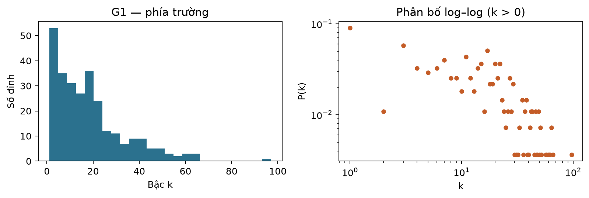

*Hình 3.2. Bậc trường trong G1: histogram và log–log. Nguồn: degree trong `data/network/metrics/g1_uni_major_2026.csv`.*

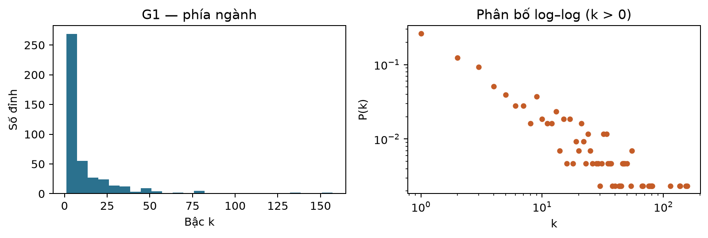

*Hình 3.3. Bậc ngành trong G1: histogram và log–log. Nguồn: cùng tệp metrics G1 năm 2026.*

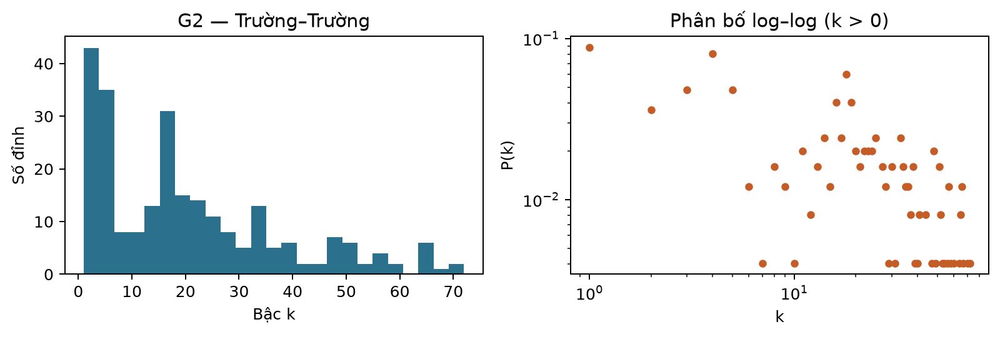

*Hình 3.4. Histogram và log–log của G2. Nguồn: `data/network/metrics/g2_uni_uni_2026.csv`.*

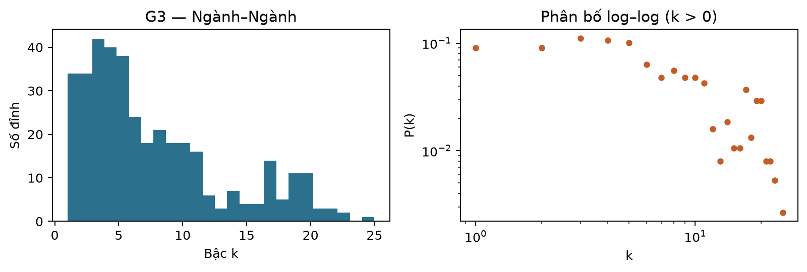

*Hình 3.5. Histogram và log–log của G3. Nguồn: `data/network/metrics/g3_major_major_2026.csv`.*

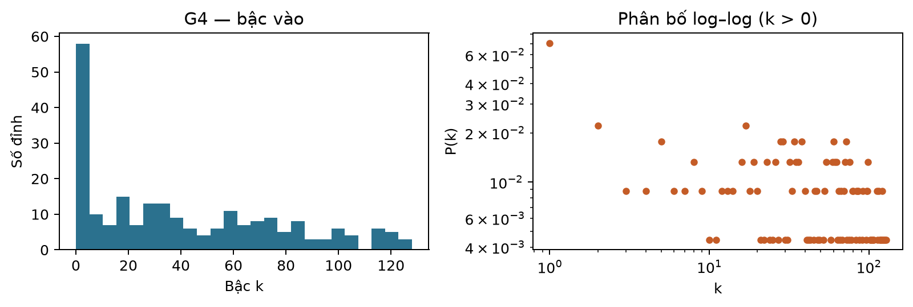

*Hình 3.6. Histogram bậc vào G4 có cả bậc 0; phần log–log chỉ vẽ k > 0. Nguồn: `data/network/metrics/g4_competition_2026.csv`.*

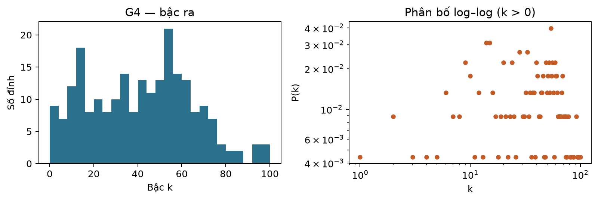

*Hình 3.7. Histogram bậc ra G4 có cả bậc 0; phần log–log chỉ vẽ k > 0. Nguồn: cùng tệp metrics G4 năm 2026.*

**(5) Ý nghĩa.** Quản trị kinh doanh và Công nghệ thông tin xuất hiện ở nhiều trường nên có bậc G1 cao; điều đó khác với Sư phạm Địa lý có nhiều ngành đồng hành trong G3. Phía ngành G1 có đuôi dài: nhiều ngành chỉ được một số ít trường mở, trong khi vài ngành phổ biến liên kết nhiều trường. Histogram và log–log giúp quan sát sự không đồng đều, nhưng đồ án chưa fit mô hình và chưa kiểm định goodness-of-fit, nên không kết luận phân bố power law hoặc cơ chế ưu tiên gắn kết. Trong tư vấn, bậc thể hiện độ rộng lựa chọn; nó không phải chất lượng đào tạo hay cơ hội việc làm.

### 3.2.2. Betweenness centrality

**(1) Định nghĩa.** Betweenness đo mức một đỉnh nằm trên các đường đi ngắn nhất giữa những đỉnh khác. Một đỉnh ít cạnh vẫn có thể có betweenness lớn nếu nối các khối vốn xa nhau.

**(2) Công thức.** Gọi $\sigma_{st}$ là số đường đi ngắn nhất từ $s$ đến $t$, $\sigma_{st}(v)$ là số đường đi ấy qua $v$:

$$C_B(v)=\sum_{s\ne v\ne t}\frac{\sigma_{st}(v)}{\sigma_{st}}.$$

Với đồ thị vô hướng một phía, chuẩn hóa bằng $2/[(n-1)(n-2)]$ nếu tổng xét cặp không thứ tự; có hướng dùng $1/[(n-1)(n-2)]$. G1 dùng chuẩn hóa riêng cho đồ thị hai phía của NetworkX, phụ thuộc kích thước hai tập đỉnh; do đó không so trực tiếp trị số G1 với G2/G3.

**(3) Cách tính và xử lý liên thông.** G1 gọi `bipartite.betweenness_centrality(g1,U)`. G2/G3/G4 gọi `nx.betweenness_centrality(g,normalized=True)` trên toàn mạng, `weight=None`, không lấy mẫu đỉnh. Cặp không có đường đi không đóng góp. G4 tôn trọng hướng; mọi đường ngắn được tính theo số cạnh, không theo số ngành cạnh tranh.

**(4) Kết quả.** Bảng dưới trình bày các trường/ngành cầu nối của hai phép chiếu. Biểu đồ top 10 G3 được trình bày tiếp ở Hình 5.3 để kết hợp với bố trí mạng.

**Bảng 3.6. Top 10 betweenness G2 năm 2026**

| Hạng | betweenness |
| --- | --- |
| 1 | Trường Đại Học Võ Trường Toản (VTT) — 0,09457 |
| 2 | Trường Đại Học Hải Phòng (THP) — 0,06863 |
| 3 | Trường Đại Học Quốc Tế Hồng Bàng (HIU) — 0,06183 |
| 4 | Trường Đại Học Hà Tĩnh (HHT) — 0,05390 |
| 5 | Trường Đại Học Kiến Trúc Đà Nẵng (KTD) — 0,04782 |
| 6 | Trường Đại Học Kiến Trúc Hà Nội (KTA) — 0,04397 |
| 7 | Trường Đại học Nghệ An (CEA) — 0,04276 |
| 8 | Trường Đại học Công nghiệp Vinh (DCV) — 0,04079 |
| 9 | Trường Sĩ Quan Thông Tin - Hệ Dân Sự - Đại Học Thông Tin Liên Lạc (TCU) — 0,03838 |
| 10 | Trường Đại Học Luật TPHCM (LPS) — 0,03729 |

*Nguồn: `data/network/metrics/g2_uni_uni_2026.csv`; tên trường/ngành đối chiếu bảng `universities` và `majors` của `data/eduradar.db`.*

**Bảng 3.7. Top 10 betweenness G3 năm 2026**

| Hạng | betweenness |
| --- | --- |
| 1 | Sinh học (7420101) — 0,16239 |
| 2 | Kỹ thuật vật liệu (7520309) — 0,07800 |
| 3 | Địa lý học (7310501) — 0,07751 |
| 4 | Khoa học đất (7620103) — 0,07460 |
| 5 | Vật lý y khoa (7520403) — 0,06888 |
| 6 | Hán Nôm (7220104) — 0,06638 |
| 7 | Kỹ thuật xây dựng (7580201) — 0,06596 |
| 8 | Ngôn ngữ Đức (7220205) — 0,06493 |
| 9 | Ngôn ngữ Pháp (7220203) — 0,06019 |
| 10 | Hải dương học (7440228) — 0,05962 |

*Nguồn: `data/network/metrics/g3_major_major_2026.csv`; tên trường/ngành đối chiếu bảng `universities` và `majors` của `data/eduradar.db`.*

**(5) Ý nghĩa.** Đại học Võ Trường Toản dẫn G2 theo betweenness nhưng không dẫn bảng bậc: hai độ đo phản ánh vai trò khác nhau. Sinh học dẫn G3 ở ngưỡng 0,25, phù hợp vai trò kết nối các nhóm khoa học tự nhiên, nông nghiệp và sư phạm. Đây là diễn giải cấu trúc của mạng, chưa khẳng định quan hệ học thuật thực tế. Thứ hạng nhạy với ngưỡng: theo `docs/do_nhay_sna.md`, Sinh học ở hạng 24 tại 0,15 và hạng 78 tại 0,35. Vì vậy không suy rộng vị trí số 1 thành thuộc tính cố định của ngành.

### 3.2.3. Closeness centrality

**(1) Định nghĩa.** Closeness đánh giá mức một đỉnh gần các đỉnh khác theo đường đi ngắn nhất. Trong báo cáo, ký hiệu $C_C$ hay CC chỉ closeness; hệ số phân cụm dùng $C_v$ hoặc $\bar C$.

**(2) Công thức.** Gọi $r_v$ là số đỉnh thuộc thành phần liên thông chứa $v$, bao gồm $v$, trong mạng có $n$ đỉnh. Hiệu chỉnh Wasserman–Faust là

$$C_C(v)=\frac{r_v-1}{n-1}\,\frac{r_v-1}{\sum_{u\ne v,\;u\leftrightarrow v}d(v,u)}.$$

Hệ số đầu giảm lợi thế của đỉnh nằm trong một thành phần nhỏ khép kín. Đỉnh cô lập được gán 0 theo quy tắc của hàm.

**(3) Cách tính và xử lý liên thông.** `nx.closeness_centrality(g)` được gọi cho G2/G3, giữ `wf_improved=True`, không truyền `distance` nên dùng số bước. Tính trên toàn mạng, mỗi đỉnh dùng phần tới được và hiệu chỉnh theo quy mô toàn mạng. Bản chạy không lưu closeness cho G1/G4; không diễn giải ô trống thành 0.

**(4) Kết quả.**

**Bảng 3.8. Top 10 closeness G2 năm 2026**

| Hạng | closeness |
| --- | --- |
| 1 | Trường Đại Học Công Nghệ và Quản Lý Hữu Nghị (DCQ) — 0,43092 |
| 2 | Trường Đại Học Ngoại Ngữ Tin Học TPHCM (DNT) — 0,43092 |
| 3 | Trường Đại học Hùng Vương TPHCM (DHV) — 0,42407 |
| 4 | Trường Đại Học Kinh Tế Kỹ Thuật Bình Dương (DKB) — 0,42407 |
| 5 | Trường Đại Học Bà Rịa – Vũng Tàu (BVU) — 0,41499 |
| 6 | Trường Đại Học Kinh Tế Công Nghiệp Long An (DLA) — 0,41259 |
| 7 | Trường Đại Học Lạc Hồng (DLH) — 0,40863 |
| 8 | Trường Đại học Sao Đỏ (SDU) — 0,40863 |
| 9 | Trường Đại Học Trưng Vương (DVP) — 0,40785 |
| 10 | Trường Đại Học Đại Nam (DDN) — 0,40476 |

*Nguồn: `data/network/metrics/g2_uni_uni_2026.csv`; tên trường/ngành đối chiếu bảng `universities` và `majors` của `data/eduradar.db`.*

**Bảng 3.9. Top 10 closeness G3 năm 2026**

| Hạng | closeness |
| --- | --- |
| 1 | Sinh học (7420101) — 0,23631 |
| 2 | Hải dương học (7440228) — 0,22465 |
| 3 | Lịch sử (7229010) — 0,22083 |
| 4 | Nông học (7620109) — 0,21931 |
| 5 | Toán tin (7460117) — 0,21903 |
| 6 | Khoa học đất (7620103) — 0,21862 |
| 7 | Hán Nôm (7220104) — 0,21553 |
| 8 | Địa lý học (7310501) — 0,21500 |
| 9 | Hóa dược (7720203) — 0,21061 |
| 10 | Kỹ thuật trắc địa - bản đồ (7520503) — 0,21061 |

*Nguồn: `data/network/metrics/g3_major_major_2026.csv`; tên trường/ngành đối chiếu bảng `universities` và `majors` của `data/eduradar.db`.*

**(5) Ý nghĩa.** Đại học Công nghệ và Quản lý Hữu Nghị và Đại học Ngoại ngữ – Tin học TP.HCM gần phần lớn lõi G2; Sinh học, Hải dương học, Lịch sử đứng gần các cụm ngành trong G3 theo số bước. Closeness đo vị trí trong phép chiếu, không trực tiếp đo khoảng cách địa lý hoặc mức tương đồng nội dung học tập. Do đường đi bỏ trọng số Jaccard, cạnh 0,25 và cạnh 1 đều dài một bước.

### 3.2.4. Eigenvector centrality

**(1) Định nghĩa.** Eigenvector gán điểm cao cho đỉnh nối với các đỉnh cũng được đánh giá cao. Khác bậc, nó xem xét vị trí của hàng xóm qua quan hệ lặp.

**(2) Công thức.** Với ma trận kề có trọng số $W$, vectơ riêng chính $x$ thỏa

$$Wx=\lambda_{\max}x,\qquad x_v=\lambda_{\max}^{-1}\sum_u w_{vu}x_u,\qquad\|x\|_2=1.$$

**(3) Cách tính và xử lý liên thông.** `nx.eigenvector_centrality_numpy(big,weight="weight")` chỉ chạy trên LCC của G2/G3. Những đỉnh ngoài LCC không có giá trị trong cột eigenvector; ô trống không phải 0. Trọng số là Jaccard, nên một nhóm ít đỉnh nhưng cạnh rất mạnh có thể chi phối nghiệm.

**(4) Kết quả.**

**Bảng 3.10. Top 10 eigenvector G2 năm 2026**

| Hạng | eigenvector |
| --- | --- |
| 1 | Trường Đại Học Ngoại Ngữ Tin Học TPHCM (DNT) — 0,20229 |
| 2 | Trường Đại Học Ngân Hàng TPHCM (NHS) — 0,18850 |
| 3 | Trường Đại Học Gia Định (GDU) — 0,17685 |
| 4 | Trường Đại Học Bà Rịa – Vũng Tàu (BVU) — 0,17643 |
| 5 | Trường Đại Học Đại Nam (DDN) — 0,17566 |
| 6 | Trường Đại học Hùng Vương TPHCM (DHV) — 0,17532 |
| 7 | Trường Đại Học Kinh Tế Kỹ Thuật Bình Dương (DKB) — 0,17405 |
| 8 | Trường Đại Học Công Nghệ và Quản Lý Hữu Nghị (DCQ) — 0,16677 |
| 9 | Đại học Kinh Tế TPHCM - Phân hiệu Vĩnh Long (KSV) — 0,16612 |
| 10 | Trường Đại Học Lạc Hồng (DLH) — 0,16360 |

*Nguồn: `data/network/metrics/g2_uni_uni_2026.csv`; tên trường/ngành đối chiếu bảng `universities` và `majors` của `data/eduradar.db`.*

**Bảng 3.11. Top 10 eigenvector G3 năm 2026**

| Hạng | eigenvector |
| --- | --- |
| 1 | Quản lý và phân tích dữ liệu khoa học (7440229) — 0,29654 |
| 2 | Địa tin học (7480206) — 0,29654 |
| 3 | Kỹ thuật địa vật lý (7520502) — 0,29654 |
| 4 | Đá quý Đá mỹ nghệ (7520505) — 0,29654 |
| 5 | Kỹ thuật khí thiên nhiên (7520605) — 0,29654 |
| 6 | Công nghệ số trong thăm dò và khai thác tài nguyên thiên nhiên (7520606) — 0,29654 |
| 7 | Xây dựng công trình ngầm thành phố và Hệ thống tàu điện ngầm (7580204) — 0,29654 |
| 8 | Du lịch địa chất (7810105) — 0,29654 |
| 9 | Quản lý tài nguyên khoáng sản (7850196) — 0,29654 |
| 10 | An toàn, Vệ sinh lao động (7850202) — 0,29654 |

*Nguồn: `data/network/metrics/g3_major_major_2026.csv`; tên trường/ngành đối chiếu bảng `universities` và `majors` của `data/eduradar.db`.*

**(5) Ý nghĩa.** G2 tập trung vào lõi các trường có danh mục ngành chồng lấn. G3 cho một giới hạn rõ rệt của độ đo: mười ngành đầu cùng điểm 0,29654 đều chỉ được Trường Đại học Mỏ – Địa chất (MDA) mở trong dữ liệu 2026. Hai tập trường của bất kỳ hai ngành trong nhóm đều là $\{\mathrm{MDA}\}$, nên Jaccard bằng 1; chúng tạo clique đầy đủ mười đỉnh và còn liên kết với các ngành khác của MDA. Cụm cạnh mạnh này chi phối vectơ riêng của LCC. Điểm cao ở đây phản ánh cấu trúc danh mục hiếm và tập trung ở một trường, không phải mười ngành quan trọng nhất quốc gia.

### 3.2.5. PageRank

**(1) Định nghĩa.** PageRank là phân bố ổn định của quá trình đi ngẫu nhiên có xác suất khởi động lại. Điểm của một đỉnh tăng khi nhận dòng chuyển từ các đỉnh có điểm cao, có xét mức chia dòng ra của nguồn.

**(2) Công thức.** Với $\alpha=0{,}85$ và $s_u^{out}=\sum_z w_{uz}$,

$$PR(v)=\frac{1-\alpha}{n}+\alpha\sum_{u\to v}\frac{w_{uv}}{s_u^{out}}PR(u),\qquad\sum_v PR(v)=1.$$

Đỉnh không có cạnh ra được xử lý bằng phân phối dangling mặc định đồng đều; công thức trên hiểu có bổ sung phần phân phối đó.

**(3) Cách tính và xử lý liên thông.** `nx.pagerank(g,weight="weight")` chạy trên toàn G2/G3/G4; G2/G3 vô hướng được hiểu như cạnh hai chiều. G4 dùng trọng số số ngành cạnh tranh. Teleportation cho phép tính điểm kể cả mạng không liên thông mạnh; G1 chưa tính PageRank trong bản chạy.

**(4) Kết quả.**

**Bảng 3.12. Top 10 PageRank G3 năm 2026**

| Hạng | pagerank |
| --- | --- |
| 1 | Tài chính - Ngân hàng (7340201) — 0,00540 |
| 2 | Logistics và quản lý chuỗi cung ứng (7510605) — 0,00523 |
| 3 | Sư phạm Địa lý (7140219) — 0,00504 |
| 4 | Toán kinh tế (7310108) — 0,00502 |
| 5 | Kế toán (7340301) — 0,00500 |
| 6 | Ngôn ngữ Anh (7220201) — 0,00474 |
| 7 | Quản trị kinh doanh (7340101) — 0,00474 |
| 8 | Quản trị khách sạn (7810201) — 0,00465 |
| 9 | Công nghệ thông tin (7480201) — 0,00462 |
| 10 | Sư phạm Ngữ văn (7140217) — 0,00459 |

*Nguồn: `data/network/metrics/g3_major_major_2026.csv`; tên trường/ngành đối chiếu bảng `universities` và `majors` của `data/eduradar.db`.*

**Bảng 3.13. Top 10 PageRank G4 năm 2026**

| Hạng | pagerank |
| --- | --- |
| 1 | Đại Học Cần Thơ (TCT) — 0,02432 |
| 2 | Đại Học Kinh Tế Quốc Dân (KHA) — 0,02117 |
| 3 | Trường Đại Học Nha Trang (TSN) — 0,01650 |
| 4 | Trường Đại Học Mở TPHCM (MBS) — 0,01598 |
| 5 | Trường Đại Học Sài Gòn (SGD) — 0,01581 |
| 6 | Trường Đại Học Sư Phạm Hà Nội (SPH) — 0,01550 |
| 7 | Đại Học Phenikaa (PKA) — 0,01389 |
| 8 | Đại Học Bách Khoa Hà Nội (BKA) — 0,01369 |
| 9 | Trường Đại Học Giao Thông Vận Tải (GHA) — 0,01366 |
| 10 | Trường Đại học Thủ Đô Hà Nội (HNM) — 0,01329 |

*Nguồn: `data/network/metrics/g4_competition_2026.csv`; tên trường/ngành đối chiếu bảng `universities` và `majors` của `data/eduradar.db`.*

**Bảng 3.14. Liên hệ PageRank và điểm chuẩn qua ba năm**

| Mạng | Độ đo | 2024 | 2025 | 2026 |
| --- | --- | --- | --- | --- |
| g4_competition | Spearman(PageRank, điểm THPT TB) | 0,5669 | 0,5352 | 0,6069 |

*Nguồn: `data/network/summary.csv`.*

**(5) Ý nghĩa.** Trong G3, PageRank cao thuộc nhiều ngành kinh tế – dịch vụ và sư phạm. Trong G4, các chuỗi cạnh hướng từ điểm thấp lên điểm cao của từng ngành có xu hướng dồn về một số trường đích, nhưng một trường vẫn có thể ở vị trí khác nhau giữa các ngành. Tương quan dương với điểm THPT trung bình là bằng chứng liên hệ trong tập dữ liệu, không đủ để coi PageRank là thứ hạng uy tín. Phân tích tương quan và cách lấy điểm trung bình được nêu tại mục 4.3.

### 3.2.6. HITS: hub và authority

**(1) Định nghĩa.** HITS xác định đồng thời hub (đỉnh trỏ tới nhiều authority mạnh) và authority (đỉnh được nhiều hub mạnh trỏ tới). G4 phân biệt trường có nhiều lựa chọn nhắm lên và trường được các đối thủ trực tiếp nhắm tới.

**(2) Công thức.** Với ma trận cạnh có trọng số $W$,

$$a^{(t+1)}=W^\top h^{(t)},\qquad h^{(t+1)}=Wa^{(t+1)}.$$

Sau mỗi vòng chuẩn hóa, nghiệm tương ứng với các vectơ riêng chính của $W^\top W$ và $WW^\top$; bản xuất chuẩn hóa để tổng authority và tổng hub lần lượt bằng 1.

**(3) Cách tính và xử lý liên thông.** `nx.hits(g,max_iter=1000,normalized=True)` chạy toàn G4; ma trận kề sử dụng thuộc tính `weight` mặc định của đồ thị nên có xét số ngành. Không lấy LCC trước khi tính. HITS không có teleportation như PageRank, có thể tập trung mạnh vào một lõi dày; các thành phần khác có điểm rất nhỏ. G1–G3 không được tính HITS trong bản chạy.

**(4) Kết quả.**

**Bảng 3.15. Top 10 hub và authority G4 năm 2026**

| Hạng | hub | authority |
| --- | --- | --- |
| 1 | Trường Đại Học Vinh (TDV) — 0,01409 | Trường Đại Học Kiến Trúc Đà Nẵng (KTD) — 0,03357 |
| 2 | Trường Đại học Công Nghệ TPHCM (DKC) — 0,01404 | Trường Đại Học Công Đoàn (LDA) — 0,02517 |
| 3 | Trường Đại Học Đồng Tháp (SPD) — 0,01401 | Trường Đại Học Sư Phạm Kỹ Thuật Hưng Yên (SKH) — 0,02358 |
| 4 | Trường Đại Học Nguyễn Tất Thành (NTT) — 0,01378 | Trường Đại Học Công Nghiệp Việt - Hung (VHD) — 0,02272 |
| 5 | Trường Đại Học Đông Á (DAD) — 0,01365 | Trường Đại học Nghệ An (CEA) — 0,02093 |
| 6 | Trường Đại học Nam Cần Thơ (DNC) — 0,01322 | Trường Đại Học Hồng Đức (HDT) — 0,01988 |
| 7 | Đại Học Duy Tân (DDT) — 0,01315 | Trường Đại Học Vinh (TDV) — 0,01921 |
| 8 | Trường Đại Học Quy Nhơn (DQN) — 0,01313 | Trường Đại Học Nông Lâm Thái Nguyên (DTN) — 0,01883 |
| 9 | Trường Đại Học Văn Lang (DVL) — 0,01276 | Đại Học Cần Thơ (TCT) — 0,01803 |
| 10 | Trường Đại Học Văn Hiến (DVH) — 0,01240 | Trường Đại Học Quy Nhơn (DQN) — 0,01790 |

*Nguồn: `data/network/metrics/g4_competition_2026.csv`; tên trường/ngành đối chiếu bảng `universities` và `majors` của `data/eduradar.db`.*

**Bảng 3.16. Liên hệ authority và điểm chuẩn qua ba năm**

| Mạng | Độ đo | 2024 | 2025 | 2026 |
| --- | --- | --- | --- | --- |
| g4_competition | Spearman(authority, điểm THPT TB) | -0,4012 | -0,4139 | 0,2343 |

*Nguồn: `data/network/summary.csv`.*

**(5) Ý nghĩa.** Top hub có nhiều trường đa ngành; top authority tập trung ở các trường có nhiều quan hệ cạnh tranh trực tiếp. Authority tương quan âm với điểm năm 2024 và 2025, nhưng dương năm 2026. Vì vậy không thể đồng nhất authority với trường điểm cao hoặc uy tín. Cơ chế lõi dày và thay đổi phân bố điểm là những cách giải thích phù hợp với số liệu, được kiểm tra thêm tại mục 4.3, không phải kết luận nhân quả.

### 3.2.7. Density

**(1) Định nghĩa.** Mật độ là tỷ lệ số cạnh quan sát được trên số cạnh tối đa có thể có của đúng loại đồ thị.

**(2) Công thức.**

$$D_{G1}=\frac{m}{|U||M|},\qquad D_{G2,G3}=\frac{2m}{n(n-1)},\qquad D_{G4}=\frac{m}{n(n-1)}.$$

**(3) Cách tính và xử lý liên thông.** G1 gọi `bipartite.density(g1,U)`; G2/G3/G4 gọi `nx.density(g)`, trên toàn mạng sau xử lý đỉnh cô lập. Mật độ không dùng trọng số và không yêu cầu liên thông. Mẫu số G1 không tính những cạnh trường–trường hay ngành–ngành vốn bị cấm trong đồ thị hai phía.

**(4) Kết quả.**

**Bảng 3.17. Mật độ theo đúng loại mạng**

| Mạng | 2024 | 2025 | 2026 |
| --- | --- | --- | --- |
| g1_uni_major | 0,0372 | 0,0388 | 0,0427 |
| g2_uni_uni | 0,0818 | 0,0789 | 0,0820 |
| g3_major_major | 0,0182 | 0,0192 | 0,0199 |
| g4_competition | 0,1577 | 0,1602 | 0,1812 |

*Nguồn: `data/network/summary.csv`.*

**(5) Ý nghĩa.** G1 có mật độ tăng, phù hợp với số cặp trường–ngành tăng. G2 dày hơn G3 vì các trường dễ có chung một phần ngành phổ biến, còn nhiều ngành có tập trường khác biệt. Không so trực tiếp mật độ hai phía với mật độ mạng có hướng như cùng một ý nghĩa: mẫu số và quy tắc tạo cạnh khác nhau. Việc G4 năm 2026 có mật độ cao hơn đồng thời ít đỉnh hơn cũng cần được xét cùng độ phủ THPT.

### 3.2.8. Average shortest path length

**(1) Định nghĩa.** Độ dài đường đi ngắn nhất trung bình là số bước trung bình để nối hai đỉnh trong cùng một miền liên thông được chọn.

**(2) Công thức.** Với $V_L$ là tập đỉnh LCC và $n_L=|V_L|$,

$$L_{LCC}=\frac{1}{n_L(n_L-1)}\sum_{u\ne v\in V_L}d(u,v).$$

**(3) Cách tính và xử lý liên thông.** G2/G3 trong script mạng và G1 trong script báo cáo được gọi `nx.average_shortest_path_length(big)`, không trọng số, trên LCC. `lcc` chọn thành phần có nhiều đỉnh nhất. Đồ thị một đỉnh được quy ước kết quả 0 trong code. G4 được tính bổ sung trên SCC lớn nhất, giữ hướng; G1 dùng LCC. Công thức trên áp dụng với miền SCC thay cho LCC khi xét G4. Bảng 3.29 ghi các số bổ sung; không đưa khoảng cách vô hạn giữa các thành phần vào trung bình và không thay đường đi có hướng bằng đường đi bỏ hướng.

**(4) Kết quả.**

**Bảng 3.18. Đường đi trung bình và phạm vi LCC**

| Mạng | Độ đo | 2024 | 2025 | 2026 |
| --- | --- | --- | --- | --- |
| g2_uni_uni | Số đỉnh LCC | 219 | 229 | 231 |
| g2_uni_uni | L trên LCC | 2,7652 | 3,3973 | 3,2475 |
| g3_major_major | Số đỉnh LCC | 358 | 361 | 364 |
| g3_major_major | L trên LCC | 5,7182 | 5,6231 | 5,6565 |

*Nguồn: `data/network/summary.csv`.*

**(5) Ý nghĩa.** G2 cần trung bình khoảng ba bước giống nhau trong LCC; G3 có đường đi dài hơn, phù hợp cấu trúc cụm lĩnh vực tách rõ. Giá trị chỉ đại diện LCC, nên phải đọc cùng số đỉnh LCC. L giảm sau tăng ngưỡng không tự chứng minh mạng kết nối tốt hơn: LCC có thể đã vỡ thành một cụm nhỏ, như kiểm tra ngưỡng G3 tại mục 4.5.

### 3.2.9. Diameter

**(1) Định nghĩa.** Đường kính là đường đi ngắn nhất dài nhất giữa một cặp đỉnh trong miền liên thông xét đến; nó phản ánh phần kéo dài nhất của cấu trúc mạng.

**(2) Công thức.**

$$\operatorname{diam}(G_L)=\max_{u,v\in V_L}d(u,v).$$

**(3) Cách tính và xử lý liên thông.** `nx.diameter(big)` tính trên cùng LCC của G2/G3 như chỉ tiêu đường đi trung bình, không trọng số. Với LCC một đỉnh code trả 0. Không có đường kính toàn mạng không liên thông trong bảng kết quả; G1 được tính bổ sung trên LCC, G4 trên SCC lớn nhất và giữ hướng; kết quả ở Bảng 3.29. Không gán 0 cho khoảng cách giữa các thành phần.

**(4) Kết quả.**

**Bảng 3.19. Đường kính của hai mạng chiếu**

| Mạng | Độ đo | 2024 | 2025 | 2026 |
| --- | --- | --- | --- | --- |
| g2_uni_uni | Đường kính LCC | 8 | 13 | 12 |
| g3_major_major | Đường kính LCC | 17 | 14 | 14 |

*Nguồn: `data/network/summary.csv`.*

**(5) Ý nghĩa.** Đường kính G2 tăng từ 8 lên 12 giữa hai mốc 2024 và 2026, trong khi LCC lớn hơn: có thể các trường ở rìa được nối thêm bằng các chuỗi dài. G3 giảm từ 17 xuống 14. Đây là quan sát theo ngưỡng 0,25; đường kính nhạy với vài cạnh cầu nối và không nên dùng riêng để đánh giá toàn mạng tiến bộ hay suy giảm.

### 3.2.10. Clustering coefficient và Transitivity

**(1) Định nghĩa.** Clustering của đỉnh đo mức các hàng xóm của nó cũng liên kết với nhau; trung bình clustering cho mỗi đỉnh trọng số như nhau. Transitivity đo tỷ lệ bộ ba liên thông đóng thành tam giác trên toàn mạng, nên nhấn mạnh các đỉnh tạo nhiều bộ ba hơn.

**(2) Công thức.** Với $T_v$ là số tam giác qua $v$,

$$C_v=\frac{2T_v}{k_v(k_v-1)},\quad \bar C=\frac1n\sum_v C_v,\quad\mathrm{Transitivity}=\frac{3\,T}{\sum_v\binom{k_v}{2}}.$$

Quy ước $C_v=0$ nếu $k_v<2$; $T$ là số tam giác khác nhau. Hai đại lượng trung bình và transitivity không thể thay thế nhau.

**(3) Cách tính và xử lý liên thông.** G2/G3 lưu `nx.clustering(g,weight=None)`, `nx.average_clustering(g)` và `nx.transitivity(g)` trên toàn mạng. Đỉnh bậc dưới 2 vẫn góp 0 vào trung bình. Không dùng trọng số Jaccard; không loại thành phần nhỏ. G1 và G4 được tính bổ sung từ DB bằng `scripts/report_network_supplement.py` tại Bảng 3.29. G1 hai phía nên clustering tam giác bằng 0; G4 dùng clustering có hướng, còn transitivity chỉ tính sau bỏ hướng và được ghi nhãn riêng.

**(4) Kết quả.**

**Bảng 3.20. Phân cụm cục bộ và tỷ lệ đóng tam giác**

| Mạng | Độ đo | 2024 | 2025 | 2026 |
| --- | --- | --- | --- | --- |
| g2_uni_uni | Clustering trung bình | 0,5527 | 0,5544 | 0,5486 |
| g2_uni_uni | Transitivity | 0,5289 | 0,5504 | 0,5436 |
| g3_major_major | Clustering trung bình | 0,5285 | 0,5701 | 0,5180 |
| g3_major_major | Transitivity | 0,6417 | 0,6634 | 0,6651 |

*Nguồn: `data/network/summary.csv`.*

**Bảng 3.21. Top 10 local clustering của G2 và G3 năm 2026, chỉ xét đỉnh bậc ít nhất 5**

| Hạng | G2 — tên trường (mã), bậc, clustering | G3 — tên ngành (mã), bậc, clustering |
| ---: | --- | --- |
| 1 | Khoa Giáo Dục Thể Chất Huế (DHC), $k=5$, $C=1,00000$ | Kỹ thuật điện tử - viễn thông (7520207), $k=5$, $C=1,00000$ |
| 2 | Trường Đại Học Sư Phạm Thể Dục Thể Thao TPHCM (STS), $k=5$, $C=1,00000$ | Biến đổi khí hậu và phát triển bền vững (7440298), $k=5$, $C=1,00000$ |
| 3 | Trường Đại Học Thể Dục Thể Thao Bắc Ninh (TDB), $k=5$, $C=1,00000$ | Quản lý biển (7850199), $k=5$, $C=1,00000$ |
| 4 | Trường Đại Học Sư Phạm Thể Dục Thể Thao Hà Nội (TDH), $k=5$, $C=1,00000$ | Kỹ thuật không gian (7520121), $k=12$, $C=1,00000$ |
| 5 | Trường Đại Học Thể Dục Thể Thao TPHCM (TDS), $k=5$, $C=1,00000$ | Ngôn ngữ Bồ Đào Nha (7220207), $k=5$, $C=1,00000$ |
| 6 | Trường Đại Học Thể Dục Thể Thao Đà Nẵng (TTD), $k=5$, $C=1,00000$ | Nghiên cứu phát triển (7310111), $k=5$, $C=1,00000$ |
| 7 | Trường Đại Học Kỹ Thuật Y Tế Hải Dương (DKY), $k=16$, $C=0,95833$ | Chỉ huy âm nhạc (7210204), $k=5$, $C=1,00000$ |
| 8 | Trường Đại Học Y Dược Thái Nguyên (DTY), $k=16$, $C=0,95833$ | Thanh nhạc (7210206), $k=5$, $C=1,00000$ |
| 9 | Trường Đại Học Y Tế Công Cộng (YTC), $k=6$, $C=0,93333$ | Năng lượng tái tạo (đào tạo bằng tiếng Việt) (7510208), $k=7$, $C=1,00000$ |
| 10 | Trường Đại học Y khoa Tokyo Việt Nam (THU), $k=12$, $C=0,89394$ | Giáo dục Mầm non (7140201), $k=17$, $C=0,97059$ |

*Nguồn: `data/network/metrics/g2_uni_uni_2026.csv`, `data/network/metrics/g3_major_major_2026.csv`; tên trường từ bảng `universities` của `data/eduradar.db`. Xếp giảm dần theo cột `clustering`, lọc `degree >= 5`; khi bằng nhau giữ thứ tự xuất hiện trong CSV. Script tái lập cả danh sách ở khóa `clustering_top10_2026` trong JSON stdout.*

Sáu trường thể dục thể thao đầu bảng G2 đều có bậc 5 và clustering 1, phù hợp một nhóm sáu trường đóng kín quan hệ trong phép chiếu. Các trường y dược tiếp theo cũng có mức đóng tam giác cao. Trong G3, nhiều ngành có clustering 1 nhưng bậc chỉ 5: mọi cặp hàng xóm của chúng nối nhau, chưa chứng minh đỉnh ấy là cầu nối hay có độ phổ biến toàn hệ thống. Lọc bậc ít nhất 5 giảm các ví dụ quá tầm thường ở bậc 2–4, nhưng không loại bỏ ảnh hưởng của các nhóm nhỏ khép kín.

**(5) Ý nghĩa.** Clustering G2 khoảng 0,55 cho thấy nhiều nhóm trường có danh mục tương tự khá khép kín. G3 có transitivity khoảng 0,64–0,67 nhưng clustering trung bình thấp hơn: các đỉnh có nhiều bộ ba tập trung vào các nhóm đóng tam giác mạnh. Một đỉnh có clustering bằng 1 nhưng bậc 2 chỉ nói rằng hai hàng xóm nối nhau; không chứng minh vai trò trung tâm. Các chỉ tiêu cao ở phép chiếu còn chịu ảnh hưởng của chính cách sinh cạnh qua hàng xóm chung.

### 3.2.11. Modularity

**(1) Định nghĩa.** Modularity đánh giá mức cạnh tập trung trong các cộng đồng so với mô hình kỳ vọng giữ tổng trọng số bậc. Cần một phân hoạch cộng đồng trước khi đánh giá $Q$.

**(2) Công thức.** Với $s_i=\sum_j w_{ij}$, $2W=\sum_i s_i$ và $c_i$ là nhãn cộng đồng,

$$Q=\frac{1}{2W}\sum_{ij}\left(w_{ij}-\frac{s_i s_j}{2W}\right)\delta(c_i,c_j).$$

Đây là dạng có trọng số, độ phân giải mặc định $\gamma=1$; không nhầm $W$ với số cạnh khi Jaccard không đồng đều.

**(3) Cách tính và xử lý liên thông.** G2/G3 chạy `community.louvain_communities(g,weight="weight",seed=42)` trên toàn mạng, sau đó `community.modularity(g,comms,weight="weight")`. Thành phần tách rời vẫn tham gia phân hoạch; ID cộng đồng được sắp theo kích thước giảm dần để xuất, không phải thứ bậc chất lượng. Q của GN và Louvain trên mẫu 60 đỉnh tại mục 4.2 là phép tính khác, không thay Q toàn mạng.

**(4) Kết quả.**

**Bảng 3.22. Cộng đồng và modularity toàn mạng**

| Mạng | Độ đo | 2024 | 2025 | 2026 |
| --- | --- | --- | --- | --- |
| g2_uni_uni | Số cộng đồng Louvain | 19 | 19 | 20 |
| g2_uni_uni | Q Louvain có trọng số | 0,4511 | 0,4939 | 0,4822 |
| g3_major_major | Số cộng đồng Louvain | 28 | 27 | 19 |
| g3_major_major | Q Louvain có trọng số | 0,8394 | 0,8460 | 0,8363 |

*Nguồn: `data/network/summary.csv`.*

**(5) Ý nghĩa.** G3 có Q khoảng 0,84, phù hợp các khối ngành tách rõ theo nhóm trường đào tạo. G2 có Q khoảng 0,45–0,49, các khối còn chồng lấn nhiều hơn. Q cao là chứng cứ cấu trúc của phân hoạch tại tham số đã chọn, chưa đủ xác nhận cộng đồng là nhóm xã hội có thật; mạng quá vỡ cũng có thể cho Q cao. Cần đọc Q cùng LCC, số thành phần và phân tích độ nhạy.

### 3.2.12. Các độ đo bổ sung: components, LCC, assortativity, reciprocity

**(1) Định nghĩa.** Components đếm các miền liên thông; LCC là miền có nhiều đỉnh nhất. G4 có thành phần yếu (bỏ hướng khi xét khả năng nối) và mạnh (mọi cặp tới được nhau theo hướng). Assortativity đo tương quan bậc ở hai đầu cạnh. Reciprocity là tỷ lệ cạnh có cạnh ngược chiều.

**(2) Công thức.** Tỷ lệ LCC là $n_L/n$. Assortativity là hệ số Pearson $r=\operatorname{Corr}(k_u,k_v)$ trên các đầu cạnh theo quy tắc đồ thị vô hướng. Với G4,

$$R=\frac{|\{(u,v)\in E:(v,u)\in E\}|}{m}.$$

Một cặp tương hỗ đóng góp hai cạnh vào tử và mẫu. Đây là reciprocity không trọng số.

**(3) Cách tính và xử lý liên thông.** G1/G2/G3 dùng `nx.number_connected_components`; G4 dùng `number_weakly_connected_components` và `number_strongly_connected_components`. `lcc(g)` dùng thành phần yếu nếu có hướng. `degree_assortativity_coefficient(g)` chỉ lưu cho G2/G3, không truyền `weight`; `nx.reciprocity(g)` chỉ lưu cho G4. Vì G4 chỉ có LCC yếu, không được gọi 224 đỉnh năm 2026 là một thành phần mạnh.

**(4) Kết quả.**

**Bảng 3.23. Liên thông và đồng phối bậc của các phép chiếu**

| Mạng | Độ đo | 2024 | 2025 | 2026 |
| --- | --- | --- | --- | --- |
| g2_uni_uni | Thành phần liên thông | 12 | 9 | 8 |
| g2_uni_uni | Số đỉnh LCC | 219 | 229 | 231 |
| g2_uni_uni | Assortativity | 0,3761 | 0,4246 | 0,3928 |
| g3_major_major | Thành phần liên thông | 13 | 12 | 7 |
| g3_major_major | Số đỉnh LCC | 358 | 361 | 364 |
| g3_major_major | Assortativity | 0,6123 | 0,5943 | 0,6526 |

*Nguồn: `data/network/summary.csv`.*

**Bảng 3.24. Liên thông yếu/mạnh và tương hỗ G4**

| Mạng | Độ đo | 2024 | 2025 | 2026 |
| --- | --- | --- | --- | --- |
| g4_competition | Thành phần yếu | 2 | 3 | 2 |
| g4_competition | Thành phần mạnh | 17 | 13 | 35 |
| g4_competition | Số đỉnh LCC yếu | 257 | 256 | 224 |
| g4_competition | Reciprocity | 0,3415 | 0,3454 | 0,3377 |

*Nguồn: `data/network/summary.csv`.*

**(5) Ý nghĩa.** Assortativity dương ở G2/G3 cho thấy các đỉnh có nhiều quan hệ thường nối với các đỉnh cũng nhiều quan hệ; đó là bậc trong mạng chiếu, không đồng nhất với quy mô tuyển sinh. G4 có reciprocity khoảng một phần ba vì cùng hai trường có thể đổi thứ tự điểm giữa các ngành. Số thành phần mạnh tăng lên 35 vào 2026 dù mật độ cao hơn cho thấy mật độ và khả năng đi hai chiều phản ánh hai mặt khác nhau.

## 3.3. Bảng tổng hợp toàn bộ chỉ tiêu đã xuất

Các bảng dưới đây chép đủ các cột chỉ tiêu trong `summary.csv` cho từng mạng và ba năm. Những global chưa có trong tệp gốc được tính đọc từ DB ở Bảng 3.29, giữ rõ miền LCC/SCC và định nghĩa có hướng. Không coi số tính bổ sung là số đã ghi trong summary. “— chưa tính” nghĩa là bản chạy không xuất giá trị, không có nghĩa giá trị bằng 0. “Không áp dụng” dùng cho trường không phù hợp loại mạng hoặc thuật toán đang được báo cáo. `compute_seconds` là thời gian khối `undirected_metrics`, có cả so sánh mẫu; không phải thời gian toàn pipeline. Các thời gian là quan sát của lượt chạy đã lưu, phụ thuộc máy và không được xem như hằng số thuật toán.

**Bảng 3.25. Toàn bộ trường summary của g1_uni_major**

| Chỉ tiêu / tên cột | 2024 | 2025 | 2026 |
| --- | --- | --- | --- |
| Số đỉnh (`nodes`) | 707 | 712 | 705 |
| Số trường (G1) (`universities`) | 279 | 278 | 276 |
| Số ngành (G1) (`majors`) | 428 | 434 | 429 |
| Số cạnh (`edges`) | 4.447 | 4.680 | 5.058 |
| Mật độ hai phía (`bipartite_density`) | 0,0372 | 0,0388 | 0,0427 |
| Số ngành TB/trường (`avg_majors_per_uni`) | 15,9391 | 16,8345 | 18,3261 |
| Số trường TB/ngành (`avg_unis_per_major`) | 10,3902 | 10,7834 | 11,7902 |
| Thành phần liên thông (vô hướng) (`components`) | 15 | 12 | 14 |
| Mật độ một phía (`density`) | Không áp dụng | Không áp dụng | Không áp dụng |
| Số đỉnh LCC (yếu nếu có hướng) (`lcc_nodes`) | Xem Bảng 3.29 | Xem Bảng 3.29 | Xem Bảng 3.29 |
| Bậc trung bình (`avg_degree`) | Xem Bảng 3.29 | Xem Bảng 3.29 | Xem Bảng 3.29 |
| Clustering TB (`avg_clustering`) | Xem Bảng 3.29 | Xem Bảng 3.29 | Xem Bảng 3.29 |
| Transitivity (`transitivity`) | Xem Bảng 3.29 | Xem Bảng 3.29 | Xem Bảng 3.29 |
| Đường đi TB trên LCC (`avg_path_length_lcc`) | Xem Bảng 3.29 | Xem Bảng 3.29 | Xem Bảng 3.29 |
| Đường kính LCC (`diameter_lcc`) | Xem Bảng 3.29 | Xem Bảng 3.29 | Xem Bảng 3.29 |
| Assortativity (`assortativity`) | Xem Bảng 3.29 | Xem Bảng 3.29 | Xem Bảng 3.29 |
| Số cộng đồng Louvain (`louvain_communities`) | Không áp dụng trong phân hoạch đã chọn | Không áp dụng trong phân hoạch đã chọn | Không áp dụng trong phân hoạch đã chọn |
| Q Louvain toàn mạng (`modularity_louvain`) | Không áp dụng trong phân hoạch đã chọn | Không áp dụng trong phân hoạch đã chọn | Không áp dụng trong phân hoạch đã chọn |
| Số đỉnh mẫu GN/Louvain (`gn_sample_nodes`) | Không áp dụng trong phân hoạch đã chọn | Không áp dụng trong phân hoạch đã chọn | Không áp dụng trong phân hoạch đã chọn |
| Q tốt nhất GN trên mẫu (`gn_best_modularity`) | Không áp dụng trong phân hoạch đã chọn | Không áp dụng trong phân hoạch đã chọn | Không áp dụng trong phân hoạch đã chọn |
| Số cộng đồng GN ở Q tốt nhất (`gn_best_k`) | Không áp dụng trong phân hoạch đã chọn | Không áp dụng trong phân hoạch đã chọn | Không áp dụng trong phân hoạch đã chọn |
| Thời gian GN mẫu (giây) (`gn_seconds`) | — chưa tính | — chưa tính | — chưa tính |
| Q Louvain mẫu (`louvain_sample_modularity`) | Không áp dụng trong phân hoạch đã chọn | Không áp dụng trong phân hoạch đã chọn | Không áp dụng trong phân hoạch đã chọn |
| Thời gian Louvain mẫu (giây) (`louvain_sample_seconds`) | — chưa tính | — chưa tính | — chưa tính |
| Thời gian undirected_metrics (giây) (`compute_seconds`) | — chưa tính | — chưa tính | — chưa tính |
| Ngưỡng Jaccard (`jaccard_threshold`) | Không áp dụng | Không áp dụng | Không áp dụng |
| Thành phần yếu (`weak_components`) | Không áp dụng | Không áp dụng | Không áp dụng |
| Thành phần mạnh (`strong_components`) | Không áp dụng | Không áp dụng | Không áp dụng |
| Reciprocity (`reciprocity`) | Không áp dụng | Không áp dụng | Không áp dụng |
| Spearman(authority, điểm TB) (`spearman_authority_vs_avg_score`) | Không áp dụng | Không áp dụng | Không áp dụng |
| Spearman(PageRank, điểm TB) (`spearman_pagerank_vs_avg_score`) | Không áp dụng | Không áp dụng | Không áp dụng |
| Khoảng điểm G4 (`score_gap`) | Không áp dụng | Không áp dụng | Không áp dụng |

*Nguồn: `data/network/summary.csv`; ô rỗng được ghi rõ theo phạm vi phép tính trong `sna/build.py`.*

**Bảng 3.26. Toàn bộ trường summary của g2_uni_uni**

| Chỉ tiêu / tên cột | 2024 | 2025 | 2026 |
| --- | --- | --- | --- |
| Số đỉnh (`nodes`) | 251 | 250 | 249 |
| Số trường (G1) (`universities`) | Không áp dụng | Không áp dụng | Không áp dụng |
| Số ngành (G1) (`majors`) | Không áp dụng | Không áp dụng | Không áp dụng |
| Số cạnh (`edges`) | 2.566 | 2.455 | 2.531 |
| Mật độ hai phía (`bipartite_density`) | Không áp dụng | Không áp dụng | Không áp dụng |
| Số ngành TB/trường (`avg_majors_per_uni`) | Không áp dụng | Không áp dụng | Không áp dụng |
| Số trường TB/ngành (`avg_unis_per_major`) | Không áp dụng | Không áp dụng | Không áp dụng |
| Thành phần liên thông (vô hướng) (`components`) | 12 | 9 | 8 |
| Mật độ một phía (`density`) | 0,0818 | 0,0789 | 0,0820 |
| Số đỉnh LCC (yếu nếu có hướng) (`lcc_nodes`) | 219 | 229 | 231 |
| Bậc trung bình (`avg_degree`) | 20,4462 | 19,6400 | 20,3293 |
| Clustering TB (`avg_clustering`) | 0,5527 | 0,5544 | 0,5486 |
| Transitivity (`transitivity`) | 0,5289 | 0,5504 | 0,5436 |
| Đường đi TB trên LCC (`avg_path_length_lcc`) | 2,7652 | 3,3973 | 3,2475 |
| Đường kính LCC (`diameter_lcc`) | 8 | 13 | 12 |
| Assortativity (`assortativity`) | 0,3761 | 0,4246 | 0,3928 |
| Số cộng đồng Louvain (`louvain_communities`) | 19 | 19 | 20 |
| Q Louvain toàn mạng (`modularity_louvain`) | 0,4511 | 0,4939 | 0,4822 |
| Số đỉnh mẫu GN/Louvain (`gn_sample_nodes`) | 60 | 60 | 60 |
| Q tốt nhất GN trên mẫu (`gn_best_modularity`) | 0,0109 | 0,0042 | 0,0019 |
| Số cộng đồng GN ở Q tốt nhất (`gn_best_k`) | 9 | 11 | 11 |
| Thời gian GN mẫu (giây) (`gn_seconds`) | 8,2801 | 7,7934 | 7,1910 |
| Q Louvain mẫu (`louvain_sample_modularity`) | 0,1394 | 0,1595 | 0,1438 |
| Thời gian Louvain mẫu (giây) (`louvain_sample_seconds`) | 0,0137 | 0,0106 | 0,0056 |
| Thời gian undirected_metrics (giây) (`compute_seconds`) | 9,4367 | 8,6075 | 8,0941 |
| Ngưỡng Jaccard (`jaccard_threshold`) | 0,2500 | 0,2500 | 0,2500 |
| Thành phần yếu (`weak_components`) | Không áp dụng | Không áp dụng | Không áp dụng |
| Thành phần mạnh (`strong_components`) | Không áp dụng | Không áp dụng | Không áp dụng |
| Reciprocity (`reciprocity`) | Không áp dụng | Không áp dụng | Không áp dụng |
| Spearman(authority, điểm TB) (`spearman_authority_vs_avg_score`) | Không áp dụng | Không áp dụng | Không áp dụng |
| Spearman(PageRank, điểm TB) (`spearman_pagerank_vs_avg_score`) | Không áp dụng | Không áp dụng | Không áp dụng |
| Khoảng điểm G4 (`score_gap`) | Không áp dụng | Không áp dụng | Không áp dụng |

*Nguồn: `data/network/summary.csv`; ô rỗng được ghi rõ theo phạm vi phép tính trong `sna/build.py`.*

**Bảng 3.27. Toàn bộ trường summary của g3_major_major**

| Chỉ tiêu / tên cột | 2024 | 2025 | 2026 |
| --- | --- | --- | --- |
| Số đỉnh (`nodes`) | 387 | 387 | 377 |
| Số trường (G1) (`universities`) | Không áp dụng | Không áp dụng | Không áp dụng |
| Số ngành (G1) (`majors`) | Không áp dụng | Không áp dụng | Không áp dụng |
| Số cạnh (`edges`) | 1.360 | 1.431 | 1.412 |
| Mật độ hai phía (`bipartite_density`) | Không áp dụng | Không áp dụng | Không áp dụng |
| Số ngành TB/trường (`avg_majors_per_uni`) | Không áp dụng | Không áp dụng | Không áp dụng |
| Số trường TB/ngành (`avg_unis_per_major`) | Không áp dụng | Không áp dụng | Không áp dụng |
| Thành phần liên thông (vô hướng) (`components`) | 13 | 12 | 7 |
| Mật độ một phía (`density`) | 0,0182 | 0,0192 | 0,0199 |
| Số đỉnh LCC (yếu nếu có hướng) (`lcc_nodes`) | 358 | 361 | 364 |
| Bậc trung bình (`avg_degree`) | 7,0284 | 7,3953 | 7,4907 |
| Clustering TB (`avg_clustering`) | 0,5285 | 0,5701 | 0,5180 |
| Transitivity (`transitivity`) | 0,6417 | 0,6634 | 0,6651 |
| Đường đi TB trên LCC (`avg_path_length_lcc`) | 5,7182 | 5,6231 | 5,6565 |
| Đường kính LCC (`diameter_lcc`) | 17 | 14 | 14 |
| Assortativity (`assortativity`) | 0,6123 | 0,5943 | 0,6526 |
| Số cộng đồng Louvain (`louvain_communities`) | 28 | 27 | 19 |
| Q Louvain toàn mạng (`modularity_louvain`) | 0,8394 | 0,8460 | 0,8363 |
| Số đỉnh mẫu GN/Louvain (`gn_sample_nodes`) | 60 | 60 | 60 |
| Q tốt nhất GN trên mẫu (`gn_best_modularity`) | 0,6384 | 0,6323 | 0,6598 |
| Số cộng đồng GN ở Q tốt nhất (`gn_best_k`) | 7 | 6 | 6 |
| Thời gian GN mẫu (giây) (`gn_seconds`) | 0,4907 | 0,4968 | 0,6619 |
| Q Louvain mẫu (`louvain_sample_modularity`) | 0,6384 | 0,6337 | 0,6662 |
| Thời gian Louvain mẫu (giây) (`louvain_sample_seconds`) | 0,0157 | 0,0053 | 0,0025 |
| Thời gian undirected_metrics (giây) (`compute_seconds`) | 1,6113 | 1,4918 | 1,7016 |
| Ngưỡng Jaccard (`jaccard_threshold`) | 0,2500 | 0,2500 | 0,2500 |
| Thành phần yếu (`weak_components`) | Không áp dụng | Không áp dụng | Không áp dụng |
| Thành phần mạnh (`strong_components`) | Không áp dụng | Không áp dụng | Không áp dụng |
| Reciprocity (`reciprocity`) | Không áp dụng | Không áp dụng | Không áp dụng |
| Spearman(authority, điểm TB) (`spearman_authority_vs_avg_score`) | Không áp dụng | Không áp dụng | Không áp dụng |
| Spearman(PageRank, điểm TB) (`spearman_pagerank_vs_avg_score`) | Không áp dụng | Không áp dụng | Không áp dụng |
| Khoảng điểm G4 (`score_gap`) | Không áp dụng | Không áp dụng | Không áp dụng |

*Nguồn: `data/network/summary.csv`; ô rỗng được ghi rõ theo phạm vi phép tính trong `sna/build.py`.*

**Bảng 3.28. Toàn bộ trường summary của g4_competition**

| Chỉ tiêu / tên cột | 2024 | 2025 | 2026 |
| --- | --- | --- | --- |
| Số đỉnh (`nodes`) | 259 | 260 | 226 |
| Số trường (G1) (`universities`) | Không áp dụng | Không áp dụng | Không áp dụng |
| Số ngành (G1) (`majors`) | Không áp dụng | Không áp dụng | Không áp dụng |
| Số cạnh (`edges`) | 10.541 | 10.789 | 9.215 |
| Mật độ hai phía (`bipartite_density`) | Không áp dụng | Không áp dụng | Không áp dụng |
| Số ngành TB/trường (`avg_majors_per_uni`) | Không áp dụng | Không áp dụng | Không áp dụng |
| Số trường TB/ngành (`avg_unis_per_major`) | Không áp dụng | Không áp dụng | Không áp dụng |
| Thành phần liên thông (vô hướng) (`components`) | Không áp dụng | Không áp dụng | Không áp dụng |
| Mật độ một phía (`density`) | 0,1577 | 0,1602 | 0,1812 |
| Số đỉnh LCC (yếu nếu có hướng) (`lcc_nodes`) | 257 | 256 | 224 |
| Bậc trung bình (`avg_degree`) | Xem Bảng 3.29 | Xem Bảng 3.29 | Xem Bảng 3.29 |
| Clustering TB (`avg_clustering`) | Xem Bảng 3.29 | Xem Bảng 3.29 | Xem Bảng 3.29 |
| Transitivity (`transitivity`) | Xem Bảng 3.29 | Xem Bảng 3.29 | Xem Bảng 3.29 |
| Đường đi TB trên LCC (`avg_path_length_lcc`) | Xem Bảng 3.29 | Xem Bảng 3.29 | Xem Bảng 3.29 |
| Đường kính LCC (`diameter_lcc`) | Xem Bảng 3.29 | Xem Bảng 3.29 | Xem Bảng 3.29 |
| Assortativity (`assortativity`) | Xem Bảng 3.29 | Xem Bảng 3.29 | Xem Bảng 3.29 |
| Số cộng đồng Louvain (`louvain_communities`) | Không áp dụng trong phân hoạch đã chọn | Không áp dụng trong phân hoạch đã chọn | Không áp dụng trong phân hoạch đã chọn |
| Q Louvain toàn mạng (`modularity_louvain`) | Không áp dụng trong phân hoạch đã chọn | Không áp dụng trong phân hoạch đã chọn | Không áp dụng trong phân hoạch đã chọn |
| Số đỉnh mẫu GN/Louvain (`gn_sample_nodes`) | Không áp dụng trong phân hoạch đã chọn | Không áp dụng trong phân hoạch đã chọn | Không áp dụng trong phân hoạch đã chọn |
| Q tốt nhất GN trên mẫu (`gn_best_modularity`) | Không áp dụng trong phân hoạch đã chọn | Không áp dụng trong phân hoạch đã chọn | Không áp dụng trong phân hoạch đã chọn |
| Số cộng đồng GN ở Q tốt nhất (`gn_best_k`) | Không áp dụng trong phân hoạch đã chọn | Không áp dụng trong phân hoạch đã chọn | Không áp dụng trong phân hoạch đã chọn |
| Thời gian GN mẫu (giây) (`gn_seconds`) | — chưa tính | — chưa tính | — chưa tính |
| Q Louvain mẫu (`louvain_sample_modularity`) | Không áp dụng trong phân hoạch đã chọn | Không áp dụng trong phân hoạch đã chọn | Không áp dụng trong phân hoạch đã chọn |
| Thời gian Louvain mẫu (giây) (`louvain_sample_seconds`) | — chưa tính | — chưa tính | — chưa tính |
| Thời gian undirected_metrics (giây) (`compute_seconds`) | — chưa tính | — chưa tính | — chưa tính |
| Ngưỡng Jaccard (`jaccard_threshold`) | Không áp dụng | Không áp dụng | Không áp dụng |
| Thành phần yếu (`weak_components`) | 2 | 3 | 2 |
| Thành phần mạnh (`strong_components`) | 17 | 13 | 35 |
| Reciprocity (`reciprocity`) | 0,3415 | 0,3454 | 0,3377 |
| Spearman(authority, điểm TB) (`spearman_authority_vs_avg_score`) | -0,4012 | -0,4139 | 0,2343 |
| Spearman(PageRank, điểm TB) (`spearman_pagerank_vs_avg_score`) | 0,5669 | 0,5352 | 0,6069 |
| Khoảng điểm G4 (`score_gap`) | 2 | 2 | 2 |

*Nguồn: `data/network/summary.csv`; ô rỗng được ghi rõ theo phạm vi phép tính trong `sna/build.py`.*


Các đại lượng dưới đây được tính bổ sung trực tiếp từ `data/eduradar.db` bằng `scripts/report_network_supplement.py`, không ghi đè `data/network/summary.csv`. Script dựng lại bốn mạng với đúng hàm và tham số của `sna/build.py`, rồi assert số đỉnh/cạnh của cả 12 mạng khớp summary đã lưu trước khi xuất kết quả JSON ra stdout. Tất cả độ dài đường đi, bậc, clustering và assortativity trong bảng bổ sung đều không dùng trọng số. Số thực làm tròn bốn chữ số như summary hiện hành.

**Bảng 3.29. Các độ đo toàn mạng bổ sung của G1 và G4**

| Mạng | Chỉ tiêu và phạm vi tính | 2024 | 2025 | 2026 |
| --- | --- | ---: | ---: | ---: |
| G1 | Số đỉnh LCC | 673 | 687 | 677 |
| G1 | Bậc trung bình toàn mạng, $2m/n$ | 12,5799 | 13,1461 | 14,3489 |
| G1 | Average shortest path length trên LCC | 3,3195 | 3,3482 | 3,2963 |
| G1 | Diameter trên LCC | 8 | 8 | 7 |
| G1 | Degree assortativity, toàn mạng hai phía | −0,1448 | −0,1280 | −0,1221 |
| G1 | Average clustering, toàn mạng | 0,0000 | 0,0000 | 0,0000 |
| G1 | Transitivity, toàn mạng | 0,0000 | 0,0000 | 0,0000 |
| G4 | Số đỉnh thành phần liên thông yếu lớn nhất | 257 | 256 | 224 |
| G4 | Số đỉnh thành phần liên thông mạnh lớn nhất | 243 | 248 | 192 |
| G4 | Average shortest path length **có hướng trên SCC lớn nhất** | 2,1242 | 2,0676 | 1,9803 |
| G4 | Diameter **có hướng trên SCC lớn nhất** | 6 | 5 | 4 |
| G4 | Bậc tổng trung bình toàn mạng, $2m/n$ | 81,3977 | 82,9923 | 81,5487 |
| G4 | Bậc vào trung bình toàn mạng, $m/n$ | 40,6988 | 41,4962 | 40,7743 |
| G4 | Bậc ra trung bình toàn mạng, $m/n$ | 40,6988 | 41,4962 | 40,7743 |
| G4 | Average clustering **có hướng**, toàn mạng | 0,4701 | 0,4520 | 0,4637 |
| G4 | Degree assortativity **out-degree nguồn / in-degree đích** | 0,0137 | −0,0744 | 0,0145 |
| G4 | Transitivity của **đồ thị bỏ hướng**, toàn mạng | 0,5845 | 0,5683 | 0,5444 |

*Nguồn: `data/eduradar.db`; tính bằng `scripts/report_network_supplement.py`, tái dùng hàm dựng mạng trong `sna/build.py`; quy mô được đối chiếu `data/network/summary.csv`. Dòng LCC yếu G4 cũng khớp giá trị đã có trong summary; các dòng bổ sung khác không được tuyên bố là cột đã lưu trong summary.*

**Cách tính và giới hạn diễn giải.** G1 là hai phía nên không có tam giác, do đó clustering và transitivity bằng 0 theo định nghĩa tam giác thông thường; kết quả này không có nghĩa không tồn tại nhóm trường/ngành liên quan. Assortativity G1 so bậc của hai loại đỉnh khác nhau trong cùng một đồ thị, không phải assortativity của một phép chiếu trường hoặc ngành; các giá trị âm không thể trực tiếp so như cùng ý nghĩa với G2/G3.

G4 chỉ dùng LCC yếu để mô tả phạm vi liên thông khi bỏ hướng. Để tính đường đi và đường kính **giữ hướng**, script lấy thành phần liên thông mạnh lớn nhất bằng `max(nx.strongly_connected_components(g4), key=len)`, sau đó gọi `nx.average_shortest_path_length` và `nx.diameter` trên đồ thị con cảm sinh ấy. Không lấy tất cả đỉnh của LCC yếu làm miền đường đi có hướng vì nhiều cặp có thể không tới được nhau. Ví dụ năm 2026, đường đi trung bình 1,9803 chỉ đại diện SCC 192 trường, không phải toàn bộ 226 trường G4.

Clustering G4 gọi `nx.average_clustering(g4, weight=None)` trực tiếp trên đồ thị có hướng. Định nghĩa đỉnh trong trường hợp có hướng dùng

$$C_v^{dir}=\frac{T_v^{dir}}{2\,[k_v^{tot}(k_v^{tot}-1)-2k_v^{\leftrightarrow}]},$$

trong đó $T_v^{dir}$ đếm tam giác có hướng theo quy tắc của hàm, $k_v^{tot}=k_v^{in}+k_v^{out}$ và $k_v^{\leftrightarrow}$ là số hàng xóm có cạnh qua lại. Vì định nghĩa khác, không thay chỉ tiêu này bằng average clustering của G4 sau bỏ hướng. Assortativity G4 gọi `nx.degree_assortativity_coefficient(g4)` với mặc định `x='out'`, `y='in'`, `weight=None`. Transitivity G4 được tính riêng bằng `nx.transitivity(g4.to_undirected())`, không được gọi là transitivity có hướng; hai cạnh ngược chiều được gộp thành một cạnh khi bỏ hướng, và trọng số không được dùng trong phép tính này.

Louvain/modularity và so sánh GN ở báo cáo chỉ áp dụng G2/G3; với G1/G4, các ô tương ứng có thể ghi **“không áp dụng trong mô hình phân hoạch đã chọn”**. Đây là phạm vi lựa chọn của đồ án, không có nghĩa những thuật toán ấy tuyệt đối không thể áp dụng cho G1/G4. Các cột thời gian chưa chạy cho G1/G4 vẫn ghi **“— chưa tính”**.

Lệnh tái lập (chỉ đọc và xuất JSON ra stdout):

```powershell
.venv/Scripts/python.exe -X utf8 scripts/report_network_supplement.py
```

Script còn tái tính ba phép temporal validation AA từ DB và các CSV dự đoán đã lưu, với cùng quy tắc tên–mã và mẫu số 300 ở Chương 4. Kết quả top300 lần lượt là 56/300 cho 2024→2025, 36/300 cho 2025→2026 và 69/300 cho 2024→2026; nhờ vậy phần kiểm chứng có thể tái lập cùng bảng global bổ sung mà không chạy lại centrality.


## 3.4. Nhận xét cấu trúc và thay đổi 2024–2026

**Dấu hiệu thế giới nhỏ.** G2 có đường đi trung bình trong LCC 2,7652–3,3973 bước và clustering trung bình 0,5486–0,5544, cao hơn mật độ 0,0789–0,0820. Đây là những dấu hiệu phù hợp với cấu trúc thế giới nhỏ: nhiều nhóm khép kín nhưng vẫn nối qua một số cầu nối. Đồ án chưa tạo tập mô hình null cùng quy mô/phân bố bậc, chưa đo tỷ số small-world hay kiểm định độ khác biệt, nên không xác nhận chính thức G2 là mạng small-world. G3 có đường đi khoảng 5,6–5,7 bước, transitivity cao và Q khoảng 0,84, thể hiện phân khối ngành rõ; cần cùng hạn chế kiểm định như G2.

**Mở rộng danh mục ngành ở G1.** Cạnh tăng từ 4.447 lên 5.058 (khoảng 13,7%), trong khi trường giảm 279 xuống 276 và ngành 428 lên 429. Số ngành trung bình mỗi trường tăng 15,9391 lên 18,3261. Như vậy tập dữ liệu cho thấy quan hệ trường–ngành dày hơn; không được đồng nhất cạnh với số chỉ tiêu hoặc số sinh viên.

**G2 và G3 thay đổi ở ngưỡng 0,25.** G2 giảm từ 12 xuống 8 thành phần, LCC tăng từ 219 lên 231 đỉnh; đường đi trung bình và đường kính cũng tăng, phù hợp khả năng nối thêm các phần rìa. G3 giảm từ 13 xuống 7 thành phần và 28 xuống 19 cộng đồng; transitivity tăng 0,6417 lên 0,6651 trong khi Q vẫn cao. Có thể mô tả là liên kết/hội tụ hơn trong cấu hình này, nhưng kiểm tra độ nhạy cho thấy nhận xét về liên thông có thể đảo chiều ở Jaccard 0,35. Chiều tăng Q của G2 và transitivity của G3 vững hơn qua các ngưỡng đã khảo sát.

**G4 cần tách biến động cấu trúc khỏi độ phủ.** Đỉnh giảm 259 xuống 226, cạnh giảm 10.541 xuống 9.215; mật độ tăng 0,1577 lên 0,1812 vì mẫu số cũng giảm. Điểm THPT thang 30 có mã ngành trong dữ liệu đầu vào của `load` phủ 276, 270 và 238 trường qua ba năm trước lọc cờ và loại cô lập. Sự khác nhau này không đủ chứng minh cạnh tranh ngoài đời đã giảm. Authority đổi dấu tương quan, còn PageRank giữ tương quan dương, là hai quan sát cần giải thích theo phương pháp và phân bố điểm ở Chương 4.

*Nguồn cho mục 3.4: `data/network/summary.csv`, `data/eduradar.db` (đếm `COUNT(DISTINCT uni_code)` với `major_code IS NOT NULL`, THPT, thang 30), `docs/do_nhay_sna.md`.*

# Chương 4. Thuật toán áp dụng

## 4.1. Louvain: phát hiện cộng đồng trường và ngành

**Mục tiêu và lý do chọn.** Louvain tìm nhóm đỉnh có quan hệ nội bộ mạnh để nhận diện nhóm trường có danh mục giống nhau trong G2 và khối ngành đồng xuất hiện trong G3. Chọn thuật toán vì xử lý được trọng số Jaccard, chi phí phù hợp quy mô vài trăm đỉnh và cho phân hoạch có thể đưa lên web.

**Nguyên lý và mã giả.** Thuật toán luân phiên hai pha: chuyển từng đỉnh sang cộng đồng lân cận nếu làm tăng modularity, rồi thu gọn mỗi cộng đồng thành một siêu đỉnh và lặp lại. Kết quả là tối ưu cục bộ, không bảo đảm Q cực đại toàn cục.

```text
khởi tạo mỗi đỉnh là một cộng đồng
lặp:
    duyệt đỉnh, thử chuyển sang cộng đồng hàng xóm
    nhận chuyển có ΔQ dương lớn nhất; lặp đến khi không cải thiện
    thu gọn cộng đồng thành siêu đỉnh, cộng trọng số các cạnh
    dừng nếu mức tăng Q không đạt ngưỡng
trả phân hoạch cuối, tính Q trên mạng đầu vào
```

**Tham số và độ phức tạp.** Code gọi `louvain_communities(g,weight="weight",seed=42)`, resolution mặc định 1, không chỉnh threshold hoặc số mức. Jaccard đầu vào là 0,25. Mỗi lượt cục bộ thường duyệt quan hệ lân cận gần $O(m)$; tổng chi phí phụ thuộc số lượt và số mức thu gọn, không có bảo đảm tuyến tính cho mọi đầu vào. Seed cố định hỗ trợ tái lập trong cùng môi trường; không loại bỏ tính phụ thuộc nghiệm cục bộ.

**Kết quả.**

**Bảng 4.1. Louvain toàn mạng qua ba năm**

| Mạng | Độ đo | 2024 | 2025 | 2026 |
| --- | --- | --- | --- | --- |
| g2_uni_uni | Đỉnh | 251 | 250 | 249 |
| g2_uni_uni | Cạnh | 2.566 | 2.455 | 2.531 |
| g2_uni_uni | Cộng đồng | 19 | 19 | 20 |
| g2_uni_uni | Q | 0,4511 | 0,4939 | 0,4822 |
| g3_major_major | Đỉnh | 387 | 387 | 377 |
| g3_major_major | Cạnh | 1.360 | 1.431 | 1.412 |
| g3_major_major | Cộng đồng | 28 | 27 | 19 |
| g3_major_major | Q | 0,8394 | 0,8460 | 0,8363 |

*Nguồn: `data/network/summary.csv`.*

**Bảng 4.2. Cộng đồng g2_uni_uni năm 2026 và tên tiêu biểu**

| ID | Số đỉnh | Bốn đỉnh có bậc cao nhất (hoặc toàn bộ nếu nhỏ hơn bốn) |
| --- | --- | --- |
| 0 | 59 | Trường Đại Học Ngoại Ngữ Tin Học TPHCM; Trường Đại Học Công Nghệ và Quản Lý Hữu Nghị; Trường Đại học Hùng Vương TPHCM; Trường Đại Học Kinh Tế Kỹ Thuật Bình Dương |
| 1 | 33 | Trường Đại Học Hải Phòng; Trường Đại Học Hà Tĩnh; Trường Đại Học Hùng Vương; Trường Đại Học Hải Dương |
| 2 | 31 | Đại học Kinh Tế TPHCM - Phân hiệu Vĩnh Long; Trường Đại Học Ngân Hàng TPHCM; Học Viện Ngân Hàng; Trường Đại Học Kinh Tế Công Nghiệp Long An |
| 3 | 25 | Trường Đại Học Công Nghiệp Việt Trì; Trường Đại Học Kinh tế công nghệ Thái Nguyên; Trường Đại Học Kinh Tế Kỹ Thuật Công Nghiệp; Trường Đại Học Võ Trường Toản |
| 4 | 24 | Trường Đại học Y Dược - ĐHQG Hà Nội; Trường Đại học Kỹ thuật Y Dược Đà Nẵng; Trường Y Dược Đà Nẵng; Trường Đại Học Y Dược Huế |
| 5 | 22 | Trường Đại Học Thủy Lợi; Trường Đại học Công nghệ Giao thông vận tải; Phân hiệu Đại học Xây dựng miền Trung tại Đà Nẵng; Trường Đại Học Xây Dựng Miền Trung |
| 6 | 6 | Học Viện Công Nghệ Bưu Chính Viễn Thông; Trường Đại học Quản lý và công nghệ TPHCM; Trường Đại học Công nghệ Thông tin và Truyền thông Việt Hàn - Đại học Đà Nẵng; Học Viện Công Nghệ Bưu Chính Viễn Thông (Cơ sở TP.HCM) |
| 7 | 6 | Trường Ngoại Ngữ Thái Nguyên; Trường Đại Học Ngoại Ngữ Đà Nẵng; Trường Đại Học Ngoại Ngữ Huế; Học Viện Khoa Học Quân Sự - Hệ Dân sự |
| 8 | 6 | Học Viện An Ninh Nhân Dân; Trường Sĩ Quan Thông Tin - Hệ Dân Sự - Đại Học Thông Tin Liên Lạc; Trường Đại Học An Ninh Nhân Dân; Học Viện Cảnh Sát Nhân Dân |
| 9 | 6 | Khoa Giáo Dục Thể Chất Huế; Trường Đại Học Sư Phạm Thể Dục Thể Thao TPHCM; Trường Đại Học Thể Dục Thể Thao Bắc Ninh; Trường Đại Học Sư Phạm Thể Dục Thể Thao Hà Nội |
| 10 | 5 | Trường Đại Học Luật Hà Nội; Trường Đại học Luật Huế; Trường Đại học Kiểm Sát ; Học viện Tòa án |
| 11 | 5 | Học Viện Hành Chính và Quản trị công; Học Viện Thanh Thiếu Niên Việt Nam; Học viện cán bộ TPHCM; Trường Đại Học Văn Hóa Hà Nội |
| 12 | 5 | Trường Đại Học Nghệ Thuật Huế; Trường Đại Học Mỹ Thuật Công Nghiệp; Trường Đại Học Mỹ Thuật Việt Nam; Trường Đại Học Mỹ Thuật TPHCM |
| 13 | 4 | Trường Đại Học Khoa Học Thái Nguyên; Trường Đại Học Khoa Học Tự Nhiên Hà Nội; Trường Đại Học Khoa Học Huế; Trường Đại Học Khoa Học Tự Nhiên TPHCM |
| 14 | 2 | Trường Sĩ Quan Lục Quân 1 - Đại học Trần Quốc Tuấn; Trường Sĩ Quan Lục Quân 2 - Đại học Nguyễn Huệ |
| 15 | 2 | Học Viện Chính Trị Công An Nhân Dân; Trường Sĩ Quan Chính Trị - Đại Học Chính Trị |
| 16 | 2 | Học Viện Âm Nhạc Huế; Nhạc Viện TPHCM |
| 17 | 2 | Học viện Phòng cháy chữa cháy và Cứu nạn cứu hộ; Học viện Phòng cháy chữa cháy và cứu nạn cứu hộ (phía Nam) |
| 18 | 2 | Trường Đại Học Khoa Học Xã Hội và Nhân Văn Hà Nội; Trường Đại Học Khoa Học Xã Hội và Nhân Văn TPHCM |
| 19 | 2 | Trường Đại Học Sân Khấu Điện Ảnh TPHCM; Trường Đại Học Sân Khấu Điện Ảnh Hà Nội |

*Nguồn: `data/network/metrics/g2_uni_uni_2026.csv`; tên trường/ngành từ bảng `universities` và `majors` của DB.*

**Bảng 4.3. Cộng đồng g3_major_major năm 2026 và tên tiêu biểu**

| ID | Số đỉnh | Bốn đỉnh có bậc cao nhất (hoặc toàn bộ nếu nhỏ hơn bốn) |
| --- | --- | --- |
| 0 | 50 | Công nghệ chế biến thủy sản; Phát triển nông thôn; Quản lý thủy sản; Công nghệ chế biến lâm sản |
| 1 | 48 | Logistics và quản lý chuỗi cung ứng; Tài chính - Ngân hàng; Quản trị khách sạn; Truyền thông đa phương tiện |
| 2 | 38 | Quản lý thông tin; Hán Nôm; Ngôn ngữ Đức; Lưu trữ học |
| 3 | 34 | Sinh học; Vật lý y khoa; Hải dương học; Quản lý năng lượng |
| 4 | 33 | Sư phạm Địa lý; Giáo dục Chính trị; Giáo dục Công dân; Sư phạm Lịch sử - Địa lý |
| 5 | 33 | Khí tượng và khí hậu học; Toán kinh tế; Thủy văn học; Quản lý tài nguyên nước |
| 6 | 32 | Kỹ thuật xây dựng; Kỹ thuật cơ điện tử; Kỹ thuật môi trường; Kỹ thuật cơ khí |
| 7 | 28 | Công nghệ điện ảnh, truyền hình; Diễn viên kịch, điện ảnh - truyền hình; Đạo diễn điện ảnh, truyền hình; Nhạc công kịch hát dân tộc |
| 8 | 21 | Kỹ thuật trắc địa - bản đồ; Địa chất học; Địa kỹ thuật xây dựng; Quản lý và phân tích dữ liệu khoa học |
| 9 | 17 | Kỹ nghệ gỗ và nội thất (đào tạo bằng tiếng Việt); Công nghệ may; Kỹ thuật công nghiệp (đào tạo bằng tiếng Việt); Robot và trí tuệ nhân tạo |
| 10 | 16 | Y học dự phòng; Y học cổ truyền; Răng - Hàm - Mặt; Kỹ thuật hình ảnh y học |
| 11 | 10 | Piano; Âm nhạc học; Biểu diễn nhạc cụ truyền thống; Biểu diễn nhạc cụ phương Tây |
| 12 | 4 | Hội họa; Đồ họa; Điêu khắc; Lý luận, lịch sử và phê bình mỹ thuật |
| 13 | 3 | Khoa học và Kỹ thuật máy tính; Công nghệ Thực phẩm và sức khỏe – EFTH; Nông nghiệp thông minh và bền vững |
| 14 | 2 | Ngành Nghiệp vụ an ninh; Ngành An ninh mạng và phòng chống tội phạm công nghệ cao |
| 15 | 2 | Công nghệ kỹ thuật máy tính; Công nghệ kỹ thuật nhiệt |
| 16 | 2 | Du lịch điện tử; Quản trị du lịch và khách sạn |
| 17 | 2 | Quản lý bệnh viện; Khoa học y sinh |
| 18 | 2 | Kinh tế thể thao; Quản trị công nghệ truyền thông |

*Nguồn: `data/network/metrics/g3_major_major_2026.csv`; tên trường/ngành từ bảng `universities` và `majors` của DB.*

**Đánh giá.** G2 có các nhóm dễ giải thích như y dược, sư phạm/đại học địa phương, kinh tế – tài chính, công nghiệp – kỹ thuật; G3 có nhóm nông – lâm – thủy sản, kinh tế – dịch vụ – CNTT, khoa học xã hội, sư phạm, nghệ thuật và y dược. Nhãn lĩnh vực là diễn giải thủ công từ tên tiêu biểu, không phải nhãn được thuật toán học. Cộng đồng nhỏ có thể đơn thuần là thành phần tách rời. Q cao của G3 cho thấy phân khối rõ trong mô hình, nhưng không xác nhận ranh giới ngành học tuyệt đối. Độ ổn định theo ngưỡng và theo seed được đánh giá tại mục 4.5.

## 4.2. Girvan–Newman: đối chiếu trên mẫu 60 đỉnh

**Mục tiêu và lý do chọn.** Girvan–Newman (GN) cho góc nhìn từ cầu nối: lần lượt bỏ cạnh có betweenness cao để tách mạng. Thuật toán giúp đối chiếu Louvain trên cùng một mẫu, đồng thời minh họa khác biệt giữa tách cầu nối và tối ưu modularity trực tiếp.

**Nguyên lý và mã giả.**

```text
lấy đồ thị con cảm sinh của 60 đỉnh có bậc cao nhất
lặp tối đa 10 phân hoạch do girvan_newman sinh:
    tính lại edge betweenness, bỏ cạnh lớn nhất đến khi tách thêm thành phần
    tính Q của phân hoạch trên đồ thị mẫu ban đầu
    lưu phân hoạch có Q cao nhất
chạy Louvain trên đúng đồ thị mẫu để so Q và thời gian
```

**Tham số và độ phức tạp.** `sub = g.subgraph(sorted(g,key=lambda n:-g.degree(n))[:60]).copy()`. Code dùng `zip(range(2,12),community.girvan_newman(sub))`: tối đa mười phân hoạch sinh ra, không bảo đảm số cộng đồng đúng bằng biến vòng lặp nếu mẫu vốn đã không liên thông. GN mặc định tính edge betweenness không trọng số; Q và Louvain trên mẫu cũng không truyền `weight`, nên sử dụng mặc định `weight="weight"` đối với modularity/Louvain của NetworkX (thuộc tính Jaccard hiện có). Cần phân biệt điều này với betweenness dùng để chọn cạnh: không có chuyển Jaccard thành khoảng cách. Chi phí GN trường hợp xấu khoảng $O(nm^2)$; đó là lý do chỉ chạy mẫu. Louvain trên mẫu dùng seed 42.

**Kết quả.** Bảng giữ nguyên thời gian đã lưu; không lấy thời gian lần chạy mới thay thế.

**Bảng 4.4. So sánh GN và Louvain trên mẫu cảm sinh 60 đỉnh bậc cao**

| Mạng | Độ đo | 2024 | 2025 | 2026 |
| --- | --- | --- | --- | --- |
| g2_uni_uni | Số đỉnh mẫu | 60 | 60 | 60 |
| g2_uni_uni | Số cộng đồng GN tốt nhất | 9 | 11 | 11 |
| g2_uni_uni | Q GN tốt nhất | 0,0109 | 0,0042 | 0,0019 |
| g2_uni_uni | Q Louvain cùng mẫu | 0,1394 | 0,1595 | 0,1438 |
| g2_uni_uni | Giây GN | 8,2801 | 7,7934 | 7,1910 |
| g2_uni_uni | Giây Louvain | 0,0137 | 0,0106 | 0,0056 |
| g3_major_major | Số đỉnh mẫu | 60 | 60 | 60 |
| g3_major_major | Số cộng đồng GN tốt nhất | 7 | 6 | 6 |
| g3_major_major | Q GN tốt nhất | 0,6384 | 0,6323 | 0,6598 |
| g3_major_major | Q Louvain cùng mẫu | 0,6384 | 0,6337 | 0,6662 |
| g3_major_major | Giây GN | 0,4907 | 0,4968 | 0,6619 |
| g3_major_major | Giây Louvain | 0,0157 | 0,0053 | 0,0025 |

*Nguồn: `data/network/summary.csv`.*

**Đánh giá.** Trên mẫu G2, Louvain cho Q cao hơn GN rõ rệt và thời gian ngắn hơn; mẫu G3 có Q gần nhau hơn. Chọn mẫu bậc cao tạo ra lõi cảm sinh, có thể loại bỏ chính các đỉnh rìa/cầu nối quan trọng; đây không phải benchmark đại diện mọi cấu trúc. GN chỉ xem mười phân hoạch, không duyệt toàn bộ cây phân cấp để tìm tối ưu. Không so Q mẫu với Q toàn mạng như cùng một bài toán, và không suy từ vài số giây trên một máy thành tỷ lệ tăng tốc tổng quát.

## 4.3. HITS, PageRank và tương quan Spearman với điểm chuẩn

**Mục tiêu và lý do chọn.** Hai thuật toán kiểm tra hai khía cạnh của mạng cạnh tranh: HITS tìm cặp hub–authority trong lõi cạnh tranh trực tiếp, PageRank mô tả dòng lan truyền qua nhiều bước. Spearman được dùng vì quan tâm thứ hạng, không yêu cầu liên hệ tuyến tính giữa điểm centrality và điểm chuẩn.

**Nguyên lý và mã giả.** Công thức HITS/PageRank đã nêu ở mục 3.2.5–3.2.6. Với mỗi năm:

```text
dựng G4 từ THPT30, flag rỗng, MAX theo trường–ngành
chạy HITS toàn G4 (1000 vòng tối đa), PageRank có trọng số (alpha 0,85)
từ dữ liệu load(year), lấy THPT30, tính MEAN(score) theo trường
ghép các trường có cả centrality và điểm trung bình
rank hai chuỗi theo hạng trung bình khi bằng nhau
tính Pearson giữa hai dãy hạng → Spearman
```

Điểm trung bình ở bước kiểm tra **không lọc `flag`**, và chỉ lấy các dòng đã có `major_code` vì `load(year)` lọc sẵn. Nó cũng không lấy MAX trước khi tính trung bình. Vì vậy đây là trung bình các dòng điểm THPT30 có map ngành của trường, chịu ảnh hưởng cơ cấu ngành/chương trình/tổ hợp; không phải một điểm tuyển sinh đại diện đã chuẩn hóa.

**Tham số và độ phức tạp.** HITS `max_iter=1000,normalized=True`; PageRank dùng mặc định $\alpha=0{,}85$, `weight="weight"`; khoảng G4 bằng 2. Một phép nhân ma trận thưa mỗi vòng tốn khoảng $O(m)$, tổng gần $O(t(n+m))$ tùy thuật toán số và số vòng hội tụ. Lấy hạng hai dãy tốn $O(n\log n)$. Spearman dùng công thức chung $\rho=\operatorname{Corr}(\operatorname{rank}(x),\operatorname{rank}(y))$; không dùng công thức $1-6\sum d_i^2/[n(n^2-1)]$ mà bỏ qua các giá trị đồng hạng.

**Kết quả.**

**Bảng 4.5. Tương quan đã lưu trong summary**

| Mạng | Độ đo | 2024 | 2025 | 2026 |
| --- | --- | --- | --- | --- |
| g4_competition | Trường trong G4 | 259 | 260 | 226 |
| g4_competition | ρ authority với điểm TB | -0,4012 | -0,4139 | 0,2343 |
| g4_competition | ρ PageRank với điểm TB | 0,5669 | 0,5352 | 0,6069 |

*Nguồn: `data/network/summary.csv`.*

**Bảng 4.6. Số trường / authority trung bình theo nhóm điểm THPT trung bình**

| Nhóm điểm TB | 2024 | 2025 | 2026 |
| --- | --- | --- | --- |
| ≤17 | 71 / 0,00650 | 76 / 0,00684 | 69 / 0,00309 |
| (17;19] | 35 / 0,00845 | 24 / 0,00545 | 28 / 0,00774 |
| (19;21] | 39 / 0,00318 | 51 / 0,00358 | 50 / 0,00655 |
| (21;23] | 34 / 0,00170 | 53 / 0,00202 | 38 / 0,00362 |
| (23;25] | 41 / 0,00069 | 29 / 0,00078 | 26 / 0,00295 |
| >25 | 39 / 0,00085 | 27 / 0,00139 | 15 / 0,00189 |

*Nguồn: `data/eduradar.db` (lọc như biến `thpt` trong `main`, không lọc flag), ghép `metrics/g4_competition_<năm>.csv`; authority CSV làm tròn 5 chữ số.*

**Bảng 4.7. Phân bố các cặp trường–ngành dùng dựng cạnh G4**

| Chỉ tiêu | 2024 | 2025 | 2026 |
| --- | --- | --- | --- |
| Cặp trường–ngành (THPT30, flag rỗng, MAX) | 4.287 | 4.535 | 4.455 |
| Cặp đúng 15 điểm | 885 | 1.138 | 1.431 |
| Cặp có điểm ≤16 | 1.389 | 1.551 | 1.636 |
| Trường có THPT30 trong load(), trước lọc flag/cô lập | 276 | 270 | 238 |

*Nguồn: truy vấn `data/eduradar.db` theo `major_code IS NOT NULL`; ba dòng đầu áp đúng bộ lọc `g4_competition`, dòng cuối áp bộ lọc điểm trung bình.*

**Đánh giá và diễn giải dấu tương quan.** Năm 2024–2025, nhóm điểm thấp – trung bình có authority trung bình cao hơn nhóm điểm cao; điều này phù hợp với HITS tập trung vào lõi cạnh tranh dày. Trọng số số ngành có thể làm các trường đa ngành trong vùng đông đối thủ được nhấn mạnh. Trong năm 2026, số cặp đúng 15 điểm tăng lên 1.431, trong khi authority trung bình nhóm ≤17 giảm và nhóm 17–21 cao hơn; nhóm điểm trung bình trên 25 cũng chỉ còn 15 trường trong G4. Các quan sát này gợi ý sự thay đổi phân bố điểm và phạm vi quan sát góp phần vào việc authority đổi dấu. Chúng không chứng minh riêng một biến là nguyên nhân, vì nhiều ngành, trường và dòng dữ liệu cùng thay đổi.

PageRank tương quan dương ở cả ba năm, mạnh hơn authority theo trị số dương trong năm 2026. Điều này phù hợp với dòng chuyển qua cạnh hướng lên trong từng ngành và cơ chế chia dòng ra/teleportation. Tuy nhiên cạnh giữa các ngành có thể tạo chu trình, PageRank còn phụ thuộc số ngành và độ phủ trường; không thể diễn giải là xếp hạng học thuật. Báo cáo chưa thực hiện kiểm định p-value, khoảng tin cậy hay kiểm soát quy mô danh mục ngành, nên các hệ số chỉ là mô tả liên hệ trong mẫu.

## 4.4. Adamic–Adar: dự đoán liên kết ngành

**Mục tiêu và lý do chọn.** Adamic–Adar (AA) xếp hạng những cặp ngành chưa có cạnh G3 nhưng có hàng xóm chung. Nó ưu tiên bằng chứng từ hàng xóm ít phổ biến, phù hợp kiểm tra khả năng hai ngành sẽ cùng xuất hiện trong các tập trường tương tự mà không cần nhãn huấn luyện.

**Nguyên lý và mã giả.**

$$AA(x,y)=\sum_{z\in N(x)\cap N(y)}\frac{1}{\log |N(z)|}.$$

```text
với mọi cặp chưa có cạnh trong G3:
    tìm hàng xóm chung
    cộng 1/log(bậc hàng xóm chung)
sắp giảm dần AA, giữ 300 cặp đầu
đối chiếu dự đoán năm trước với cạnh vượt Jaccard 0,25 ở năm sau
```

**Tham số và độ phức tạp.** Code gọi `nx.adamic_adar_index(g)` không truyền danh sách cặp, tức xét mọi non-edge của G3 sau bỏ cô lập; không dùng trọng số Jaccard trong AA. Giữ `top=300`, xuất tên ngành và AA làm tròn bốn chữ số. Có $O(n^2)$ cặp ứng viên trong trường hợp xấu; mỗi cặp cần giao hai tập hàng xóm, chi phí phụ thuộc bậc (cận đơn giản $O(n^2\Delta)$), sau đó sắp danh sách điểm. Một hàng xóm chung của hai đỉnh khác nhau luôn có bậc ít nhất 2 nên không phát sinh $\log 1$ trong đóng góp hợp lệ.

**Kết quả: mười cặp minh họa năm 2026.**

**Bảng 4.8. Mười cặp AA cao nhất G3 năm 2026**

| Hạng | Ngành A | Ngành B | AA |
| --- | --- | --- | --- |
| 1 | Văn học | Giáo dục Chính trị | 5,0762 |
| 2 | Sư phạm Tiếng Anh | Giáo dục Công dân | 5,0363 |
| 3 | Kinh doanh quốc tế | Quản trị dịch vụ du lịch và lữ hành | 5,0023 |
| 4 | Tâm lý học giáo dục | Việt Nam học | 4,8374 |
| 5 | Văn học | Tâm lý học giáo dục | 4,7365 |
| 6 | Giáo dục Mầm non | Việt Nam học | 4,6962 |
| 7 | Giáo dục Thể chất | Việt Nam học | 4,6962 |
| 8 | Truyền thông đa phương tiện | Kế toán | 4,6943 |
| 9 | Công nghệ thông tin | Công nghệ tài chính | 4,6943 |
| 10 | Kỹ thuật Dầu khí (Khoan-Khai thác Mỏ Dầu khí) | Kỹ thuật trắc địa - bản đồ | 4,4406 |

*Nguồn: `data/network/metrics/link_prediction_2026.csv`; thứ tự hai ngành không có hướng.*

Các cặp như Văn học – Giáo dục Chính trị có thể phản ánh cụm trường sư phạm cùng mở chúng, không có nghĩa hai chương trình tương đương. Cặp Công nghệ thông tin – Công nghệ tài chính gợi liên hệ trong khối kinh tế – công nghệ, nhưng vẫn cần đọc như đồng xuất hiện trong danh mục trường.

**Kiểm chứng theo thời gian.** Dựng lại G3 trực tiếp từ DB bằng `load` → `g1_bipartite` → `jaccard_projection(...,"major",0.25)` → bỏ cô lập, không ghi đè kết quả. Dùng top 300 đã lưu trong `metrics/link_prediction_<năm gốc>.csv`; ghép tên về mã trong bảng `majors`. Khi tên trùng nhiều mã, một dòng được tính trúng nếu có ít nhất một cặp mã hợp lệ tạo cạnh ở năm đích. Chỉ mã có ở cả hai mạng được đối chiếu; dòng dự đoán không còn cặp mã hợp lệ vẫn tính trượt trong mẫu số 300, đồng thời báo riêng số dòng đối chiếu được.

Nền ngẫu nhiên là tỷ lệ các non-edge năm gốc trên tập mã chung hai năm trở thành cạnh năm đích. Đây là nền theo cặp mã, còn danh sách lưu theo tên; sự khác nhau này và quy tắc any-code có thể làm độ nâng hơi lạc quan. Các năm đích chỉ dùng để kiểm tra, không dùng để chọn top 300. Chưa có kiểm định hoặc khoảng tin cậy cho mức nâng.

**Bảng 4.9. Temporal validation AA với năm gốc và năm đích tách rõ**

| Gốc → đích | Trúng top10 | Trúng top100 | Trúng top300 / precision@300 | Dòng top300 đối chiếu được | Cạnh mới / non-edge nền | Tỷ lệ nền | Nâng so nền |
| --- | --- | --- | --- | --- | --- | --- | --- |
| 2024 → 2025 | 5 | 26 | 56 / 18,67% | 292 | 189 / 61.927 | 0,3052% | 61,2 lần |
| 2025 → 2026 | 1 | 19 | 36 / 12,00% | 296 | 189 / 61.845 | 0,3056% | 39,3 lần |
| 2024 → 2026 (hai năm) | 8 | 30 | 69 / 23,00% | 283 | 294 / 56.090 | 0,5242% | 43,9 lần |

*Nguồn: `data/eduradar.db`, `metrics/link_prediction_2024.csv`, `metrics/link_prediction_2025.csv`; G3 dựng bằng các hàm hiện hành trong `sna/build.py`, Jaccard 0,25 và bỏ cô lập.*

**Đánh giá.** Các phép kiểm một năm vẫn tốt hơn nền nhiều lần, nhưng precision@300 khác nhau và thấp hơn phép kiểm hai năm. Con số 23% so 0,52% chỉ thuộc **2024 → 2026**, không phải “năm sau”. Mô hình dự đoán một cạnh cùng xuất hiện vượt ngưỡng, không dự báo điểm chuẩn, nhu cầu lao động hay quyết định mở ngành. Tệp chỉ lưu tên làm mất định danh mã ở bước kiểm chứng; nên giữ mã ngành trong lần cải tiến sau và so thêm các baseline như common neighbors hoặc resource allocation trước khi khẳng định AA là lựa chọn tốt nhất.

## 4.5. Độ nhạy tham số và độ ổn định cộng đồng

**Mục tiêu và lý do khảo sát.** Jaccard 0,25 và khoảng điểm 2 là tham số mô hình do nhóm chọn; cần kiểm tra xem kết luận có đổi khi điều chỉnh hợp lý. Phân tích thay một tham số mỗi lần, giữ tham số còn lại cố định; năm 2026 là chính, kèm 2024 cho so sánh hai mốc.

**Nguyên lý, mã giả và tham số.**

```text
giữ gap=2, thử Jaccard {0,15;0,20;0,25;0,30;0,35} năm 2026
giữ Jaccard=0,25, thử gap {1;2;3}
so n,m,LCC,Q,L và tương quan điểm
trên đỉnh chung, so phân hoạch Louvain bằng ARI và NMI
chạy 20 seed ở ngưỡng chuẩn làm mức dao động nền
```

Ngưỡng 0,20 và 0,30 chỉ được bổ sung cho 2026; không giả định mọi cấu hình đều chạy cả ba năm. Chi phí là tổng chi phí dựng mạng và tính độ đo của từng cấu hình, bao gồm GN mẫu nếu dùng lệnh build hiện tại. ARI/NMI cần so nhãn trên cùng tập đỉnh chung, không so trực tiếp ID cộng đồng vì ID chỉ là nhãn.

Với bảng chéo hai phân hoạch $n_{ij}$, tổng hàng $a_i$, tổng cột $b_j$,

$$\operatorname{ARI}=\frac{\sum_{ij}\binom{n_{ij}}2-\left[\sum_i\binom{a_i}2\sum_j\binom{b_j}2\right]/\binom n2}{\frac12\left[\sum_i\binom{a_i}2+\sum_j\binom{b_j}2\right]-\left[\sum_i\binom{a_i}2\sum_j\binom{b_j}2\right]/\binom n2},\qquad\operatorname{NMI}=\frac{2I(X;Y)}{H(X)+H(Y)}.$$

ARI hiệu chỉnh sự trùng khớp ngẫu nhiên; NMI đo thông tin chung chuẩn hóa. Cả hai bằng 1 khi hai phân hoạch trùng nhau (không cần cùng ID).

**Kết quả.**

**Bảng 4.10. Độ nhạy mạng chiếu năm 2026 theo Jaccard**

| Mạng / chỉ tiêu | 0,15 | 0,20 | 0,25 | 0,30 | 0,35 |
| --- | --- | --- | --- | --- | --- |
| G2 đỉnh | 261 | 258 | 249 | 237 | 218 |
| G2 cạnh | 7.453 | 4.437 | 2.531 | 1.326 | 717 |
| G2 LCC (%) | 95,4 | 94,6 | 92,8 | 83,5 | 64,7 |
| G2 Q | 0,260 | 0,360 | 0,482 | 0,614 | 0,702 |
| G2 cộng đồng | 11 | 11 | 20 | 23 | 30 |
| G3 đỉnh | 406 | 399 | 377 | 337 | 275 |
| G3 cạnh | 3.461 | 2.164 | 1.412 | 917 | 589 |
| G3 LCC (%) | 99,0 | 98,2 | 96,6 | 63,8 | 8,4 |
| G3 Q | 0,685 | 0,773 | 0,836 | 0,880 | 0,899 |
| G3 cộng đồng | 14 | 15 | 19 | 33 | 52 |
| G3 L (LCC) | 3,29 | 4,03 | 5,66 | 12,87 | 1,72 |

*Nguồn: `docs/do_nhay_sna.md`, mục 2; giá trị trình bày giữ đúng độ làm tròn của tài liệu nguồn.*

**Bảng 4.11. Độ nhạy G4 theo khoảng điểm**

| Chỉ tiêu / năm | 1 điểm | 2 điểm | 3 điểm |
| --- | --- | --- | --- |
| Cạnh 2026 | 6.098 | 9.215 | 11.492 |
| Mật độ 2026 | 0,122 | 0,181 | 0,226 |
| Thành phần mạnh 2026 | 50 | 35 | 23 |
| ρ PageRank 2026 | 0,527 | 0,607 | 0,664 |
| ρ authority 2026 | 0,233 | 0,234 | 0,248 |
| Cạnh 2024 | 7.107 | 10.541 | 12.731 |
| ρ PageRank 2024 | 0,450 | 0,567 | 0,634 |
| ρ authority 2024 | −0,384 | −0,401 | −0,309 |

*Nguồn: `docs/do_nhay_sna.md`, mục 3.*

**Bảng 4.12. Ổn định cộng đồng Louvain trên đỉnh chung năm 2026**

| So sánh | G2 ARI / NMI | G3 ARI / NMI |
| --- | --- | --- |
| 0,15 với 0,25 | 0,610 / 0,745 | 0,593 / 0,748 |
| 0,35 với 0,25 | 0,676 / 0,835 | 0,485 / 0,792 |
| 0,15 với 0,35 | 0,504 / 0,715 | 0,408 / 0,748 |
| 20 seed với seed42 tại 0,25 (trung bình) | 0,813 / 0,904 | 0,923 / 0,964 |
| ARI thấp nhất trong 20 seed | 0,612 | 0,849 |

*Nguồn: `docs/do_nhay_sna.md`, mục 4; số đỉnh chung 0,15–0,25: G2 249/G3 377, 0,35–0,25: G2 218/G3 275.*

Biểu đồ đầy đủ được trình bày ở Hình 5.5 (`fig/sensitivity_jaccard.png`) và Hình 5.6 (`fig/sensitivity_gap.png`), dựa trên cùng các bảng trong tài liệu độ nhạy.

**Đánh giá lựa chọn và giới hạn.** Trong các ngưỡng đã thử, 0,25 là mức lớn nhất giữ hơn 90% đỉnh trong LCC của cả G2 và G3. Ở 0,30, G3 chỉ còn 63,8%; ở 0,35 còn 8,4%. Giá trị đường đi 1,72 ở 0,35 chỉ mô tả một LCC 23 ngành, không chứng minh toàn mạng “gần nhau hơn”. Ngưỡng thấp 0,15 làm G2 dày hơn nhưng Q chỉ 0,260. Do đó 0,25 là lựa chọn cân bằng có căn cứ thực nghiệm trong tập cấu hình khảo sát, chưa phải tối ưu toàn cục.

Tài liệu độ nhạy cho biết biến động tuyệt đối điểm MAX cùng trường–ngành giữa hai năm liền kề có trung vị 1,00 và 0,95; khoảng 76–80% không vượt 2 điểm. Điều này hỗ trợ chọn 2 như một khoảng gần nhau theo quy mô dao động quan sát, chưa chứng minh hai trường thực sự tranh cùng thí sinh. Gap 1 cho G4 rời rạc hơn, gap 3 nối thêm nhiều cặp xa điểm hơn. Dấu authority âm 2024/dương 2026 và PageRank dương giữ qua các gap đã thử.

Đổi ngưỡng làm ARI thấp hơn dao động trung bình do đổi seed, trong khi NMI vẫn khá cao: các khối lớn có thể còn được giữ nhưng tách/gộp khác nhau. Nhóm mười trường y dược được theo dõi trong tài liệu nguồn luôn ở cùng cộng đồng. Các kết luận nhạy gồm top betweenness, số cộng đồng chính xác, top G3 và chiều thay đổi liên thông qua năm. Kết luận vững hơn gồm cấu trúc phân khối G3, dấu tương quan G4 trong các phép thử và chiều tăng transitivity G3/Q G2 giữa hai mốc. Nhận định thế giới nhỏ vẫn chỉ là dấu hiệu do chưa có mô hình null.

## 4.6. Chuyển kết quả mạng thành chỉ số “độ hot” và ngành tương tự

**Mục tiêu và lý do chọn.** Web cần một chỉ số tham khảo để sắp thứ tự các lựa chọn phù hợp và một cách mở rộng tìm kiếm sang ngành liên quan. Nhóm dùng công thức kết hợp thứ hạng trường, tăng trưởng độ phủ ngành và biến động điểm; phần liên quan ngành dùng hàng xóm trực tiếp G3. Hai chức năng có mục đích khác với dự đoán liên kết AA.

**Nguyên lý, công thức và mã giả.** Theo `docs/TONG_KET_DU_LIEU.md`, chỉ số cố định theo bộ dữ liệu 2026 là

$$H=0{,}5S_{trường}+0{,}3S_{ngành}+0{,}2S_{xu\ hướng}.$$

$S_{trường}=(101-rank)/100$ với hạng VNUR trực tiếp; hạng kế thừa nhân thêm 0,8; chưa có hạng cho 0. Hạng 2026 dùng tham khảo cho các năm và đơn vị kế thừa phải ghi rõ đại học mẹ.

$S_{ngành}$ là percentile của mức tăng bậc ngành **trong G1**, $\Delta k_m=k_m^{2026}-k_m^{2024}$, tức số trường mở ngành tăng/giảm. Không dùng bậc G3 thay thế. Tập so sánh là hợp các ngành có ở ít nhất một trong hai G1; ngành thiếu ở một mốc có bậc 0 ở mốc đó. Có 466 ngành, lấy $\lceil0{,}10\times466\rceil=47$ ngành để gắn nhãn “Ngành hot 2026”; dòng không có ngành thuộc tập so sánh cho điểm ngành 0.

$S_{xu\ hướng}$ là percentile của $\Delta s=s^{2026}-s^{2025}$ trong cùng phương thức. Ghép bằng trường, mã chương trình, phương thức và thang điểm; mỗi năm lấy `MAX(score)` với flag rỗng. Có 12.914 khóa đủ hai năm; thiếu một năm nhận giá trị trung tính 0,5. Không cộng trực tiếp chênh lệch thang 30 với thang 100 hay các phương thức khác nhau.

Với $N$ giá trị so sánh, $L$ là số giá trị nhỏ hơn và $R$ là số giá trị nhỏ hơn hoặc bằng giá trị đang xét, percentile hạng trung bình là

$$p=\frac{L+R+1}{2N}.$$

Percentile và H cuối làm tròn bốn chữ số. Khi bằng nhau, các giá trị nhận cùng hạng trung bình.

```text
tính Δdegree G1 năm2026 − năm2024 trên hợp ngành → percentile ngành
chọn 47 ngành đầu làm nhãn hot
ghép MAX điểm2025/2026 theo trường, chương trình, phương thức, thang
tính percentile Δscore trong từng phương thức, thiếu cặp gán 0,5
kết hợp điểm trường/ngành/xu hướng theo trọng số 0,5/0,3/0,2
với ngành cần tìm: lấy tối đa 8 hàng xóm G3 theo Jaccard giảm dần
```

**Tham số và độ phức tạp.** Tỷ trọng là quy ước sản phẩm 50%–30%–20%, nhóm ngành hot là 10%; chưa được học hoặc hiệu chỉnh bằng nhãn thành công tuyển sinh. Sau nhóm/ghép dữ liệu, tính percentile bằng xếp hạng có chi phí khoảng $O(N\log N)$; lấy tám hàng xóm tương tự dùng sắp danh sách kề, khoảng $O(k\log k)$ cho một ngành. Jaccard G3 vẫn dùng ngưỡng 0,25 và trọng số bốn chữ số của mạng đã dựng.

**Kết quả đã đối chiếu.**

**Bảng 4.13. Phạm vi dữ liệu dùng cho chỉ số tham khảo**

| Thành phần | Kết quả |
| --- | --- |
| Trường có VNUR | 149/292: 95 trực tiếp, 54 kế thừa |
| Trường chưa có hạng | 143 |
| Tập tăng trưởng ngành G1 (2024 ∪ 2026) | 466 ngành |
| Nhãn Ngành hot 2026 | 47 ngành |
| Khóa điểm đủ 2025 và 2026 để tính xu hướng | 12.914 |
| Ngành tương tự | Tối đa 8 hàng xóm G3 theo Jaccard giảm dần |

*Nguồn: `docs/TONG_KET_DU_LIEU.md`, mục VNUR và độ hot; quy tắc hàng xóm: `sna/build.py`, khối sinh `similar_majors`.*

**Đánh giá và ý nghĩa ứng dụng.** Chỉ số tạo cách sắp xếp có thể giải thích, nhưng là thang tham khảo do nhóm thiết kế, không phải xác suất trúng tuyển, dự báo điểm hay xác nhận ngành “hot” trên thị trường lao động. Chưa có thí nghiệm người dùng hoặc tập nhãn tuyển sinh để đánh giá chất lượng các trọng số. Tăng bậc G1 còn chịu ảnh hưởng độ phủ dữ liệu theo năm. Phân nhóm Thử sức/Vừa sức/An toàn vẫn phải dựa trên điểm và thang phương thức; không được suy ra chỉ từ H.

Danh sách “Ngành tương tự” trên web lấy những ngành **đã có cạnh** trong G3 và ưu tiên Jaccard cao, tức gần nhau về tập trường mở. AA xét các cặp **chưa có cạnh** để xếp khả năng liên kết sau này. Do đó hai danh sách không được thay tên cho nhau. Ngành không còn trong G3 sau lọc ngưỡng sẽ không có danh sách hàng xóm G3; đó là giới hạn của mô hình hiện tại, không phải bằng chứng ngành không có lựa chọn liên quan.


# Chương 5. Trực quan hoá và mô phỏng

## 5.1. Công cụ và quy ước đọc hình

NetworkX dựng đồ thị và tính độ đo; Matplotlib tạo biểu đồ có thể tái lập bằng `scripts/build_report_figures.py`. Các hình mạng trong báo cáo dùng bố cục lực `spring_layout`, seed 42, trọng số Jaccard, với màu đỉnh lấy từ phân hoạch Louvain đã lưu trong `metrics`. Gephi hỗ trợ khảo sát bố cục ForceAtlas2 trên tệp GEXF theo hướng dẫn ở mục 5.4; ảnh xuất từ Gephi cần người thực hiện bổ sung vào vị trí đã đánh dấu. Không gọi hình NetworkX là ảnh Gephi.

Ứng dụng sử dụng vis-network để kéo, thu phóng, chọn đỉnh và đổi mạng/năm. Chuyển động các đỉnh là mô phỏng bố cục lực phục vụ đọc mạng; không phải mô phỏng hành vi thí sinh hay dự báo điểm chuẩn. Toàn bộ tính toán dùng đồ thị đầy đủ; lớp hiển thị web giữ tối đa 1.500 cạnh có trọng số lớn nhất để duy trì khả năng tương tác. Vì vậy, số cạnh nhìn thấy trên web có thể nhỏ hơn số cạnh trong bảng độ đo. GEXF xuất bởi `sna/build.py` giữ đồ thị đầy đủ để kiểm tra bằng Gephi.

## 5.2. Mạng trường và mạng ngành năm 2026

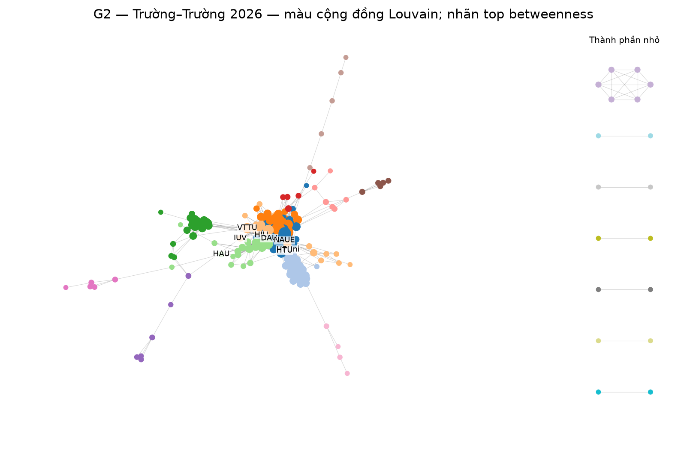

Hình 5.1. Mạng G2 năm 2026 vẽ bằng NetworkX; màu biểu diễn cộng đồng Louvain, kích thước đỉnh tăng theo bậc và nhãn chỉ các đỉnh betweenness cao. Nguồn: dựng từ `data/eduradar.db`; màu và nhãn theo `data/network/metrics/g2_uni_uni_2026.csv`.

Mục đích của hình là nhận diện các khối trường có danh mục ngành giống nhau và các trường nối giữa những khối đó. G2 có 249 đỉnh, 2.531 cạnh và 20 cộng đồng, modularity 0,4822. Vị trí hình học chỉ hỗ trợ đọc quan hệ; khoảng cách giữa hai đỉnh trên trang không phải khoảng cách địa lý hay chênh lệch điểm chuẩn.

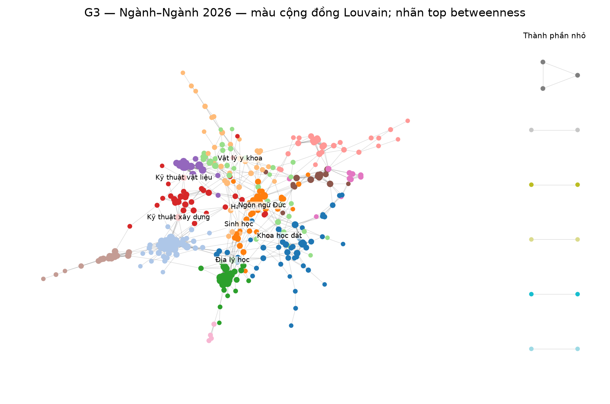

Hình 5.2. Mạng G3 năm 2026 vẽ bằng NetworkX, tô màu theo Louvain; nhãn ưu tiên các ngành cầu nối. Nguồn: `data/eduradar.db`; `data/network/metrics/g3_major_major_2026.csv`.

Mục đích là quan sát cụm lĩnh vực và các lối nối giữa chúng. G3 có 377 đỉnh, 1.412 cạnh, 19 cộng đồng và modularity 0,8363; cấu trúc cộng đồng rõ hơn G2 theo độ đo này. Các ngành cùng nhóm có tập trường đào tạo tương tự; không thể từ màu cụm kết luận chúng có cùng chương trình học hay chuẩn đầu ra.

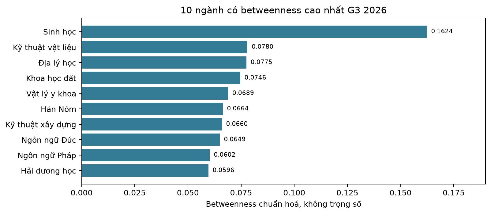

Hình 5.3. Mười ngành có betweenness cao nhất G3 năm 2026, sắp giảm dần. Nguồn: `data/network/metrics/g3_major_major_2026.csv`, cột `betweenness`; script `scripts/build_report_figures.py`.

Biểu đồ thanh làm rõ chênh lệch vị trí cầu nối: Sinh học đạt khoảng 0,1624, cao hơn Kỹ thuật vật liệu khoảng 0,0780. Thứ hạng này chỉ diễn giải ở Jaccard 0,25; phân tích độ nhạy cho thấy Sinh học đổi hạng mạnh khi thay ngưỡng, nên không suy ra đây là ngành cầu nối số một trong mọi mô hình.

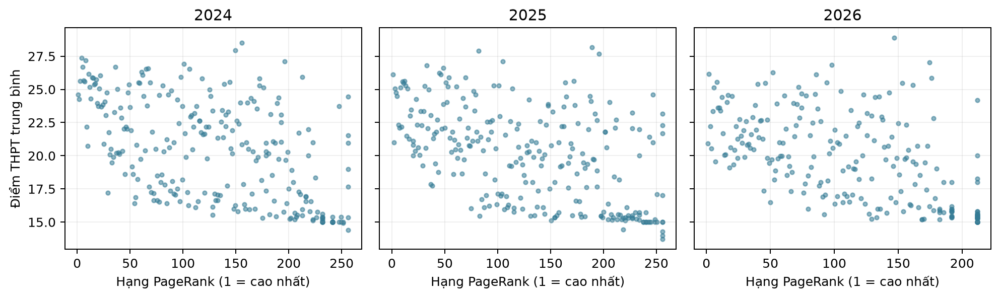

Hình 5.4. Hạng PageRank G4 và điểm THPT trung bình theo trường, ba năm. Hạng 1 biểu diễn PageRank cao nhất nên chiều trục hạng ngược chiều giá trị PageRank. Nguồn: `data/network/metrics/g4_competition_2024.csv`, `g4_competition_2025.csv`, `g4_competition_2026.csv`; điểm trung bình từ `admissions` trong `data/eduradar.db`, lọc THPT thang 30 theo đúng phép tính ở `sna/build.py`.

Biểu đồ giúp so sánh xếp hạng mạng với điểm thực tế thay vì chỉ xem danh sách đứng đầu. Spearman giữa giá trị PageRank và điểm trung bình lần lượt là 0,5669; 0,5352; 0,6069. Quan hệ dương có độ phân tán rõ rệt: PageRank không thay thế điểm chuẩn của từng chương trình và không đo chất lượng đào tạo.

## 5.3. Mô phỏng thay đổi tham số

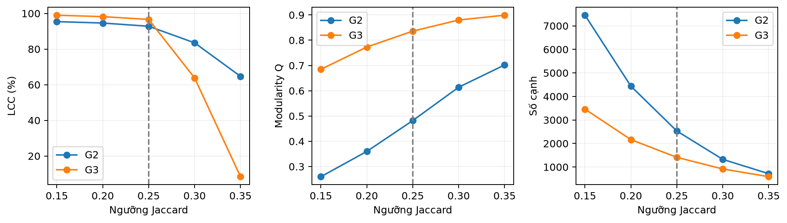

Hình 5.5. Thay đổi tỉ lệ đỉnh trong LCC, modularity và số cạnh của G2/G3 năm 2026 theo ngưỡng Jaccard. Nguồn: `docs/do_nhay_sna.md`, mục 2; script `scripts/build_report_figures.py`.

Mục đích là kiểm tra mức đánh đổi giữa khả năng liên thông và độ tách cộng đồng. G3 giảm LCC từ 96,6% ở ngưỡng 0,25 xuống 63,8% ở 0,30 và 8,4% ở 0,35; modularity tăng khi mạng bị chia nhỏ. Vì vậy, modularity cao hơn không tự động có nghĩa mô hình tốt hơn cho mọi câu hỏi.

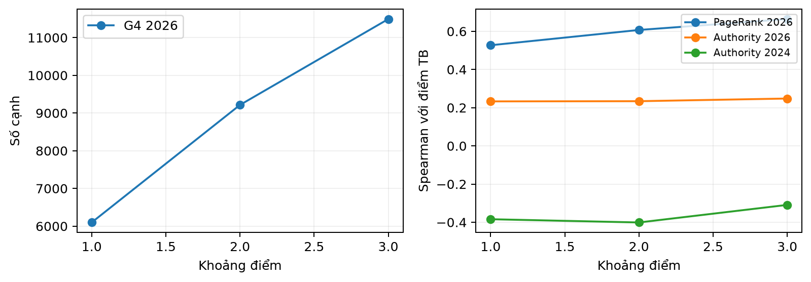

Hình 5.6. Số cạnh và tương quan Spearman của G4 khi khoảng điểm thay đổi. Nguồn: `docs/do_nhay_sna.md`, mục 3, số đã làm tròn trong nguồn.

Mục đích là quan sát tác động của phạm vi cạnh tranh. Năm 2026 số cạnh tăng từ 6.098 lên 11.492 khi khoảng điểm tăng từ 1 lên 3; dấu tương quan authority năm 2024 vẫn âm và năm 2026 vẫn dương. Mô phỏng này là phép đổi tham số mô hình, không phải can thiệp lên quá trình tuyển sinh thực tế.

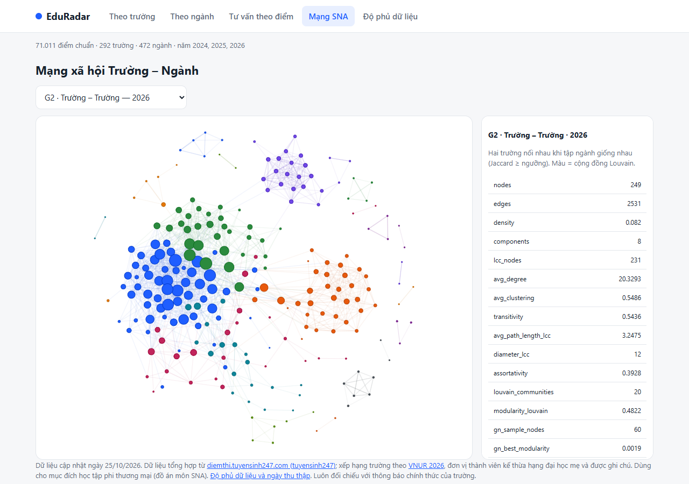

Hình 5.7. Tab Mạng SNA trên GitHub Pages, khung nhìn rộng 1.280 px, chụp ngày 25/10/2026. Nguồn giao diện: [web EduRadar](https://tiennguyen2406.github.io/Tuyensinhdaihoc/); dữ liệu đối chiếu `data/network/summary.csv`.

Hình minh hoạ việc chuyển kết quả phân tích thành công cụ quan sát: chọn mạng/năm, kéo và thu phóng, xem độ đo và đỉnh nổi bật. Giới hạn hiển thị cạnh được nêu ở mục 5.1 để tránh nhầm hình tương tác với toàn bộ đồ thị dùng để tính toán.

## 5.4. Chỗ chèn hình Gephi và hướng dẫn thực hiện

**[CHỖ CHÈN HÌNH GEPHI G2 — NGƯỜI THỰC HIỆN BỔ SUNG]**

Hình 5.8. Mạng G2 năm 2026 trong Gephi, bố cục ForceAtlas2, màu theo cộng đồng Louvain. Dự kiến lưu `docs/fig/gephi_g2_2026.png`. Mục đích: kiểm tra trực quan lõi trường đa ngành và nhóm y dược; khi bổ sung ảnh, nhận xét dựa trên 20 cộng đồng và modularity 0,4822 đã tính, không lấy số cụm theo màu mắt thường.

**[CHỖ CHÈN HÌNH GEPHI G3 — NGƯỜI THỰC HIỆN BỔ SUNG]**

Hình 5.9. Mạng G3 năm 2026 trong Gephi, bố cục ForceAtlas2, màu theo cộng đồng Louvain. Dự kiến lưu `docs/fig/gephi_g3_2026.png`. Mục đích: quan sát các khối ngành và lối nối của Sinh học; khi bổ sung ảnh, đối chiếu 19 cộng đồng và modularity 0,8363 với bảng số liệu.

Nguồn số cho hai chú thích dự kiến: `data/network/summary.csv`, năm 2026. Các đường dẫn Gephi ở trên là tên tệp dự kiến, chưa được dùng làm đường dẫn nhúng hình trong bản Word.

Cách làm trong Gephi:

1. Mở `data/network/gexf/g2_uni_uni_2026.gexf` bằng Open, chọn đồ thị vô hướng; kiểm tra bảng import đủ 249 đỉnh và 2.531 cạnh. Lặp lại cho `g3_major_major_2026.gexf` với 377 đỉnh, 1.412 cạnh.
2. Trong Appearance → Nodes → Partition, chọn thuộc tính `community` đã xuất từ Louvain. Dùng thuộc tính có sẵn để màu thống nhất với báo cáo; không chạy lại Modularity rồi mặc nhiên coi số nhóm giống seed 42.
3. Trong Ranking, chọn `degree` cho kích thước đỉnh. Chạy ForceAtlas2, bật Prevent Overlap; có thể bật LinLog để tách cụm. Dừng khi bố cục dễ đọc, sau đó điều chỉnh nhãn và Preview.
4. Xuất PNG nền trắng, giữ chú giải màu và các nhãn tiêu biểu. Lưu vào hai đường dẫn dự kiến, thay các dấu chỗ trống bằng ảnh, rồi chạy lại script xuất Word.

# Chương 6. Ứng dụng minh hoạ

## 6.1. Địa chỉ và kiến trúc vận hành

Ứng dụng công khai: [https://tiennguyen2406.github.io/Tuyensinhdaihoc/](https://tiennguyen2406.github.io/Tuyensinhdaihoc/). GitHub Pages phục vụ HTML, CSS, JavaScript và các JSON được xuất trước bởi `scripts/export_static.py`. Trình duyệt đọc JSON theo đường dẫn tương đối dưới thư mục dự án. Bản này dùng được khi máy chủ FastAPI của người thực hiện đã tắt.

Bản chạy tại máy sử dụng `webapp/main.py` với FastAPI để truy vấn SQLite và trả kết quả cho cùng giao diện tĩnh trong `webapp/static/`. Luồng kiến trúc giữ nguyên: crawler → raw → `pipeline/clean.py` → SQLite → FastAPI và `sna/build.py`. Việc xuất JSON cho Pages là bước đóng gói kết quả để trình diễn công khai, không bổ sung một cơ sở dữ liệu hay một tầng phân tích mới.

## 6.2. Năm tab và chức năng

**Bảng 6.1. Chức năng và dữ liệu phục vụ của ứng dụng.**

| Tab | Chức năng chính | Liên hệ với đồ án |
| --- | --- | --- |
| Theo trường | Tìm tên/mã, lọc tỉnh và năm; xem điểm theo phương thức, chương trình, tổ hợp; đề án và học phí có nguồn | Kiểm tra dữ liệu sạch, phân biệt đơn vị học phí, năm đề án và hạng kế thừa |
| Theo ngành | Tra mã ngành chuẩn hoặc tên chương trình; so trường, năm và phương thức; gợi ý ngành gần trên G3 | Đưa chuẩn hoá ngành và mạng chiếu vào tra cứu |
| Tư vấn theo điểm | Nhập phương thức, tổ hợp, điểm, năm; phân mức Thử sức/Vừa sức/An toàn và sắp theo độ hot | Sử dụng mức tăng bậc ngành G1 trong công thức mục 4.6 |
| Mạng SNA | Chọn G1–G4 và năm; mạng tương tác, độ đo và top đỉnh | Minh hoạ centrality, cộng đồng và hướng cạnh tranh |
| Độ phủ dữ liệu | Xem phạm vi từng trường/năm, nguồn, thời điểm, học phí và các giới hạn | Công khai phần thiếu để người dùng đánh giá kết quả |

Nguồn mô tả chức năng: `webapp/static/index.html`, `webapp/static/app.js`, `webapp/main.py`; số độ phủ: `docs/TONG_KET_DU_LIEU.md`. Bảng mô tả chức năng không bổ sung số liệu ngoài bộ nguồn đã chỉ định.

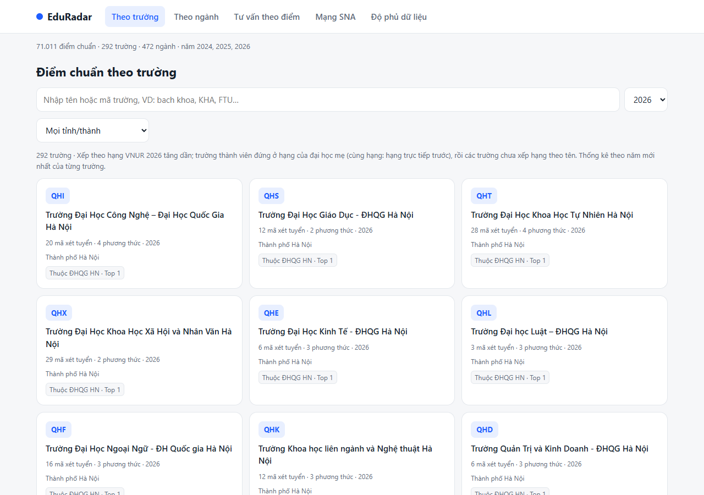

Hình 6.1. Tab Theo trường trên web thật ở 1.280 px. Mục đích: minh hoạ danh mục trường và lọc theo tên/tỉnh. Danh mục có 292 trường có điểm; hạng trực tiếp và hạng kế thừa có nhãn riêng. Nguồn số: `docs/TONG_KET_DU_LIEU.md`; ảnh web công khai ngày 25/10/2026.

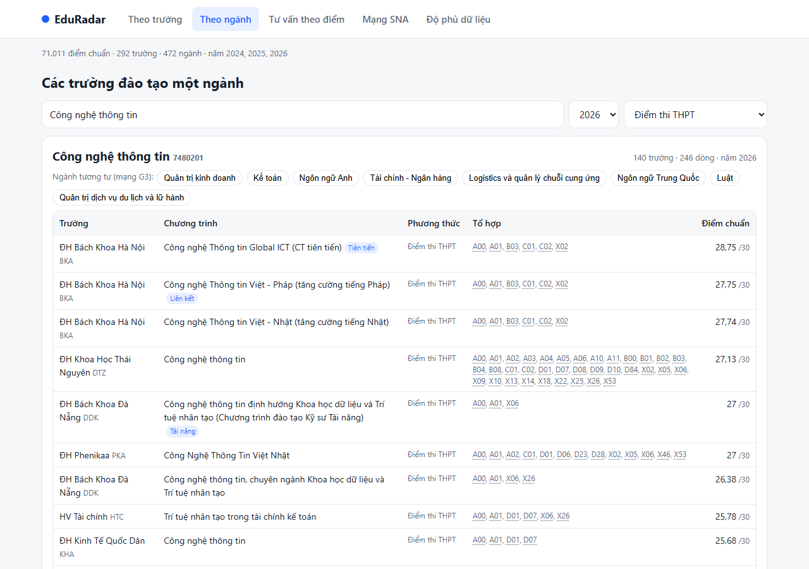

Hình 6.2. Tra ngành Công nghệ thông tin trên web thật ở 1.280 px. Mục đích: so sánh các trường cùng ngành trong đúng năm và phương thức. Mã ngành chuẩn giúp ghép tên chương trình khác nhau; 1.735 dòng chưa có mã vẫn là giới hạn khi tra theo ngành chuẩn. Nguồn số: `docs/TONG_KET_DU_LIEU.md`; ảnh ngày 25/10/2026.

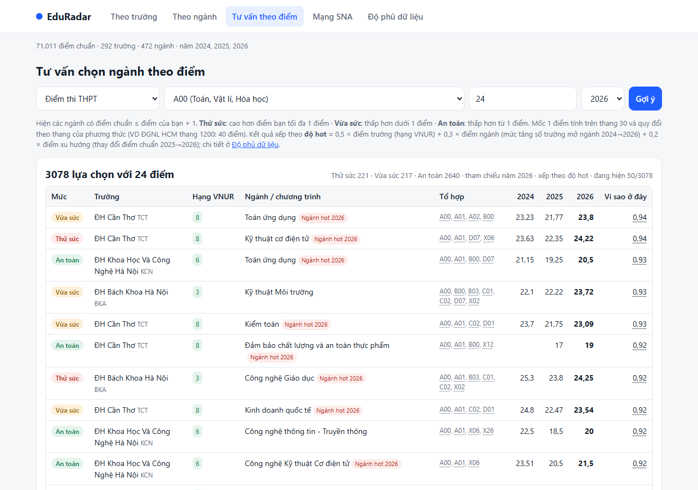

Hình 6.3. Tư vấn với điểm 24, phương thức THPT, tổ hợp A00, năm tham chiếu 2026; rộng 1.280 px. Mục đích: minh hoạ các mức gợi ý và giải thích độ hot. Đây là truy vấn mẫu; điểm 24 là đầu vào minh hoạ, không phải số thống kê. Dữ liệu/công thức: `docs/TONG_KET_DU_LIEU.md`; ảnh web thật ngày 25/10/2026.

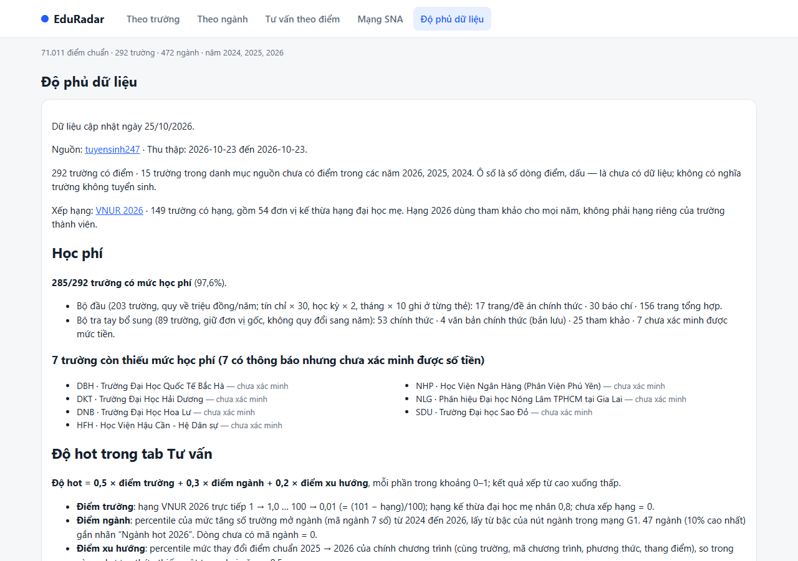

Hình 6.4. Tab Độ phủ dữ liệu trên web thật ở 1.280 px. Mục đích: cho phép kiểm tra năm thiếu và giới hạn nguồn. Học phí tham khảo phủ 285/292 trường, đề án phủ 267/292; độ phủ không đồng nghĩa mọi thông tin đều thuộc năm 2026. Nguồn số: `docs/TONG_KET_DU_LIEU.md`; ảnh ngày 25/10/2026.

Tab Mạng SNA ở Hình 5.7 là ảnh thứ năm trong bộ ảnh các tab ở 1.280 px. Ảnh dùng lại trong mục này để giữ một bản minh hoạ thống nhất, không tính thành một lần kiểm tra riêng.

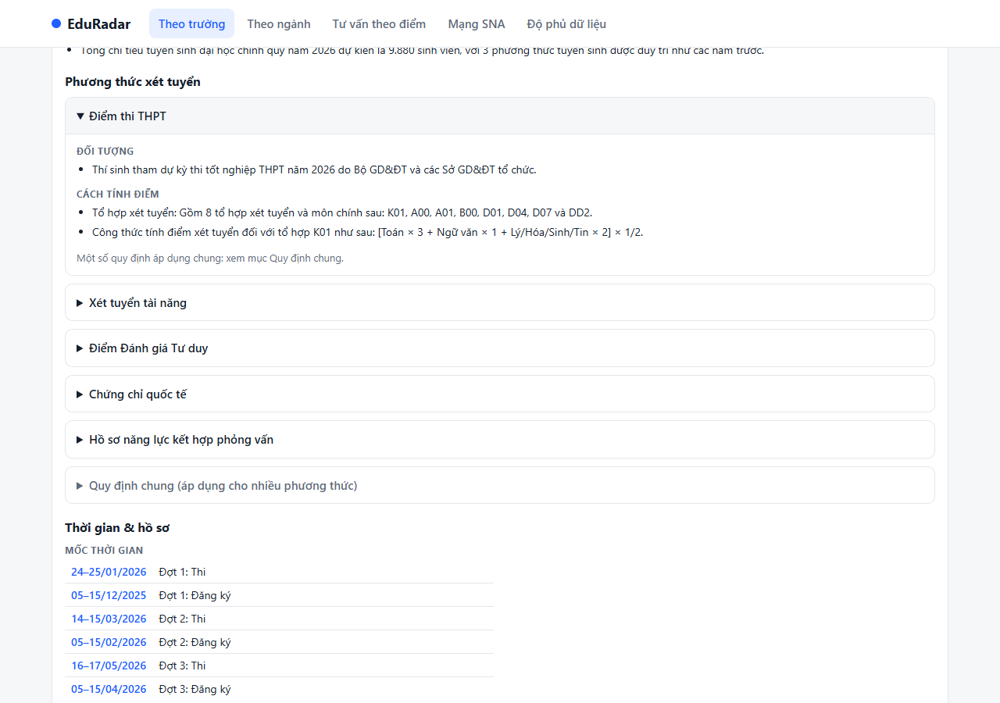

Hình 6.5. Phần đề án của Đại học Bách khoa Hà Nội trên web thật. Mục đích: minh hoạ dữ kiện bóc theo heading thành từng phương thức, thời gian và hồ sơ. Giao diện dẫn về HOCMAI và giữ năm nguồn; các chi tiết trong ảnh là nội dung hiển thị, không được dùng để suy rộng độ phủ ngoài `docs/TONG_KET_DU_LIEU.md`. Ảnh ngày 25/10/2026, rộng 1.280 px.

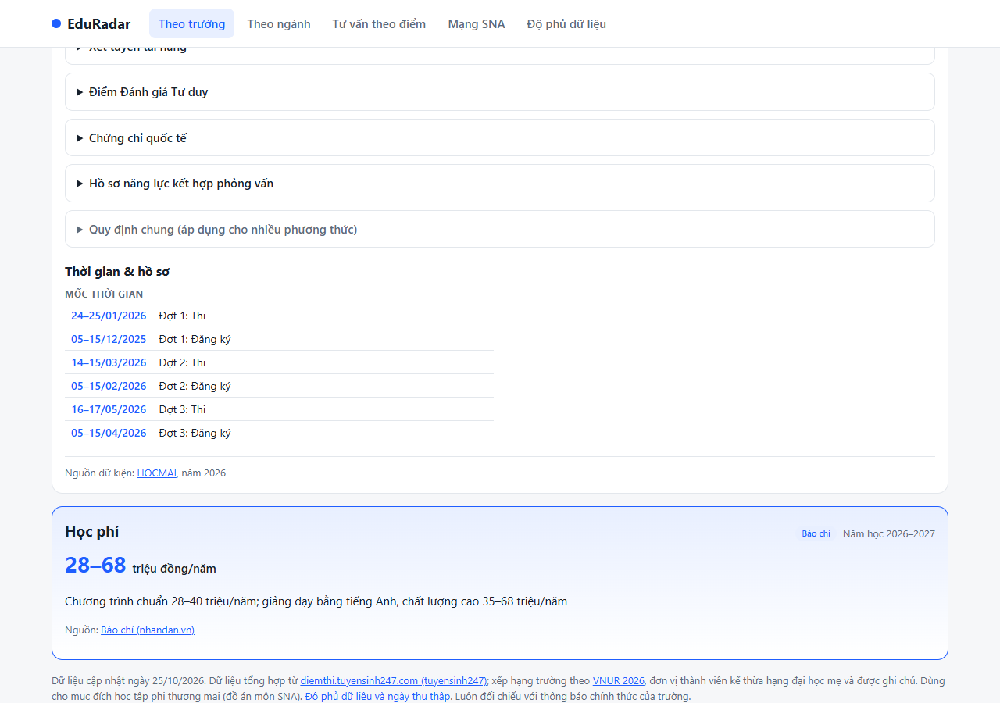

Hình 6.6. Phần cuối đề án và thẻ học phí trên cùng trang Đại học Bách khoa Hà Nội, web thật ở 1.280 px. Mục đích: cho thấy mức học phí đi cùng đơn vị, năm học và nhãn nguồn. Các mức trong ảnh là ví dụ giao diện; khi dùng để quyết định đăng ký phải theo liên kết và phạm vi chương trình trên thẻ. Ảnh ngày 25/10/2026; cách xử lý học phí mô tả tại mục 2.5.

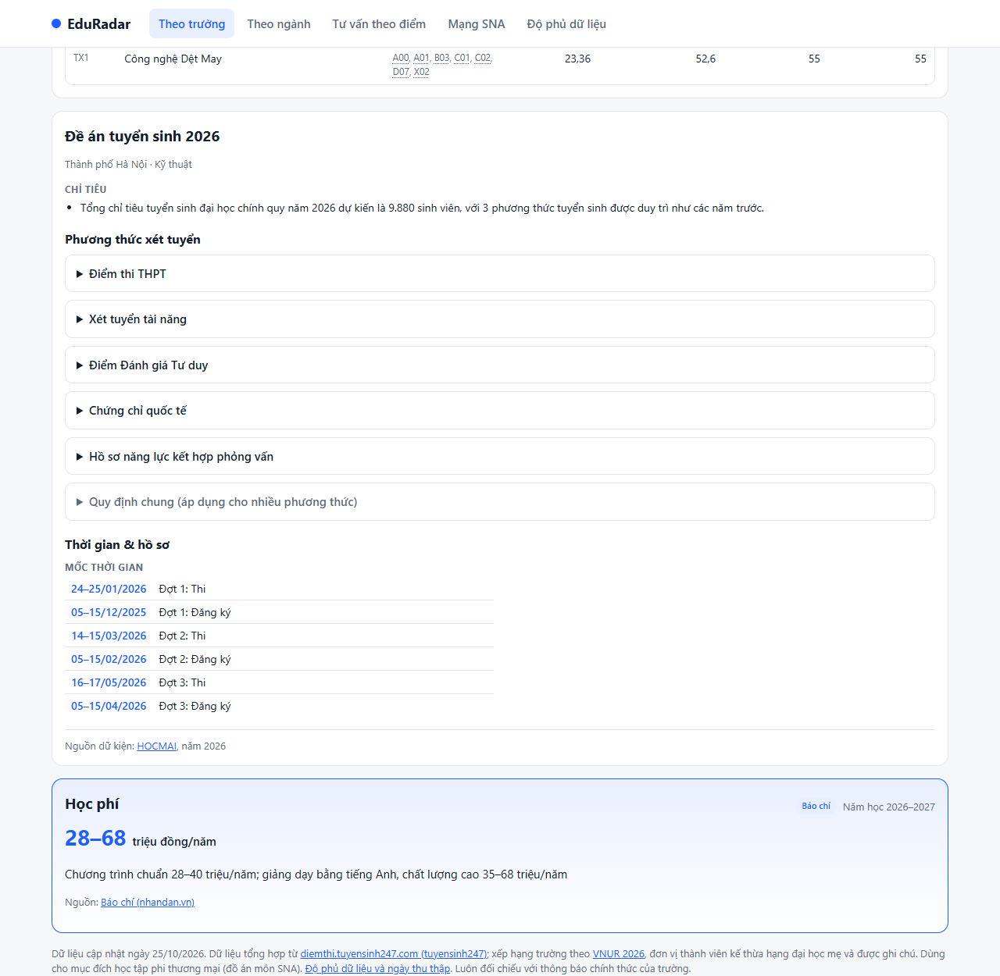

Hình 6.7. Cùng một trang trường hiển thị đề án và học phí sau khi thu gọn các khối chi tiết bằng điều khiển trên giao diện. Mục đích: kiểm tra hai nguồn thông tin bổ sung xuất hiện trong một luồng tra cứu. Ảnh web thật ngày 25/10/2026, rộng 1.280 px; không ghép ảnh từ các trang khác nhau.

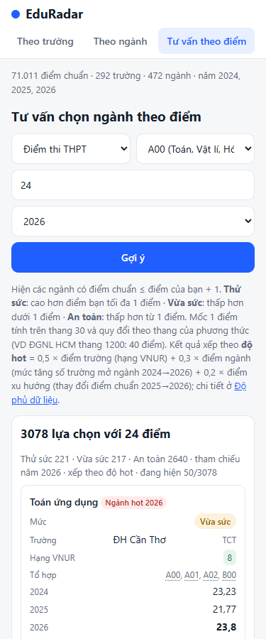

Hình 6.8. Tab Tư vấn theo điểm ở khung nhìn 375 px. Mục đích: minh hoạ khả năng dùng trên điện thoại; thanh điều khiển và kết quả được bố trí theo chiều dọc. Ảnh web thật ngày 25/10/2026; cùng truy vấn mẫu với Hình 6.3.

## 6.3. Kiểm chứng ứng dụng

`docs/TONG_KET_DU_LIEU.md` ghi nhận kiểm Edge headless ở 375 px và 1.280 px cho năm tab trên FastAPI và bản tĩnh: 100 phép đối chiếu JSON khớp; sau deploy, 50 phép đối chiếu JSON trên GitHub Pages khớp FastAPI. Các kiểm tra đó xác nhận sự nhất quán của hai cách phục vụ tại thời điểm kiểm; không thay cho đánh giá tính đúng của thông báo gốc. Bộ ảnh trong báo cáo được chụp lại từ URL công khai bằng `scripts/capture_report_web.cjs`, không dùng bản chạy localhost.

## 6.4. Kịch bản demo năm bước

1. Mở URL công khai; tại Theo trường tìm BKA, chọn 2026, xem một dòng điểm kèm tổ hợp, mở phần đề án và học phí để chỉ ra năm, đơn vị và nguồn.
2. Sang Theo ngành, nhập mã `7480201` (Công nghệ thông tin), chọn cùng năm và phương thức THPT; so sánh các trường và xem gợi ý ngành tương tự từ G3.
3. Sang Tư vấn theo điểm, nhập THPT, A00, 24 điểm; giải thích ba mức theo khoảng điểm và mở phần giải thích độ hot của một kết quả. Nêu rõ độ hot là chỉ số tham khảo, không phải xác suất đỗ.
4. Sang Mạng SNA, chọn G2 năm 2026 rồi G3 năm 2026; thu phóng và chọn một đỉnh; đối chiếu trường/ngành cầu nối với bảng betweenness. Chuyển G4 để giải thích mũi tên và sự khác nhau giữa authority với PageRank.
5. Sang Độ phủ dữ liệu; chỉ ra trường/năm thiếu, ngày cập nhật và giới hạn học phí/đề án. Kết thúc bằng việc mở nguồn chính thức hoặc nguồn gốc của một kết quả để minh hoạ khả năng truy nguồn.

# Chương 7. Kết luận

## 7.1. Trả lời các câu hỏi nghiên cứu

Về các trường giống nhau, G2 năm 2026 cho 20 cộng đồng với modularity 0,4822. Nhóm trường kinh tế, trường đa ngành, đại học địa phương và y dược có cấu trúc phân biệt trong tập ngành đào tạo. Cộng đồng là kết quả từ danh mục ngành ở ngưỡng Jaccard 0,25; không phải một bảng xếp hạng chất lượng. Nhóm y dược giữ được cấu trúc chung trong phân tích độ nhạy, trong khi số cộng đồng chính xác thay đổi theo ngưỡng.

Về ngành phổ biến và ngành cầu nối, phải tách hai câu hỏi. Bậc ngành G1 đo số trường mở ngành; các ngành như Quản trị kinh doanh và Công nghệ thông tin có độ phủ cao. Betweenness G3 đo vai trò nối giữa các tập trường: Sinh học đạt khoảng 0,1624 và đứng đầu ở cấu hình chuẩn, nhưng đổi hạng mạnh khi ngưỡng thay đổi. Eigenvector cao của nhóm ngành chỉ có ở Đại học Mỏ – Địa chất là hệ quả clique có Jaccard bằng 1, không chứng minh nhu cầu tuyển sinh hay nhu cầu lao động cao.

Về cạnh tranh, G4 năm 2026 có 226 đỉnh, 9.215 cạnh; authority nhấn mạnh các trường nhận liên kết từ lõi hub dày đặc. PageRank thể hiện sự lan truyền nhiều bước và tương quan dương với điểm THPT trung bình ở cả ba năm. Authority âm năm 2024–2025 rồi dương năm 2026 cho thấy tên gọi authority không thể mặc nhiên hiểu là uy tín học thuật; cách xây dựng cạnh và phân bố điểm chi phối kết quả.

Về thay đổi theo thời gian, số cạnh G1 tăng từ 4.447 lên 5.058, trong khi số trường phía G1 giảm từ 279 xuống 276. Trong mẫu thu thập, các trường hiện diện có danh mục ngành rộng hơn, nhưng không đủ căn cứ kết luận toàn bộ hệ thống đại học mở thêm ngành hay thu hẹp quy mô. G3 vẫn có cấu trúc cộng đồng mạnh, modularity khoảng 0,84. Chiều tăng modularity G2 và transitivity G3 bền hơn qua các cấu hình đã thử; thứ hạng cầu nối và mức liên thông nhạy với ngưỡng.

Về ứng dụng, mức tăng bậc ngành G1 được dùng làm một thành phần độ hot; G3 cung cấp các ngành có tập trường đào tạo tương tự. Năm tab giúp người dùng đi từ số điểm đến trường/ngành, xem cấu trúc mạng và kiểm tra độ phủ. Đây là cách chuyển kết quả SNA thành chức năng có thể trình diễn, đồng thời giữ được giới hạn diễn giải.

Nguồn cho các kết luận định lượng: `data/network/summary.csv`; `data/network/metrics/g3_major_major_2026.csv`; `docs/do_nhay_sna.md`; `docs/TONG_KET_DU_LIEU.md`.

## 7.2. Hạn chế

Dữ liệu điểm xuất phát từ một trang tổng hợp nên có thể kế thừa sai sót hoặc thiếu sót của nguồn. Thang điểm có phần suy ra; các dòng có cờ và trùng khoá khác điểm chưa thể coi là đã xác minh. Tỉ lệ map 97,56% là độ phủ ánh xạ, không phải độ chính xác đã đo bằng đối chiếu tay. Kết quả kiểm 20 dòng còn để người thực hiện điền, không được sử dụng để tuyên bố độ chính xác trước khi kiểm.

Phép chiếu theo Jaccard làm mất một phần thông tin của mạng hai phía và có hiệu ứng clique đối với ngành hiếm. Đường đi trong G2/G3 đang tính không trọng số; đồ thị không liên thông buộc giới hạn đường đi và đường kính trên LCC. Chưa có kiểm định thế giới nhỏ với tập đồ thị null bảo toàn bậc. Louvain là heuristic có yếu tố ngẫu nhiên; so sánh Girvan–Newman chỉ trên mẫu bậc cao nên không đại diện mọi vùng mạng. Dự đoán liên kết dùng danh sách tên ngành lưu trong CSV, có nguy cơ nhập nhằng tên–mã; độ chính xác không được suy ra cho ngành mới không có trong tập gốc.

Đề án, học phí, xếp hạng và tỉnh có phạm vi nguồn khác nhau. Hạng kế thừa thuộc đại học mẹ; học phí có nhiều đơn vị và năm học; đề án có bài mang năm tiêu đề khác năm nội dung. Các thông tin này chỉ được dùng khi giữ các ghi chú đi kèm.

## 7.3. Hướng phát triển

Ưu tiên tiếp theo là hoàn tất kiểm tra 20 dòng, bổ sung nguồn chính thức cho các mục còn thiếu và đo riêng độ chính xác của ánh xạ mã ngành. Phân tích mạng có thể thử khoảng cách từ Jaccard với quy ước rõ ràng, so sánh với mô hình null và các phương pháp giữ cạnh quan trọng theo từng đỉnh. Dự đoán liên kết nên lưu mã ngành, đánh giá nhiều mốc thời gian và so sánh Adamic–Adar với các nền khác. Khi có dữ liệu đủ đồng nhất, có thể phân tích mạng theo từng phương thức và theo dõi cộng đồng động; những hướng này chưa được tính vào kết quả hiện tại.

# Tài liệu tham khảo

1. Tuyensinh247. [Điểm chuẩn đại học](https://diemthi.tuyensinh247.com/diem-chuan.html), API công khai `school/search`, `common/cutoff-score`, `common/blocks`. Ngày thu thập điểm: 23/10/2026 theo `fetch_log.csv`.
2. VNUR. [Bảng xếp hạng đại học Việt Nam](https://vnur.vn/bang-xep-hang/), bản 2026. Phạm vi sử dụng và hạng kế thừa: `docs/TONG_KET_DU_LIEU.md`.
3. HOCMAI. [Hướng nghiệp và thông tin tuyển sinh](https://huongnghiep.hocmai.vn/). Dữ kiện đề án bóc theo heading; ngày tải từng bài chưa được tổng hợp trong các nguồn thống kê của báo cáo.
4. Cổng Thông tin điện tử Chính phủ. [Danh mục và mã số các tỉnh, thành sau sắp xếp năm 2025](https://xaydungchinhsach.chinhphu.vn/bang-danh-muc-va-ma-so-cua-34-tinh-thanh-moi-cac-don-vi-hanh-chinh-cap-xa-moi-11925070418263625.htm). Địa chỉ từng trường và nguồn học phí được gắn tại thẻ trên ứng dụng.
5. NetworkX Developers. [Centrality](https://networkx.org/documentation/stable/reference/algorithms/centrality.html), [community algorithms](https://networkx.org/documentation/stable/reference/algorithms/community.html), [link prediction](https://networkx.org/documentation/stable/reference/algorithms/link_prediction.html). Tài liệu API đối chiếu các hàm ở Chương 3–4.
6. Blondel, V. D., Guillaume, J.-L., Lambiotte, R., & Lefebvre, E. (2008). [Fast unfolding of communities in large networks](https://arxiv.org/abs/0803.0476). Journal of Statistical Mechanics: Theory and Experiment, P10008. DOI: 10.1088/1742-5468/2008/10/P10008.
7. Girvan, M., & Newman, M. E. J. (2002). [Community structure in social and biological networks](https://arxiv.org/abs/cond-mat/0112110). PNAS, 99(12), 7821–7826. DOI: 10.1073/pnas.122653799.
8. Kleinberg, J. M. (1999). [Authoritative sources in a hyperlinked environment](https://www.cs.cornell.edu/home/kleinber/auth.pdf). Journal of the ACM, 46(5), 604–632. DOI: 10.1145/324133.324140.
9. Brin, S., & Page, L. (1998). [The anatomy of a large-scale hypertextual Web search engine](https://infolab.stanford.edu/~backrub/google.html). Computer Networks and ISDN Systems, 30, 107–117. DOI: 10.1016/S0169-7552(98)00110-X.
10. Adamic, L. A., & Adar, E. (2003). [Friends and neighbors on the Web](https://doi.org/10.1016/S0378-8733(03)00009-1). Social Networks, 25(3), 211–230.

Số liệu thực nghiệm của báo cáo lấy từ `docs/TONG_KET_DU_LIEU.md`, `data/clean/quality_report.md`, `data/raw/fetch_log.csv`, `data/network/summary.csv`, `data/network/metrics/*.csv`, `docs/do_nhay_sna.md` và `data/eduradar.db`. Các tài liệu học thuật dùng cho định nghĩa, thuật toán và diễn giải phương pháp.

# Phụ lục A. Cấu trúc thư mục và lệnh chạy

## A.1. Cấu trúc chính

```text
crawler/                Thu thập API điểm và HTML đề án
data/raw/               Phản hồi gốc và fetch_log.csv (không commit)
data/manual/            Bản đồ sửa tay, VNUR, tỉnh và học phí
pipeline/clean.py       Làm sạch, chuẩn hoá và tạo SQLite
pipeline/dean.py        Bóc dữ kiện đề án theo heading
pipeline/tuition_import.py  Nhập học phí bổ sung và overrides
data/eduradar.db        DB sinh tại máy (không commit)
sna/build.py            Dựng bốn mạng, tính độ đo, xuất GEXF
data/network/           summary.csv, metrics/, gexf/, fig/ (sinh tại máy)
webapp/                 FastAPI và HTML/JS tĩnh
site/                   Bản tĩnh công khai trên GitHub Pages
scripts/                Xuất site, dựng báo cáo, kiểm tra và chụp ảnh
docs/                   Báo cáo và docs/fig/ (commit)
```

## A.2. Lệnh tái lập

Chạy tại thư mục repo bằng PowerShell; các lệnh dưới đây dùng Python của môi trường dự án. Dừng web trước khi crawl; khi raw đã có, bắt đầu từ bước làm sạch. Không chạy lại thu thập chỉ để dựng báo cáo.

```powershell
uv sync --locked
# Chỉ khi cần thu thập và đã dừng web:
.venv/Scripts/python.exe -m crawler.fetch
.venv/Scripts/python.exe -m crawler.fetch_dean
# Tái tạo dữ liệu từ raw có sẵn:
.venv/Scripts/python.exe -m pipeline.clean
.venv/Scripts/python.exe -m pipeline.tuition_import
.venv/Scripts/python.exe -m pipeline.dean
.venv/Scripts/python.exe -m sna.build
.venv/Scripts/python.exe scripts/export_static.py
# Chạy bản FastAPI hoặc bản tĩnh:
.venv/Scripts/python.exe -m uvicorn webapp.main:app --port 8000
.venv/Scripts/python.exe -m http.server 8001 --directory site
# Dựng hình và báo cáo từ dữ liệu có sẵn:
.venv/Scripts/python.exe scripts/build_report_figures.py
node scripts/capture_report_web.cjs
.venv/Scripts/python.exe scripts/build_report_docx.py
.venv/Scripts/python.exe scripts/check_report.py
```

Hai lệnh chạy web là hai lựa chọn phục vụ tương ứng; dừng tiến trình đang chạy trước khi chuyển bước. Chỉnh dữ liệu thủ công qua `data/manual/`, sau đó chạy lại pipeline; không sửa trực tiếp bảng sạch hay DB. Để chụp ảnh cần Playwright ở `.venv/browser-check/node_modules` và Edge; để xuất Word cần `pypandoc_binary`, `python-docx` đã khai báo trong môi trường dự án.


## A.3. Số record sạch theo từng trường

Bảng A.1. Toàn bộ 292 mã trường; giá trị 0 biểu diễn chưa có dòng điểm trong năm ở mẫu thu thập. Tổng của ba cột năm là 71.011.

| Trường (mã) | 2024 | 2025 | 2026 | Tổng |
| --- | --- | --- | --- | --- |
| Học Viện An Ninh Nhân Dân (ANH) | 22 | 26 | 16 | 64 |
| Trường Đại Học An Ninh Nhân Dân (ANS) | 19 | 20 | 4 | 43 |
| Đại Học Bách Khoa Hà Nội (BKA) | 192 | 325 | 287 | 804 |
| Trường Đại học Y Dược Buôn Ma Thuột (BMU) | 12 | 16 | 28 | 56 |
| Học Viện Biên Phòng (BPH) | 12 | 40 | 30 | 82 |
| Học Viện Công Nghệ Bưu Chính Viễn Thông (BVH) | 88 | 252 | 351 | 691 |
| Học Viện Công Nghệ Bưu Chính Viễn Thông (Cơ sở TP.HCM) (BVS) | 59 | 117 | 162 | 338 |
| Trường Đại Học Bà Rịa – Vũng Tàu (BVU) | 152 | 188 | 180 | 520 |
| Trường Đại học Công nghiệp và Thương mại Hà Nội (CCM) | 22 | 22 | 33 | 77 |
| Trường Đại học Nghệ An (CEA) | 30 | 80 | 73 | 183 |
| Trường Đại Học CMC (CMC) | 40 | 42 | 100 | 182 |
| Học Viện Cảnh Sát Nhân Dân (CSH) | 15 | 16 | 4 | 35 |
| Trường Đại Học Cảnh Sát Nhân Dân (CSS) | 19 | 20 | 4 | 43 |
| Trường Đại Học Đông Á (DAD) | 214 | 228 | 883 | 1325 |
| Trường Đại Học Bình Dương (DBD) | 52 | 52 | 37 | 141 |
| Trường Đại học Nông Lâm Bắc Giang (DBG) | 53 | 40 | 60 | 153 |
| Trường Đại Học Quốc Tế Bắc Hà (DBH) | 16 | 0 | 0 | 16 |
| Trường Đại Học Bạc Liêu (DBL) | 34 | 44 | 58 | 136 |
| Trường Đại học Intracom (DCA) | 14 | 0 | 68 | 82 |
| Trường Đại Học Công Nghệ Đồng Nai (DCD) | 44 | 75 | 66 | 185 |
| Trường Sĩ Quan Đặc Công (DCH) | 5 | 6 | 20 | 31 |
| Trường Đại Học Cửu Long (DCL) | 61 | 76 | 126 | 263 |
| Đại Học Công Nghiệp Hà Nội (DCN) | 195 | 179 | 222 | 596 |
| Trường Đại Học Công Nghệ và Quản Lý Hữu Nghị (DCQ) | 30 | 34 | 34 | 98 |
| Trường Đại Học Công Thương TPHCM (DCT) | 136 | 153 | 176 | 465 |
| Trường Đại học Công nghiệp Vinh (DCV) | 12 | 8 | 6 | 26 |
| Trường Đại Học Công Nghệ Đông Á (DDA) | 105 | 0 | 0 | 105 |
| Trường Đại Học Thành Đông (DDB) | 50 | 0 | 58 | 108 |
| Trường Đại Học Ngoại Ngữ Đà Nẵng (DDF) | 39 | 63 | 24 | 126 |
| Trường Đại Học Bách Khoa Đà Nẵng (DDK) | 124 | 163 | 133 | 420 |
| Trường Đại Học Điện Lực (DDL) | 57 | 96 | 114 | 267 |
| Trường Đại Học Công Nghiệp Quảng Ninh (DDM) | 18 | 22 | 60 | 100 |
| Trường Đại Học Đại Nam (DDN) | 78 | 84 | 146 | 308 |
| Phân Hiệu Đại Học Đà Nẵng tại Kon Tum (DDP) | 13 | 29 | 17 | 59 |
| Trường Đại Học Kinh Tế – Đại Học Đà Nẵng (DDQ) | 57 | 70 | 55 | 182 |
| Trường Đại Học Sư Phạm - Đại Học Đà Nẵng (DDS) | 81 | 100 | 112 | 293 |
| Đại Học Duy Tân (DDT) | 205 | 290 | 351 | 846 |
| Trường Đại Học Đông Đô (DDU) | 36 | 60 | 102 | 198 |
| Viện nghiên cứu và đào tạo Việt Anh - Đại học Đà Nẵng (DDV) | 6 | 24 | 0 | 30 |
| Trường Y Dược Đà Nẵng (DDY) | 7 | 11 | 11 | 29 |
| Trường Đại học Luật Huế (DHA) | 4 | 4 | 4 | 12 |
| Khoa Giáo Dục Thể Chất Huế (DHC) | 2 | 2 | 2 | 6 |
| Trường Du Lịch - Đại Học Huế (DHD) | 21 | 14 | 28 | 63 |
| Khoa Kỹ thuật và Công nghệ - Đại học Huế (DHE) | 18 | 21 | 40 | 79 |
| Trường Đại Học Ngoại Ngữ Huế (DHF) | 33 | 24 | 52 | 109 |
| Khoa Quốc tế - Đại học Huế (DHI) | 9 | 8 | 9 | 26 |
| Trường Đại Học Kinh Tế - Đại Học Huế (DHK) | 43 | 42 | 88 | 173 |
| Trường Đại Học Nông Lâm Huế (DHL) | 43 | 40 | 76 | 159 |
| Trường Đại Học Nghệ Thuật Huế (DHN) | 12 | 12 | 12 | 36 |
| Phân Hiệu Đại Học Huế tại Quảng Trị (DHQ) | 10 | 6 | 0 | 16 |
| Trường Đại Học Sư Phạm Huế (DHS) | 97 | 88 | 170 | 355 |
| Trường Đại Học Khoa Học Huế (DHT) | 76 | 102 | 144 | 322 |
| Trường Đại học Hùng Vương TPHCM (DHV) | 38 | 57 | 92 | 187 |
| Trường Đại Học Y Dược Huế (DHY) | 14 | 11 | 34 | 59 |
| Trường Đại Học Kinh Tế Kỹ Thuật Bình Dương (DKB) | 51 | 54 | 80 | 185 |
| Trường Đại học Công Nghệ TPHCM (DKC) | 189 | 244 | 312 | 745 |
| Trường Đại Học Dược Hà Nội (DKH) | 13 | 14 | 17 | 44 |
| Trường Đại Học Kinh Tế Kỹ Thuật Công Nghiệp (DKK) | 192 | 200 | 196 | 588 |
| Trường Đại học Kiểm Sát  (DKS) | 64 | 54 | 76 | 194 |
| Trường Đại Học Hải Dương (DKT) | 50 | 91 | 128 | 269 |
| Trường Đại Học Kỹ Thuật Y Tế Hải Dương (DKY) | 24 | 25 | 25 | 74 |
| Trường Đại Học Kinh Tế Công Nghiệp Long An (DLA) | 24 | 27 | 27 | 78 |
| Trường Đại Học Lạc Hồng (DLH) | 25 | 104 | 113 | 242 |
| Trường Đại Học Lao Động – Xã Hội (Cơ sở II) (DLS) | 22 | 14 | 98 | 134 |
| Trường Đại Học Lao Động – Xã Hội (DLX) | 30 | 18 | 196 | 244 |
| Trường Đại Học Tài Chính Marketing (DMS) | 181 | 88 | 136 | 405 |
| Trường Đại học Tài Nguyên và Môi Trường Hà Nội (DMT) | 86 | 70 | 108 | 264 |
| Trường Đại Học Hoa Lư (DNB) | 14 | 13 | 13 | 40 |
| Trường Đại học Nam Cần Thơ (DNC) | 87 | 180 | 199 | 466 |
| Học Viện Khoa Học Quân Sự - Hệ Dân sự (DNH) | 0 | 3 | 9 | 12 |
| Trường Đại Học Ngoại Ngữ Tin Học TPHCM (DNT) | 76 | 69 | 115 | 260 |
| Trường Đại Học Đồng Nai (DNU) | 15 | 24 | 35 | 74 |
| Trường Đại Học Phan Châu Trinh (DPC) | 18 | 42 | 35 | 95 |
| Trường Đại Học Phương Đông (DPD) | 50 | 64 | 146 | 260 |
| Trường Đại Học Phạm Văn Đồng (DPQ) | 28 | 28 | 54 | 110 |
| Trường Đại Học Phan Thiết (DPT) | 45 | 45 | 48 | 138 |
| Trường Đại Học Phú Xuân (DPX) | 9 | 12 | 45 | 66 |
| Trường Đại Học Phú Yên (DPY) | 18 | 24 | 21 | 63 |
| Trường Đại Học Quảng Bình (DQB) | 26 | 131 | 116 | 273 |
| Học Viện Kỹ Thuật Quân Sự - Hệ Dân sự (DQH) | 0 | 32 | 61 | 93 |
| Trường Đại Học Kinh Doanh và Công Nghệ Hà Nội (DQK) | 52 | 90 | 94 | 236 |
| Trường Đại Học Quy Nhơn (DQN) | 181 | 399 | 286 | 866 |
| Trường Đại Học Quang Trung (DQT) | 39 | 30 | 0 | 69 |
| Trường Đại Học Quảng Nam (DQU) | 26 | 60 | 56 | 142 |
| Trường Đại Học Sân Khấu Điện Ảnh TPHCM (DSD) | 0 | 0 | 4 | 4 |
| Trường Đại Học Công Nghệ Sài Gòn (DSG) | 40 | 54 | 80 | 174 |
| Trường Đại học Sư phạm Kỹ thuật - Đại học Đà Nẵng (DSK) | 50 | 92 | 25 | 167 |
| Trường Đại Học Thái Bình (DTB) | 50 | 20 | 40 | 110 |
| Trường Đại học Công Nghệ Thông Tin và Truyền Thông Thái Nguyên (DTC) | 48 | 75 | 99 | 222 |
| Trường Đại Học Tây Đô (DTD) | 73 | 100 | 145 | 318 |
| Trường Đại học Kinh tế và Quản trị kinh doanh Thái Nguyên (DTE) | 38 | 84 | 203 | 325 |
| Trường Ngoại Ngữ Thái Nguyên (DTF) | 10 | 16 | 15 | 41 |
| Phân hiệu Đại học Thái Nguyên tại Hà Giang (DTG) | 14 | 15 | 0 | 29 |
| Trường Đại Học Kỹ Thuật Công Nghiệp Thái Nguyên (DTK) | 47 | 78 | 116 | 241 |
| Trường Đại Học Thăng Long (DTL) | 62 | 176 | 169 | 407 |
| Trường Đại học Tài Nguyên và Môi Trường TPHCM (DTM) | 57 | 187 | 100 | 344 |
| Trường Đại Học Nông Lâm Thái Nguyên (DTN) | 46 | 75 | 69 | 190 |
| Phân Hiệu Đại Học Thái Nguyên Tại Lào Cai (DTP) | 20 | 32 | 0 | 52 |
| Khoa Quốc Tế - Đại Học Thái Nguyên (DTQ) | 12 | 42 | 104 | 158 |
| Đại Học Sư Phạm Thái Nguyên (DTS) | 71 | 139 | 127 | 337 |
| Trường Đại Học Tôn Đức Thắng (DTT) | 517 | 598 | 1139 | 2254 |
| Trường Đại Học Lương Thế Vinh (DTV) | 20 | 22 | 22 | 64 |
| Trường Đại Học Y Dược Thái Nguyên (DTY) | 18 | 36 | 45 | 99 |
| Trường Đại Học Khoa Học Thái Nguyên (DTZ) | 66 | 186 | 280 | 532 |
| Trường Đại Học Kinh tế công nghệ Thái Nguyên (DVB) | 17 | 46 | 44 | 107 |
| Trường Đại Học Văn Hóa, Thể Thao Và Du Lịch Thanh Hóa (DVD) | 126 | 120 | 0 | 246 |
| Trường Đại Học Văn Hiến (DVH) | 214 | 127 | 130 | 471 |
| Trường Đại Học Văn Lang (DVL) | 178 | 227 | 448 | 853 |
| Trường Đại Học Trưng Vương (DVP) | 28 | 32 | 34 | 94 |
| Đại Học Trà Vinh (DVT) | 178 | 313 | 144 | 635 |
| Trường Đại Học Yersin Đà Lạt (DYD) | 80 | 68 | 51 | 199 |
| Học Viện Quân Y - Hệ Dân sự (DYH) | 0 | 6 | 12 | 18 |
| Trường Đại Học Quốc Tế Miền Đông (EIU) | 30 | 30 | 30 | 90 |
| Trường Đại Học Hòa Bình (ETU) | 47 | 42 | 59 | 148 |
| Trường Đại Học Tài Chính Ngân Hàng Hà Nội (FBU) | 9 | 30 | 36 | 75 |
| Trường Đại Học FPT (FPT) | 7 | 0 | 16 | 23 |
| Trường Đại Học Gia Định (GDU) | 59 | 75 | 87 | 221 |
| Trường Đại Học Giao Thông Vận Tải (GHA) | 117 | 139 | 175 | 431 |
| Trường Đại Học Sư Phạm Nghệ Thuật Trung Ương (GNT) | 17 | 27 | 38 | 82 |
| Trường Đại Học Giao Thông Vận Tải (Cơ sở 2) (GSA) | 47 | 72 | 79 | 198 |
| Trường Đại học Công nghệ Giao thông vận tải (GTA) | 99 | 336 | 338 | 773 |
| Học viện Báo chí và Tuyên truyền (HBT) | 218 | 165 | 98 | 481 |
| Học Viện Chính Trị Công An Nhân Dân (HCA) | 8 | 8 | 8 | 24 |
| Học viện Kỹ thuật và Công nghệ an ninh (Phía Bắc) (HCB) | 4 | 14 | 18 | 36 |
| Học Viện Hành Chính và Quản trị công (HCH) | 149 | 203 | 184 | 536 |
| Học viện Kỹ thuật và Công nghệ an ninh (Phía Nam) (HCN) | 4 | 14 | 14 | 32 |
| Học Viện Chính Sách và Phát Triển (HCP) | 80 | 81 | 225 | 386 |
| Học Viện Hành Chính Và Quản Trị Công (phía Nam) (HCS) | 32 | 82 | 0 | 114 |
| Trường Đại Học Hồng Đức (HDT) | 217 | 208 | 254 | 679 |
| Học Viện Hậu Cần - Hệ Quân sự (HEH) | 20 | 24 | 20 | 64 |
| Học Viện Hậu Cần - Hệ Dân sự (HFH) | 0 | 9 | 30 | 39 |
| Trường Sĩ Quan Phòng Hóa (HGH) | 8 | 6 | 8 | 22 |
| Trường Đại Học Hàng Hải Việt Nam (HHA) | 281 | 868 | 699 | 1848 |
| Học Viện Hàng không Việt Nam (HHK) | 76 | 196 | 245 | 517 |
| Trường Đại Học Hà Tĩnh (HHT) | 30 | 109 | 158 | 297 |
| Trường Đại Học Quốc Tế Hồng Bàng (HIU) | 151 | 320 | 405 | 876 |
| Trường Đại Học Hạ Long (HLU) | 46 | 93 | 64 | 203 |
| Trường Đại học Thủ Đô Hà Nội (HNM) | 78 | 122 | 58 | 258 |
| Học Viện Phụ Nữ Việt Nam (HPN) | 52 | 63 | 184 | 299 |
| Trường Đại học Quản lý và Công nghệ Hải Phòng (HPU) | 18 | 12 | 28 | 58 |
| Học Viện Hải Quân (HQH) | 12 | 10 | 20 | 42 |
| Học Viện Ngoại Giao (HQT) | 56 | 33 | 41 | 130 |
| Trường Đại Học Hoa Sen (HSU) | 128 | 186 | 186 | 500 |
| Học viện Tòa án (HTA) | 32 | 8 | 16 | 56 |
| Học Viện Tài chính (HTC) | 42 | 68 | 103 | 213 |
| Học Viện Thanh Thiếu Niên Việt Nam (HTN) | 20 | 24 | 22 | 66 |
| Học viện Tài chính - Phân hiệu Hưng Yên (HTY) | 21 | 21 | 32 | 74 |
| Học Viện Âm Nhạc Huế (HVA) | 0 | 0 | 12 | 12 |
| Học viện cán bộ TPHCM (HVC) | 10 | 20 | 15 | 45 |
| Học Viện Dân Tộc (HVD) | 2 | 2 | 2 | 6 |
| Học Viện Nông Nghiệp Việt Nam (HVN) | 36 | 38 | 46 | 120 |
| Học Viện Quản Lý Giáo Dục (HVQ) | 12 | 35 | 42 | 89 |
| Học Viện Y Dược Học Cổ Truyền Việt Nam (HYD) | 6 | 3 | 3 | 12 |
| Trường Đại Học Công Nghiệp TPHCM (IUH) | 189 | 198 | 273 | 660 |
| Trường Đại học Kỹ Thuật Công Nghệ Cần Thơ (KCC) | 44 | 66 | 88 | 198 |
| Trường Đại Học Khoa Học Và Công Nghệ Hà Nội (KCN) | 16 | 60 | 60 | 136 |
| Trường Sĩ Quan Không Quân - Hệ Đại học (KGH) | 14 | 9 | 21 | 44 |
| Đại Học Kinh Tế Quốc Dân (KHA) | 460 | 529 | 937 | 1926 |
| Học Viện Kỹ Thuật Mật Mã (KMA) | 4 | 4 | 20 | 28 |
| Học Viện Kỹ Thuật Quân Sự - Hệ Quân sự (KQH) | 12 | 14 | 31 | 57 |
| Đại Học Kinh Tế TPHCM (KSA) | 222 | 177 | 164 | 563 |
| Đại học Kinh Tế TPHCM - Phân hiệu Vĩnh Long (KSV) | 60 | 90 | 45 | 195 |
| Trường Đại Học Kiến Trúc Hà Nội (KTA) | 35 | 38 | 30 | 103 |
| Trường Đại Học Kiến Trúc Đà Nẵng (KTD) | 56 | 32 | 37 | 125 |
| Trường Đại Học Kiến Trúc TPHCM (KTS) | 55 | 58 | 44 | 157 |
| Trường Sĩ Quan Lục Quân 1 - Đại học Trần Quốc Tuấn (LAH) | 4 | 16 | 10 | 30 |
| Trường Sĩ Quan Lục Quân 2 - Đại học Nguyễn Huệ (LBH) | 16 | 12 | 41 | 69 |
| Trường Sĩ Quan Chính Trị - Đại Học Chính Trị (LCH) | 24 | 17 | 35 | 76 |
| Trường Đại Học Công Đoàn (LDA) | 17 | 27 | 65 | 109 |
| Phân hiệu Đại học Lâm nghiệp tỉnh Gia Lai (LNA) | 12 | 0 | 0 | 12 |
| Trường Đại Học Lâm nghiệp (LNH) | 54 | 112 | 134 | 300 |
| Phân hiệu Đại Học Lâm nghiệp tại Đồng Nai (LNS) | 41 | 30 | 44 | 115 |
| Trường Đại Học Luật Hà Nội (LPH) | 62 | 32 | 26 | 120 |
| Trường Đại Học Luật TPHCM (LPS) | 37 | 120 | 210 | 367 |
| Trường Đại Học Mở TPHCM (MBS) | 171 | 183 | 335 | 689 |
| Trường Đại Học Mỏ Địa Chất (MDA) | 83 | 188 | 204 | 475 |
| Trường Đại Học Mở Hà Nội (MHN) | 48 | 49 | 67 | 164 |
| Trường Đại học Công nghệ Miền Đông (MIT) | 75 | 57 | 0 | 132 |
| Trường Đại Học Mỹ Thuật Công Nghiệp (MTC) | 0 | 7 | 7 | 14 |
| Trường Đại Học Mỹ Thuật Việt Nam (MTH) | 0 | 5 | 6 | 11 |
| Trường Đại Học Mỹ Thuật TPHCM (MTS) | 0 | 5 | 10 | 15 |
| Trường Đại Học Xây Dựng Miền Tây (MTU) | 18 | 27 | 32 | 77 |
| Học Viện Ngân Hàng (Phân Viện Bắc Ninh) (NHB) | 12 | 16 | 36 | 64 |
| Trường Đại Học Hà Nội (NHF) | 172 | 54 | 58 | 284 |
| Học Viện Ngân Hàng (NHH) | 120 | 181 | 247 | 548 |
| Học Viện Ngân Hàng (Phân Viện Phú Yên) (NHP) | 6 | 15 | 45 | 66 |
| Trường Đại Học Ngân Hàng TPHCM (NHS) | 44 | 57 | 76 | 177 |
| Phân hiệu Đại học Nông Lâm TPHCM tại Gia Lai (NLG) | 24 | 24 | 0 | 48 |
| Phân hiệu Đại học Nông Lâm TPHCM tại Ninh Thuận (NLN) | 20 | 42 | 28 | 90 |
| Trường Đại Học Nông Lâm TPHCM (NLS) | 129 | 288 | 220 | 637 |
| Học Viện Khoa Học Quân Sự - Hệ Quân sự (NQH) | 36 | 30 | 24 | 90 |
| Trường Đại học Ngoại thương (NTH) | 278 | 184 | 372 | 834 |
| Trường Đại học Ngoại thương (Cơ sở II) (NTS) | 50 | 52 | 55 | 157 |
| Trường Đại Học Nguyễn Tất Thành (NTT) | 252 | 286 | 341 | 879 |
| Trường Đại Học Nguyễn Trãi (NTU) | 22 | 28 | 28 | 78 |
| Nhạc Viện TPHCM (NVS) | 0 | 0 | 7 | 7 |
| Trường Sĩ Quan Pháo Binh (PBH) | 8 | 6 | 8 | 22 |
| Học viện Phòng cháy chữa cháy và Cứu nạn cứu hộ (PCH) | 4 | 4 | 8 | 16 |
| Học viện Phòng cháy chữa cháy và cứu nạn cứu hộ (phía Nam) (PCS) | 4 | 4 | 4 | 12 |
| Đại Học Phenikaa (PKA) | 220 | 320 | 510 | 1050 |
| Học Viện Phòng Không – Không Quân (PKH) | 8 | 14 | 20 | 42 |
| Trường Đại Học Dầu Khí Việt Nam (PVU) | 36 | 15 | 30 | 81 |
| Trường Quản Trị và Kinh Doanh - ĐHQG Hà Nội (QHD) | 14 | 18 | 18 | 50 |
| Trường Đại Học Kinh Tế - ĐHQG Hà Nội (QHE) | 19 | 18 | 18 | 55 |
| Trường Đại Học Ngoại Ngữ - ĐH Quốc gia Hà Nội (QHF) | 122 | 58 | 48 | 228 |
| Trường Đại Học Công Nghệ – Đại Học Quốc Gia Hà Nội (QHI) | 53 | 60 | 80 | 193 |
| Trường Khoa học liên ngành và Nghệ thuật Hà Nội (QHK) | 68 | 41 | 30 | 139 |
| Trường Đại học Luật – ĐHQG Hà Nội (QHL) | 32 | 12 | 9 | 53 |
| Trường Quốc Tế  - ĐHQG Hà Nội (QHQ) | 58 | 28 | 42 | 128 |
| Trường Đại Học Giáo Dục - ĐHQG Hà Nội (QHS) | 20 | 22 | 42 | 84 |
| Trường Đại Học Khoa Học Tự Nhiên Hà Nội (QHT) | 102 | 140 | 112 | 354 |
| Trường Đại Học Khoa Học Xã Hội và Nhân Văn Hà Nội (QHX) | 203 | 219 | 87 | 509 |
| Trường Đại học Y Dược - ĐHQG Hà Nội (QHY) | 12 | 36 | 18 | 66 |
| Trường Đại Học An Giang (QSA) | 111 | 170 | 43 | 324 |
| Trường Đại Học Bách Khoa HCM (QSB) | 88 | 64 | 73 | 225 |
| Trường Đại Học Công Nghệ Thông Tin - ĐHQG TPHCM (QSC) | 26 | 84 | 38 | 148 |
| Trường Đại học Kinh Tế Luật TPHCM (QSK) | 182 | 205 | 38 | 425 |
| Phân hiệu Đại học Quốc gia TPHCM tại Bến Tre (QSP) | 6 | 0 | 0 | 6 |
| Trường Đại Học Quốc Tế - ĐHQG TPHCM (QSQ) | 131 | 30 | 38 | 199 |
| Trường Đại Học Khoa Học Tự Nhiên TPHCM (QST) | 126 | 294 | 78 | 498 |
| Trường Đại Học Khoa Học Xã Hội và Nhân Văn TPHCM (QSX) | 363 | 409 | 162 | 934 |
| Trường Đại học Khoa học sức khỏe TPHCM (QSY) | 35 | 15 | 5 | 55 |
| Trường Đại học Sao Đỏ (SDU) | 70 | 60 | 105 | 235 |
| Trường Đại Học Sài Gòn (SGD) | 142 | 241 | 235 | 618 |
| Trường Đại học Quốc Tế Sài Gòn (SIU) | 56 | 42 | 42 | 140 |
| Trường Đại Học Sân Khấu Điện Ảnh Hà Nội (SKD) | 0 | 27 | 25 | 52 |
| Trường Đại Học Sư Phạm Kỹ Thuật Hưng Yên (SKH) | 62 | 119 | 142 | 323 |
| Trường Đại Học Sư Phạm Kỹ Thuật Nam Định (SKN) | 64 | 80 | 84 | 228 |
| Trường Đại Học Sư Phạm Kỹ Thuật Vinh (SKV) | 31 | 56 | 84 | 171 |
| Trường Sĩ Quan Công Binh - Hệ Quân sự - Đại học Ngô Quyền (SNH) | 8 | 0 | 0 | 8 |
| Trường Đại Học Sư Phạm Hà Nội 2 (SP2) | 103 | 149 | 82 | 334 |
| Trường Đại Học Đồng Tháp (SPD) | 129 | 438 | 213 | 780 |
| Trường Đại Học Sư Phạm Hà Nội (SPH) | 138 | 141 | 165 | 444 |
| Trường Đại Học Công nghệ Kỹ thuật TP HCM (SPK) | 648 | 526 | 243 | 1417 |
| Trường Đại Học Sư Phạm TPHCM (SPS) | 133 | 524 | 426 | 1083 |
| Trường Đại Học Sư Phạm Thể Dục Thể Thao TPHCM (STS) | 2 | 6 | 6 | 14 |
| Trường Đại Học Thái Bình Dương (TBD) | 75 | 48 | 138 | 261 |
| Đại Học Cần Thơ (TCT) | 309 | 363 | 381 | 1053 |
| Trường Sĩ Quan Thông Tin - Hệ Dân Sự - Đại Học Thông Tin Liên Lạc (TCU) | 0 | 6 | 20 | 26 |
| Trường Đại Học Thể Dục Thể Thao Bắc Ninh (TDB) | 6 | 8 | 8 | 22 |
| Trường Đại học Thành Đô (TDD) | 13 | 28 | 56 | 97 |
| Trường Đại Học Sư Phạm Thể Dục Thể Thao Hà Nội (TDH) | 6 | 4 | 8 | 18 |
| Trường Đại Học Đà Lạt (TDL) | 120 | 160 | 155 | 435 |
| Trường Đại học Thủ Dầu Một (TDM) | 146 | 151 | 189 | 486 |
| Trường Đại Học Thể Dục Thể Thao TPHCM (TDS) | 6 | 8 | 8 | 22 |
| Trường Đại Học Vinh (TDV) | 251 | 204 | 228 | 683 |
| Trường Sĩ Quan Tăng - Thiết Giáp (TGH) | 8 | 6 | 20 | 34 |
| Trường Đại Học Hải Phòng (THP) | 41 | 205 | 251 | 497 |
| Trường Đại học Y khoa Tokyo Việt Nam (THU) | 4 | 12 | 16 | 32 |
| Trường Đại Học Hùng Vương (THV) | 40 | 69 | 58 | 167 |
| Trường Đại học Kiên Giang (TKG) | 75 | 93 | 112 | 280 |
| Trường Đại Học Thủy Lợi (TLA) | 96 | 103 | 109 | 308 |
| Trường Đại Học Thủy Lợi (Cơ sở 2) (TLS) | 14 | 34 | 40 | 88 |
| Trường Đại Học Thương Mại (TMU) | 264 | 225 | 407 | 896 |
| Trường Đại học Tân Trào (TQU) | 26 | 22 | 38 | 86 |
| Trường Đại Học Nha Trang (TSN) | 135 | 178 | 468 | 781 |
| Trường Đại Học Tây Bắc (TTB) | 50 | 74 | 134 | 258 |
| Trường Đại Học Thể Dục Thể Thao Đà Nẵng (TTD) | 7 | 10 | 8 | 25 |
| Trường Đại Học Tiền Giang (TTG) | 43 | 64 | 97 | 204 |
| Trường Sĩ Quan Thông Tin - Hệ Quân sự - Đại Học Thông Tin Liên Lạc (TTH) | 8 | 6 | 20 | 34 |
| Trường Đại Học Tây Nguyên (TTN) | 110 | 108 | 151 | 369 |
| Trường Đại học Tân Tạo (TTU) | 10 | 40 | 0 | 50 |
| Trường Đại Học Y Khoa Phạm Ngọc Thạch (TYS) | 12 | 12 | 14 | 38 |
| Trường Đại Học Kinh Tế Tài Chính TPHCM (UEF) | 144 | 242 | 168 | 554 |
| Trường Đại học Tài Chính - Marketing - Phân hiệu Quảng Ngãi (UFA) | 10 | 20 | 20 | 50 |
| Trường Đại Học Kinh Bắc (UKB) | 17 | 0 | 0 | 17 |
| Trường Đại học Khánh Hòa (UKH) | 45 | 51 | 63 | 159 |
| Trường Đại học Quản lý và công nghệ TPHCM (UMT) | 24 | 27 | 40 | 91 |
| Trường Đại Học Giao Thông Vận Tải TPHCM (UTH) | 117 | 55 | 64 | 236 |
| Trường Đại Học Việt Đức (VGU) | 18 | 33 | 130 | 181 |
| Trường Đại Học Công Nghiệp Việt - Hung (VHD) | 16 | 26 | 126 | 168 |
| Trường Đại Học Văn Hóa Hà Nội (VHH) | 111 | 81 | 42 | 234 |
| Trường Đại Học Văn Hóa TPHCM (VHS) | 28 | 28 | 30 | 86 |
| Trường Đại học Việt Nhật - ĐHQG Hà Nội (VJU) | 36 | 45 | 45 | 126 |
| Trường Đại học Công nghệ Thông tin và Truyền thông Việt Hàn - Đại học Đà Nẵng (VKU) | 48 | 76 | 44 | 168 |
| Trường Đại học Công nghệ kỹ thuật Vĩnh Long (VLU) | 150 | 105 | 109 | 364 |
| Trường Sĩ Quan Kĩ Thuật Quân Sự -  Hệ Quân sự - Đại Học Trần Đại Nghĩa (VPH) | 0 | 0 | 8 | 8 |
| Trường Đại Học Võ Trường Toản (VTT) | 28 | 0 | 32 | 60 |
| Trường Đại Học Công Nghiệp Việt Trì (VUI) | 28 | 52 | 72 | 152 |
| Trường Đại Học Xây Dựng Hà Nội (XDA) | 168 | 273 | 192 | 633 |
| Phân hiệu Đại học Xây dựng miền Trung tại Đà Nẵng (XDN) | 13 | 38 | 52 | 103 |
| Trường Đại Học Xây Dựng Miền Trung (XDT) | 75 | 47 | 104 | 226 |
| Trường Đại Học Y Dược Cần Thơ (YCT) | 12 | 15 | 28 | 55 |
| Trường Đại Học Điều Dưỡng Nam Định (YDD) | 6 | 9 | 9 | 24 |
| Trường Đại học Kỹ thuật Y Dược Đà Nẵng (YDN) | 17 | 25 | 44 | 86 |
| Đại Học Y Dược TPHCM (YDS) | 32 | 32 | 36 | 100 |
| Trường Đại Học Y Hà Nội (YHB) | 28 | 22 | 35 | 85 |
| Trường Đại Học Y Khoa Vinh (YKV) | 8 | 9 | 9 | 26 |
| Trường Đại Học Y Dược Hải Phòng (YPB) | 17 | 14 | 14 | 45 |
| Học Viện Quân Y - Hệ Quân sự (YQH) | 30 | 24 | 40 | 94 |
| Trường Đại Học Y Dược Thái Bình (YTB) | 6 | 6 | 12 | 24 |
| Trường Đại Học Y Tế Công Cộng (YTC) | 12 | 11 | 11 | 34 |

Nguồn: `data/eduradar.db`, bảng `admissions` GROUP BY `uni_code`, `year`, ghép tên từ `universities`; script `scripts/report_data_evidence.py`.

# Phụ lục B. Từ điển dữ liệu bảng admissions

Bảng B.1. Các cột thực tế trong SQLite.

| Cột | Kiểu SQLite | Ý nghĩa và quy ước |
| --- | --- | --- |
| id | INTEGER | Khóa kỹ thuật sinh lại sau pipeline, không dùng làm định danh bền vững của nguồn. |
| uni_code | TEXT | Mã trường, liên kết universities.uni_code; ví dụ BKA. |
| year | INTEGER | Năm tuyển sinh 2024, 2025 hoặc 2026. |
| method | TEXT | Một trong 10 mã phương thức chuẩn. |
| method_name | TEXT | Tên phương thức hiển thị. |
| sub_method | TEXT | Mã phương thức con từ nguồn; có thể rỗng. |
| program_code | TEXT | Mã chương trình do nguồn/trường công bố, giữ tách với mã ngành. |
| major_code | TEXT | Mã ngành thống nhất nội bộ gồm 7 chữ số; NULL nếu chưa map hoặc chủ động bỏ map. |
| program_name | TEXT | Tên chương trình sau NFC, loại tiền tố đánh số và chuẩn khoảng trắng. |
| program_type | TEXT | CHUAN, TIENG_ANH, LIEN_KET, TIEN_TIEN, CLC, PHAN_HIEU hoặc TAI_NANG. |
| combos | TEXT | Nhóm mã tổ hợp đã chuẩn, loại lặp, nối bằng dấu chấm phẩy; quan hệ tách ở admission_combos. |
| score | REAL | Điểm chuẩn số dương được giữ từ nhánh điểm gốc hoặc dòng đơn. |
| scale_max | REAL | Thang mặc định hoặc suy ra; NULL cho ngoại lai không xác định được thang. |
| score_equiv | REAL | Điểm biểu diễn quy đổi lấy từ nguồn khi ghép được; NULL nếu không có. |
| note | TEXT | Ghi chú nội dung của nguồn sau chuẩn văn bản. |
| flag | TEXT | Rỗng hoặc thang_khac_30, diem_thap_bat_thuong, outlier; không bao phủ mọi lỗi. |
| match_how | TEXT | Dấu vết quy tắc gán mã ngành; thu_cong_bo là chủ động bỏ; rỗng là chưa khớp. |
| source_url | TEXT | URL trang tổng hợp điểm của trường trên Tuyensinh247. |
| crawled_at | TEXT | Thời điểm tải phản hồi gốc; khác ngày chạy lại pipeline. |

Nguồn: `PRAGMA table_info(admissions)` và dữ liệu `admissions` trong `data/eduradar.db`; cách sinh cột từ `pipeline/clean.py`. SQLite không ràng buộc toàn bộ miền giá trị bằng CHECK; các quy ước nêu trên là quy tắc pipeline.

# Phụ lục C. Hai mươi dòng kiểm tra đối chiếu

Mẫu phân tầng: chọn ngẫu nhiên hai dòng cho mỗi phương thức bằng `sample(n=2, random_state=42)`, trên dữ liệu đã sắp theo `id`. Người thực hiện đối chiếu trường, năm, phương thức, chương trình, tổ hợp, điểm và thang với nguồn; ghi Đúng/Sai và ghi chú sau kiểm. Kết quả tổng hợp: **\_\_/20**. Cột Đúng/Sai cố ý để trống. `id` hỗ trợ truy vấn lại `source_url` trong SQLite; bảng này không có cột URL.

Bảng C.1. Mẫu 20 dòng để kiểm tra thủ công.

| STT | ID | Trường | Năm | Phương thức | Chương trình | Tổ hợp | Điểm | Thang | Mã ngành | Đúng/Sai |
| --- | --- | --- | --- | --- | --- | --- | --- | --- | --- | --- |
| 1 | 21715 | DTT | 2025 | CCQT | K7340301 — Kế toán (song bằng 3+1) - Chương trình liên kết Đại học West of England, Bristol (Vương Quốc Anh) |  | 983 | 1200 | 7340301 |  |
| 2 | 51489 | QSC | 2025 | CCQT | 7340122 — Thương mại điện tử |  | 1340 | 1600 | 7340122 |  |
| 3 | 33215 | HHK | 2025 | DGNL_HCM | 7840102E — Quản lý hoạt động bay (học bằng Tiếng Anh); Quản lý và khai thác bay (học bằng Tiếng Anh) |  | 921.25 | 1200 | 7840102 |  |
| 4 | 6991 | DDK | 2024 | DGNL_HCM | 7520122 — Kỹ thuật Tàu thủy |  | 659 | 1200 | 7520122 |  |
| 5 | 33600 | HHT | 2025 | DGNL_HN | 7340101_01 — Quản trị kinh doanh |  | 50 | 150 | 7340101 |  |
| 6 | 8663 | DDT | 2024 | DGNL_HN | 7310206 — Quan hệ quốc tế |  | 85 | 150 | 7310206 |  |
| 7 | 19789 | DTL | 2025 | DGNL_SPT | 7480207 — Trí tuệ nhân tạo | A01;D01;D07 | 16 | 30 | 7480207 |  |
| 8 | 30654 | HDT | 2025 | DGNL_SPT | 7310401 — Tâm lý học |  | 11 | 30 | 7310401 |  |
| 9 | 1865 | BVS | 2025 | DGTD | 7320104 — Truyền thông đa phương tiện |  | 66.52 | 100 | 7320104 |  |
| 10 | 64415 | TMU | 2025 | DGTD | TM32 — Hệ thống thông tin quản lý (Quản trị Hệ thống thông tin - Chương trình định hướng chuyên sâu nghề nghiệp quốc tế - IPOP) |  | 65.48 | 100 | 7340405 |  |
| 11 | 46717 | NTS | 2024 | HOCBA | KDQS2.1 — Chương trình ĐHNNQT Logistics và Quản lý chuỗi cung ứng | A00;A01;D01;D07 | 31 | 40 | 7510605 |  |
| 12 | 67013 | UEF | 2025 | HOCBA | 7220210 — Ngôn ngữ Hàn Quốc | D01;D11;D14;D15;D66;X79 | 18 | 30 | 7220210 |  |
| 13 | 31879 | HHA | 2025 | KETHOP | D106 — Máy tàu thủy | C02 | 20.67 | 30 | — |  |
| 14 | 27948 | GSA | 2026 | KETHOP | GSA02 — Quản trị kinh doanh | A00;A01;C01;D01 | 24.47 | 30 | 7340101 |  |
| 15 | 9329 | DDT | 2026 | KHAC | 7510205_11 — Công nghệ Kỹ thuật Ô tô - Chương trình CTBT |  | 225 | 1200 | 7510205 |  |
| 16 | 66207 | TTG | 2025 | KHAC | 7340301 — Kế toán |  | 15 | 30 | 7340301 |  |
| 17 | 5308 | DCL | 2025 | THPT | 7540101 — Công nghệ thực phẩm | A00;A01;A02;A10;B00;C01;D01;D07;X11 | 15 | 30 | 7540101 |  |
| 18 | 52923 | QSX | 2024 | THPT | 7310613_CLC — Nhật Bản học (chuẩn quốc tế) | D01 | 23.3 | 30 | 7310613 |  |
| 19 | 1905 | BVS | 2025 | UTXT | 7329001 — Công nghệ đa phương tiện |  | 42.5 | 100 | 7329001 |  |
| 20 | 21613 | DTT | 2024 | UTXT | FA7310630Q — Việt Nam học (Chuyên ngành Du lịch và Quản lý du lịch) - Chương trình đại học bằng tiếng Anh |  | 28 | 30 | 7310630 |  |

Nguồn: `data/eduradar.db`, bảng `admissions`; chọn mẫu bằng pandas với seed 42. Cột kết quả phải được người thực hiện hoàn tất; báo cáo chưa khẳng định 20/20 dòng đúng.
