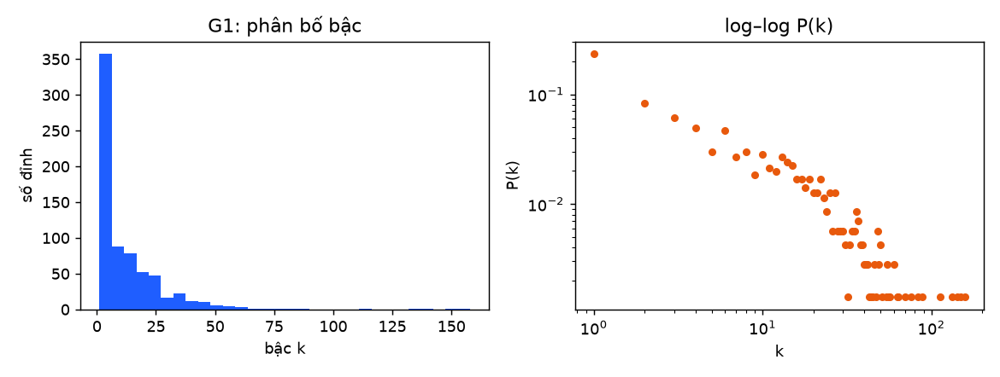
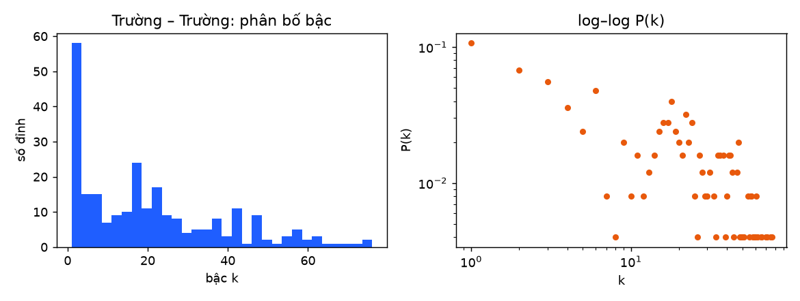
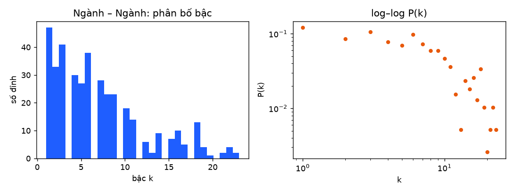

# Báo cáo phân tích mạng: hệ thống trường – ngành tuyển sinh đại học 2024–2026

Đồ án môn Phân tích mạng xã hội — EduRadar V2.

Dữ liệu đầu vào là bảng điểm chuẩn đã làm sạch (71.009 dòng, 292 trường, 2024–2026; xem
[`bao_cao_lam_sach.md`](bao_cao_lam_sach.md)). Chỉ những dòng đã được gán mã ngành chuẩn 7 chữ số
mới được dùng: 18.280 dòng (2024), 23.654 (2025), 27.340 (2026). Toàn bộ mạng và độ đo được
sinh bởi `python -m sna.build` (mã nguồn `sna/build.py`, NetworkX 3.7). Kết quả nằm trong
`data/network/`:
- `summary.csv`: số liệu toàn mạng;
- `metrics/<mạng>_<năm>.csv`: độ đo từng đỉnh;
- `metrics/link_prediction_<năm>.csv`: dự đoán liên kết;
- `gexf/`: file mở bằng Gephi;
- `fig/`: hình.

Mọi con số dưới đây lấy trực tiếp từ các file đó.

## 1. Mô hình hoá

### 1.1. Vì sao chọn bốn mạng

Câu hỏi của đề tài là: *trường nào giống trường nào, ngành nào đi cùng ngành nào, và trường nào
cạnh tranh với trường nào về điểm chuẩn?* Một mạng duy nhất không trả lời được cả ba câu, nên đồ
án xây bốn mạng có vai trò khác nhau:

| Mạng | Đỉnh | Cạnh | Trọng số | Câu hỏi trả lời |
| --- | --- | --- | --- | --- |
| **G1** Trường – Ngành (hai phía) | trường $U$, ngành $M$ | trường $u$ có tuyển ngành $m$ trong năm (theo bất kỳ phương thức nào) | số dòng điểm chuẩn của cặp $(u, m)$ | Cấu trúc gốc: ngành nào phổ biến, trường nào đa ngành |
| **G2** Trường – Trường | trường | hai trường có tập ngành giống nhau, $J \ge 0{,}25$ | hệ số Jaccard $J$ | Nhóm trường cùng "kiểu đào tạo"; ai là cầu nối giữa các nhóm |
| **G3** Ngành – Ngành | ngành | hai ngành thường được cùng các trường mở, $J \ge 0{,}25$ | hệ số Jaccard $J$ | Cụm ngành; ngành tương tự (gợi ý cho thí sinh) |
| **G4** Cạnh tranh (có hướng) | trường | $A \to B$ nếu cùng một ngành, điểm THPT của $B$ cao hơn $A$ trong khoảng $(0;\,2]$ điểm | số ngành mà quan hệ đó xảy ra | Thí sinh ở trường $A$ "nhắm lên" trường nào; mức độ cạnh tranh |

G1 là mạng gốc. G2 và G3 là hai **phép chiếu một phía** của G1 (cách làm chuẩn cho mạng hai
phía). G4 thêm thông tin **điểm số** mà G1–G3 không có, và là mạng có hướng duy nhất, nên là nơi
áp dụng HITS.

### 1.2. Cách chiếu từ G1 sang G2 và G3

Gọi $N(x)$ là tập hàng xóm của $x$ trong G1: với một trường là tập ngành trường đó mở, với một
ngành là tập trường mở ngành đó. Hai đỉnh cùng phía $a, b$ được nối trong mạng chiếu khi

$$J(a,b) = \frac{|N(a) \cap N(b)|}{|N(a) \cup N(b)|} \ge 0{,}25,$$

và trọng số cạnh bằng $J(a,b)$. Jaccard được dùng thay vì đếm số hàng xóm chung, vì đếm thô sẽ
làm các ngành rất phổ biến (Quản trị kinh doanh có ở 157 trường) nối với gần như mọi ngành khác.
Ngưỡng 0,25 loại bỏ các quan hệ yếu. Đỉnh bị cô lập sau khi lọc sẽ bị bỏ.

```
              G1 (hai phía)                         G2: chiếu lên phía trường
  Trường            Ngành
  ┌─────┐                                           J(BKA, QSB) = |{CNTT, Cơ khí}|
  │ BKA │──────┬──── CNTT ────┐                                   / |{CNTT, Cơ khí, Luật}|
  └─────┘      │              │                                 = 2/3 ≥ 0,25  →  BKA ── QSB
               └──── Cơ khí ──┤
  ┌─────┐                     │                     G3: chiếu lên phía ngành
  │ QSB │─────────────────────┘                     J(CNTT, Cơ khí) = |{BKA, QSB}|
  └─────┘──────────── Luật                                          / |{BKA, QSB}| = 1
                                                                    →  CNTT ── Cơ khí
```

*(Sơ đồ minh hoạ cách tính; đây không phải tập ngành thật của hai trường.)*

Code (`jaccard_projection`) chỉ xét những cặp có ít nhất một hàng xóm chung. Nó duyệt từng đỉnh
phía bên kia và lấy mọi cặp hàng xóm của đỉnh đó, nên tránh phải xét toàn bộ $O(n^2)$ cặp.

**G4** dùng điểm THPT thang 30, không cờ lỗi, lấy **điểm cao nhất** của mỗi cặp (ngành, trường).
Với mỗi ngành, xét mọi cặp có thứ tự $(A, B)$: nếu $0 < s_B - s_A \le 2$ thì cộng 1 vào trọng số
cạnh $A \to B$.

## 2. Các độ đo: công thức, cách tính và ý nghĩa

Ký hiệu: $n$ đỉnh, $m$ cạnh, $k_v$ là bậc, $d(u,v)$ là khoảng cách ngắn nhất, $A$ là ma trận kề.
Những gì không ghi "có trọng số" đều tính trên đồ thị không trọng số.

| Độ đo | Công thức | Cách tính trong `sna/build.py` | Ý nghĩa với đề tài tuyển sinh |
| --- | --- | --- | --- |
| Phân bố bậc | $P(k) = n_k / n$ | `g.degree()`; vẽ histogram và log–log (`degree_plot`) | Ở G1: vài ngành "đại trà" có mặt ở hàng trăm trường, còn rất nhiều ngành đặc thù chỉ 1 trường mở |
| Mật độ | $D = \dfrac{2m}{n(n-1)}$; hai phía: $D = \dfrac{m}{\lvert U\rvert\,\lvert M\rvert}$; có hướng: $D = \dfrac{m}{n(n-1)}$ | `nx.density`, `bipartite.density` | Tỉ lệ cặp trường–ngành thực sự có tuyển; mức độ trường "chồng lấn" nhau |
| Độ dài đường đi trung bình | $L = \dfrac{1}{n(n-1)}\sum_{u \ne v} d(u,v)$ | `nx.average_shortest_path_length` trên thành phần liên thông lớn nhất (LCC) | Cần trung bình bao nhiêu bước "giống nhau" để đi từ một trường hoặc ngành tới bất kỳ đỉnh nào khác |
| Đường kính | $\operatorname{diam} = \max_{u,v} d(u,v)$ | `nx.diameter` trên LCC | Hai trường hoặc ngành "khác nhau nhất" trong cùng một thành phần |
| Hệ số phân cụm | $C_v = \dfrac{2T_v}{k_v(k_v-1)}$; trung bình $\bar C$; transitivity $= \dfrac{3 \times \#\text{tam giác}}{\#\text{bộ ba liên thông}}$ | `nx.clustering(weight=None)`, `average_clustering`, `transitivity` | Các trường giống một trường X có giống nhau không, tức nhóm trường hoặc ngành có khép kín không |
| Betweenness | $C_B(v) = \sum_{s \ne v \ne t} \dfrac{\sigma_{st}(v)}{\sigma_{st}}$, chuẩn hoá chia $\tfrac{(n-1)(n-2)}{2}$ | `nx.betweenness_centrality(normalized=True)`; G1 dùng `bipartite.betweenness_centrality` | Trường hoặc ngành **cầu nối** giữa các nhóm khác nhau |
| Closeness | $C_C(v) = \dfrac{r-1}{n-1} \cdot \dfrac{r-1}{\sum_{u} d(v,u)}$, với $r$ là số đỉnh tới được (Wasserman–Faust) | `nx.closeness_centrality` (mặc định `wf_improved=True`) | Đỉnh ở "trung tâm hình học" của mạng, gần mọi đỉnh khác |
| Eigenvector | $x_v = \dfrac{1}{\lambda}\sum_u A_{uv} x_u$ ($\lambda$ là trị riêng lớn nhất) | `nx.eigenvector_centrality_numpy(weight="weight")`, chỉ tính trên LCC | Quan trọng vì nối với các đỉnh cũng quan trọng |
| PageRank | $PR(v) = \dfrac{1-\alpha}{n} + \alpha \sum_{u \to v} \dfrac{w_{uv}}{s_u} PR(u)$, $\alpha = 0{,}85$ | `nx.pagerank(weight="weight")`; G2/G3 vô hướng nên mỗi cạnh tính hai chiều | G4: dòng thí sinh "nhắm lên" lan truyền và dồn về đâu; G2/G3: gần giống bậc có trọng số |
| HITS | $\mathbf{a} = A^\top \mathbf{h}$, $\mathbf{h} = A\,\mathbf{a}$, lặp và chuẩn hoá đến hội tụ | `nx.hits(max_iter=1000, normalized=True)` trên G4, **có** dùng trọng số cạnh | G4: *authority* là trường được nhiều trường "nhắm tới", *hub* là trường có thí sinh "nhắm lên" nhiều trường |
| Modularity | $Q = \dfrac{1}{2m}\sum_{ij}\Big(A_{ij} - \dfrac{k_i k_j}{2m}\Big)\delta(c_i, c_j)$ | `community.louvain_communities(weight="weight", seed=42)` và `community.modularity` | Mạng có tách thành các nhóm trường hoặc cụm ngành rõ rệt không |

Ngoài ra còn dùng hệ số đồng phối bậc (`degree_assortativity_coefficient`): các đỉnh bậc cao có
nối với nhau không. Hệ số Spearman và Adamic–Adar được trình bày ở mục 5.

## 3. Số liệu toàn mạng theo năm

| Mạng | Độ đo | 2024 | 2025 | 2026 |
| --- | --- | ---: | ---: | ---: |
| **G1** | số trường / số ngành | 279 / 428 | 278 / 434 | 276 / 429 |
| | số cạnh | 4.447 | 4.680 | 5.058 |
| | mật độ hai phía | 0,0372 | 0,0388 | 0,0427 |
| | số ngành trung bình mỗi trường | 15,94 | 16,83 | 18,33 |
| | số trường trung bình mỗi ngành | 10,39 | 10,78 | 11,79 |
| | số thành phần liên thông | 15 | 12 | 14 |
| **G2** | số đỉnh / số cạnh | 251 / 2.566 | 250 / 2.455 | 249 / 2.531 |
| | mật độ | 0,0818 | 0,0789 | 0,0820 |
| | bậc trung bình | 20,45 | 19,64 | 20,33 |
| | thành phần / đỉnh trong LCC | 12 / 219 | 9 / 229 | 8 / 231 |
| | độ dài đường đi TB (LCC) | 2,77 | 3,40 | 3,25 |
| | đường kính (LCC) | 8 | 13 | 12 |
| | clustering TB / transitivity | 0,553 / 0,529 | 0,554 / 0,550 | 0,549 / 0,544 |
| | assortativity | 0,376 | 0,425 | 0,393 |
| | số cộng đồng Louvain / modularity | 19 / 0,451 | 19 / 0,494 | 20 / 0,482 |
| **G3** | số đỉnh / số cạnh | 387 / 1.360 | 387 / 1.431 | 377 / 1.412 |
| | mật độ | 0,0182 | 0,0192 | 0,0199 |
| | bậc trung bình | 7,03 | 7,40 | 7,49 |
| | thành phần / đỉnh trong LCC | 13 / 358 | 12 / 361 | 7 / 364 |
| | độ dài đường đi TB (LCC) | 5,72 | 5,62 | 5,66 |
| | đường kính (LCC) | 17 | 14 | 14 |
| | clustering TB / transitivity | 0,529 / 0,642 | 0,570 / 0,663 | 0,518 / 0,665 |
| | assortativity | 0,612 | 0,594 | 0,653 |
| | số cộng đồng Louvain / modularity | 28 / 0,839 | 27 / 0,846 | 19 / 0,836 |
| **G4** | số đỉnh / số cạnh | 259 / 10.541 | 260 / 10.789 | 226 / 9.215 |
| | mật độ | 0,158 | 0,160 | 0,181 |
| | thành phần liên thông yếu / mạnh | 2 / 17 | 3 / 13 | 2 / 35 |
| | tính tương hỗ (reciprocity) | 0,342 | 0,345 | 0,338 |
| | Spearman(authority, điểm TB) | **−0,401** | **−0,414** | **0,234** |
| | Spearman(PageRank, điểm TB) | 0,567 | 0,535 | 0,607 |

**Phân bố bậc.**
- **G1 2026, phía ngành:** trung vị chỉ 4 trường/ngành nhưng lớn nhất là 157; 26% số ngành (113) chỉ một trường mở; 10% ngành phổ biến nhất chiếm 49,2% số cạnh.
- **G1 2026, phía trường:** trung vị 15 ngành/trường, lớn nhất 97 (ĐH Cần Thơ).
- **Hình dạng:** đồ thị log–log (hình 1) giảm gần tuyến tính, tức phân bố đuôi dài kiểu "giàu càng giàu". Một số ít ngành đại trà chiếm phần lớn liên kết.
- **G2 và G3:** lệch phải vừa phải (độ lệch khoảng 1,0); bậc lớn nhất là 72 (G2) và 25 (G3).

**Thế giới nhỏ và phân cụm.**
- **G2:** đường đi trung bình chỉ khoảng 3 bước, clustering khoảng 0,55, cao hơn nhiều so với mật độ 0,08 (mức clustering kỳ vọng của đồ thị ngẫu nhiên cùng mật độ). Đây là đặc trưng thế giới nhỏ.
- **G3:** thưa hơn (mật độ 0,02) nhưng transitivity 0,66 và modularity khoảng 0,84. Ngành tách thành các cụm lĩnh vực rất rõ.
- **Assortativity dương ở cả hai mạng:** trường đa ngành nối với trường đa ngành, ngành đại trà nối với ngành đại trà.

## 4. Top 10 theo từng độ đo (năm 2026)

Tên trường lấy từ bảng `universities`; "ĐH" là viết tắt của "(Trường) Đại học", "HV" của "Học viện".
Bảng đầy đủ cho cả 3 năm nằm trong `data/network/metrics/`.

### 4.1. G1 — Trường – Ngành

| # | Trường: bậc (số ngành) | Trường: betweenness | Ngành: bậc (số trường) | Ngành: betweenness |
| ---: | --- | --- | --- | --- |
| 1 | ĐH Cần Thơ (TCT) — 97 | ĐH Cần Thơ (TCT) — 0,0450 | Quản trị kinh doanh — 157 | Công nghệ thông tin — 0,0964 |
| 2 | ĐH Phenikaa (PKA) — 66 | ĐH Mỏ Địa Chất (MDA) — 0,0425 | Công nghệ thông tin — 154 | Quản trị kinh doanh — 0,0784 |
| 3 | ĐH Văn Lang (DVL) — 64 | ĐH Văn Lang (DVL) — 0,0395 | Kế toán — 137 | Ngôn ngữ Anh — 0,0782 |
| 4 | ĐH Vinh (TDV) — 64 | ĐH Trà Vinh (DVT) — 0,0246 | Ngôn ngữ Anh — 136 | Kế toán — 0,0492 |
| 5 | ĐH Duy Tân (DDT) — 62 | ĐH Công nghệ Kỹ thuật TP HCM (SPK) — 0,0243 | Tài chính – Ngân hàng — 114 | Tài chính – Ngân hàng — 0,0306 |
| 6 | ĐH Đông Á (DAD) — 61 | ĐH Đông Á (DAD) — 0,0228 | Quản trị dịch vụ du lịch và lữ hành — 81 | Luật — 0,0249 |
| 7 | ĐH Công Nghệ TPHCM (DKC) — 60 | ĐH KHXH&NV TPHCM (QSX) — 0,0227 | Ngôn ngữ Trung Quốc — 80 | Quản trị dịch vụ du lịch và lữ hành — 0,0248 |
| 8 | ĐH Đồng Tháp (SPD) — 58 | ĐH Nguyễn Tất Thành (NTT) — 0,0225 | Luật — 79 | Ngôn ngữ Trung Quốc — 0,0227 |
| 9 | ĐH Nguyễn Tất Thành (NTT) — 57 | ĐH Phenikaa (PKA) — 0,0216 | Marketing — 77 | Điều dưỡng — 0,0161 |
| 10 | ĐH Quy Nhơn (DQN) — 52 | ĐH Công Nghệ TPHCM (DKC) — 0,0213 | Logistics và quản lý chuỗi cung ứng — 76 | Marketing — 0,0159 |

**Diễn giải:**
- **Trường đa ngành:** đứng đầu là các đại học vùng lớn (Cần Thơ, Vinh, Quy Nhơn, Đồng Tháp) và các trường tư đa ngành (Văn Lang, Duy Tân, Đông Á, Nguyễn Tất Thành).
- **Betweenness phía trường:** ĐH Mỏ – Địa chất xếp thứ 2 dù chỉ mở ít ngành hơn. Lý do là trường này độc quyền nhiều ngành địa chất – mỏ, nên là con đường duy nhất nối các ngành đó với phần còn lại của mạng.
- **Phía ngành:** 5 ngành kinh tế – CNTT – ngoại ngữ đứng đầu cả bậc lẫn betweenness. Đây là "xương sống" nối hầu hết các loại trường. Điều dưỡng vào top betweenness vì nối khối y dược với khối đa ngành.

### 4.2. G2 — Trường – Trường

| # | Bậc | Betweenness | Closeness |
| ---: | --- | --- | --- |
| 1 | ĐH Ngoại Ngữ Tin Học TPHCM (DNT) — 72 | ĐH Võ Trường Toản (VTT) — 0,0946 | ĐH Công Nghệ và Quản Lý Hữu Nghị (DCQ) — 0,4309 |
| 2 | ĐH Kinh Tế TPHCM – Phân hiệu Vĩnh Long (KSV) — 70 | ĐH Hải Phòng (THP) — 0,0686 | ĐH Ngoại Ngữ Tin Học TPHCM (DNT) — 0,4309 |
| 3 | ĐH Công Nghệ và Quản Lý Hữu Nghị (DCQ) — 67 | ĐH Quốc Tế Hồng Bàng (HIU) — 0,0618 | ĐH Hùng Vương TPHCM (DHV) — 0,4241 |
| 4 | ĐH Hùng Vương TPHCM (DHV) — 66 | ĐH Hà Tĩnh (HHT) — 0,0539 | ĐH Kinh Tế Kỹ Thuật Bình Dương (DKB) — 0,4241 |
| 5 | ĐH Kinh Tế Kỹ Thuật Bình Dương (DKB) — 66 | ĐH Kiến Trúc Đà Nẵng (KTD) — 0,0478 | ĐH Bà Rịa – Vũng Tàu (BVU) — 0,4150 |
| 6 | ĐH Ngân Hàng TPHCM (NHS) — 66 | ĐH Kiến Trúc Hà Nội (KTA) — 0,0440 | ĐH Kinh Tế Công Nghiệp Long An (DLA) — 0,4126 |
| 7 | ĐH Bà Rịa – Vũng Tàu (BVU) — 65 | ĐH Nghệ An (CEA) — 0,0428 | ĐH Lạc Hồng (DLH) — 0,4086 |
| 8 | ĐH Lạc Hồng (DLH) — 65 | ĐH Công nghiệp Vinh (DCV) — 0,0408 | ĐH Sao Đỏ (SDU) — 0,4086 |
| 9 | ĐH Đại Nam (DDN) — 64 | ĐH Thông tin Liên lạc – hệ dân sự (TCU) — 0,0384 | ĐH Trưng Vương (DVP) — 0,4078 |
| 10 | HV Ngân Hàng (NHH) — 60 | ĐH Luật TPHCM (LPS) — 0,0373 | ĐH Đại Nam (DDN) — 0,4048 |

| # | Eigenvector | PageRank | Clustering (chỉ xét bậc ≥ 5) |
| ---: | --- | --- | --- |
| 1 | ĐH Ngoại Ngữ Tin Học TPHCM (DNT) — 0,2023 | ĐH Ngoại Ngữ Tin Học TPHCM (DNT) — 0,0103 | Khoa Giáo Dục Thể Chất Huế (DHC) — 1 |
| 2 | ĐH Ngân Hàng TPHCM (NHS) — 0,1885 | ĐH Kinh Tế TPHCM – PH Vĩnh Long (KSV) — 0,0096 | ĐH Sư Phạm TDTT TPHCM (STS) — 1 |
| 3 | ĐH Gia Định (GDU) — 0,1769 | ĐH Ngân Hàng TPHCM (NHS) — 0,0095 | ĐH TDTT Bắc Ninh (TDB) — 1 |
| 4 | ĐH Bà Rịa – Vũng Tàu (BVU) — 0,1764 | ĐH Công Nghệ và Quản Lý Hữu Nghị (DCQ) — 0,0091 | ĐH Sư Phạm TDTT Hà Nội (TDH) — 1 |
| 5 | ĐH Đại Nam (DDN) — 0,1757 | ĐH Kinh Tế Kỹ Thuật Bình Dương (DKB) — 0,0090 | ĐH TDTT TPHCM (TDS) — 1 |
| 6 | ĐH Hùng Vương TPHCM (DHV) — 0,1753 | ĐH Hùng Vương TPHCM (DHV) — 0,0089 | ĐH TDTT Đà Nẵng (TTD) — 1 |
| 7 | ĐH Kinh Tế Kỹ Thuật Bình Dương (DKB) — 0,1741 | ĐH Lạc Hồng (DLH) — 0,0088 | ĐH Kỹ Thuật Y Tế Hải Dương (DKY) — 0,958 |
| 8 | ĐH Công Nghệ và Quản Lý Hữu Nghị (DCQ) — 0,1668 | ĐH Bà Rịa – Vũng Tàu (BVU) — 0,0087 | ĐH Y Dược Thái Nguyên (DTY) — 0,958 |
| 9 | ĐH Kinh Tế TPHCM – PH Vĩnh Long (KSV) — 0,1661 | ĐH Đại Nam (DDN) — 0,0087 | ĐH Y Tế Công Cộng (YTC) — 0,933 |
| 10 | ĐH Lạc Hồng (DLH) — 0,1636 | HV Ngân Hàng (NHH) — 0,0085 | ĐH Y khoa Tokyo Việt Nam (THU) — 0,894 |

**Diễn giải:**
- **Bậc, closeness, eigenvector, PageRank:** gần như cùng một nhóm, là các trường tư hoặc trường kinh tế đa ngành phía Nam có danh mục ngành "phổ thông" (kinh tế, CNTT, ngoại ngữ). Các trường này giống rất nhiều trường khác nên nằm ở lõi dày đặc của G2.
- **Betweenness lại đo một thứ khác:** top betweenness gần như không trùng với top bậc. Đứng đầu là các trường có danh mục ngành trải trên nhiều khối, nên giống một phần với nhiều cộng đồng khác nhau:
  - Võ Trường Toản nằm trong cộng đồng công nghiệp – kỹ thuật;
  - Hải Phòng và Hà Tĩnh trong cộng đồng đại học địa phương;
  - Kiến trúc Đà Nẵng, Kiến trúc Hà Nội nối khối kiến trúc – xây dựng với phần còn lại;
  - Luật TPHCM, Thông tin Liên lạc nối các trường chuyên ngành hẹp vào mạng.
- **Clustering = 1:** rơi vào các nhóm trường chuyên biệt khép kín, như 6 trường thể dục thể thao chỉ giống nhau, hay các trường y dược. Tôi chỉ xét bậc ≥ 5, vì với bậc 2–4 thì clustering = 1 gần như là điều hiển nhiên.

**Cộng đồng Louvain lớn nhất (G2 2026)** cho thấy các nhóm trường có ý nghĩa thực tế:

| Cộng đồng | Số trường | Trường tiêu biểu (bậc cao nhất) | Nhận xét |
| ---: | ---: | --- | --- |
| 0 | 59 | DNT, DCQ, DHV, DKB, BVU, DLH | trường tư đa ngành, chủ yếu phía Nam |
| 1 | 33 | ĐH Hải Phòng, Hà Tĩnh, Hùng Vương, Hải Dương, Quảng Bình, Tây Bắc | đại học địa phương (sư phạm + đa ngành) |
| 2 | 31 | KSV, ĐH Ngân Hàng TPHCM, HV Ngân Hàng, Thương Mại, Tài Chính Ngân Hàng HN | khối kinh tế – tài chính – ngân hàng |
| 3 | 25 | Công Nghiệp Việt Trì, Kinh tế công nghệ Thái Nguyên, Kinh Tế Kỹ Thuật Công Nghiệp, Công Nghiệp Quảng Ninh | khối công nghiệp – kỹ thuật |
| 4 | 24 | Y Dược ĐHQGHN, Y Dược Huế, Khoa học sức khỏe TPHCM, Y khoa Phạm Ngọc Thạch | khối y dược |

### 4.3. G3 — Ngành – Ngành

| # | Bậc | Betweenness | Closeness |
| ---: | --- | --- | --- |
| 1 | Sư phạm Địa lý — 25 | Sinh học — 0,1624 | Sinh học — 0,2363 |
| 2 | Logistics và quản lý chuỗi cung ứng — 23 | Kỹ thuật vật liệu — 0,0780 | Hải dương học — 0,2246 |
| 3 | Giáo dục Chính trị — 23 | Địa lý học — 0,0775 | Lịch sử — 0,2208 |
| 4 | Tài chính – Ngân hàng — 22 | Khoa học đất — 0,0746 | Nông học — 0,2193 |
| 5 | Quản trị khách sạn — 22 | Vật lý y khoa — 0,0689 | Toán tin — 0,2190 |
| 6 | Giáo dục Công dân — 22 | Hán Nôm — 0,0664 | Khoa học đất — 0,2186 |
| 7 | Truyền thông đa phương tiện — 21 | Kỹ thuật xây dựng — 0,0660 | Hán Nôm — 0,2155 |
| 8 | Sư phạm Lịch sử – Địa lý — 21 | Ngôn ngữ Đức — 0,0649 | Địa lý học — 0,2150 |
| 9 | Kỹ thuật trắc địa – bản đồ — 21 | Ngôn ngữ Pháp — 0,0602 | Hóa dược — 0,2106 |
| 10 | Công nghệ thông tin — 20 | Hải dương học — 0,0596 | Kỹ thuật trắc địa – bản đồ — 0,2106 |

| # | Eigenvector | PageRank | Clustering (chỉ xét bậc ≥ 5) |
| ---: | --- | --- | --- |
| 1 | Quản lý và phân tích dữ liệu khoa học — 0,2965 | Tài chính – Ngân hàng — 0,0054 | Kỹ thuật điện tử – viễn thông — 1 |
| 2 | Địa tin học — 0,2965 | Logistics và quản lý chuỗi cung ứng — 0,0052 | Biến đổi khí hậu và phát triển bền vững — 1 |
| 3 | Kỹ thuật địa vật lý — 0,2965 | Sư phạm Địa lý — 0,0050 | Quản lý biển — 1 |
| 4 | Đá quý Đá mỹ nghệ — 0,2965 | Toán kinh tế — 0,0050 | Kỹ thuật không gian — 1 |
| 5 | Kỹ thuật khí thiên nhiên — 0,2965 | Kế toán — 0,0050 | Ngôn ngữ Bồ Đào Nha — 1 |
| 6 | Công nghệ số trong thăm dò và khai thác tài nguyên thiên nhiên — 0,2965 | Ngôn ngữ Anh — 0,0047 | Nghiên cứu phát triển — 1 |
| 7 | Xây dựng công trình ngầm thành phố và Hệ thống tàu điện ngầm — 0,2965 | Quản trị kinh doanh — 0,0047 | Chỉ huy âm nhạc — 1 |
| 8 | Du lịch địa chất — 0,2965 | Quản trị khách sạn — 0,0046 | Thanh nhạc — 1 |
| 9 | Quản lý tài nguyên khoáng sản — 0,2965 | Công nghệ thông tin — 0,0046 | Năng lượng tái tạo — 1 |
| 10 | An toàn, Vệ sinh lao động — 0,2965 | Sư phạm Ngữ văn — 0,0046 | Giáo dục Mầm non — 0,971 |

**Diễn giải:**
- **Bậc cao ở G3** không phải là "ngành phổ biến" như ở G1. Đó là ngành có tập trường *giống* tập trường của nhiều ngành khác (Jaccard ≥ 0,25), ví dụ các ngành sư phạm cùng được các trường sư phạm mở.
- **Sinh học có betweenness và closeness cao nhất:** ngành này có ở cả trường khoa học tự nhiên, sư phạm và nông – y, nên là cầu nối giữa các cụm. Kỹ thuật vật liệu, Địa lý học, Khoa học đất, Hán Nôm, Ngôn ngữ Đức/Pháp cũng đóng vai trò nối các khối.
- **Eigenvector là một hiệu ứng cấu trúc, không phải "độ quan trọng":** 10 ngành đứng đầu cùng giá trị 0,2965 là đúng 10 ngành **chỉ do ĐH Mỏ – Địa chất (MDA) mở**. Với nhau chúng có Jaccard = 1 và tạo thành một clique đầy đủ 10 đỉnh. Mỗi ngành còn nối thêm 8 ngành MDA khác mà rất ít trường mở (Kỹ thuật mỏ, Địa chất học…), nên có bậc 17. Cụm dày đặc có trọng số tối đa này chiếm véc-tơ riêng chính của LCC.
- **PageRank** tương đối đồng đều; đứng đầu vẫn là khối kinh tế – kinh doanh.

**Cộng đồng Louvain lớn nhất (G3 2026)** tương ứng gần đúng với các khối ngành:

| Cộng đồng | Số ngành | Ngành tiêu biểu | Khối |
| ---: | ---: | --- | --- |
| 0 | 50 | Công nghệ chế biến thủy sản, Phát triển nông thôn, Quản lý thủy sản, Lâm nghiệp | nông – lâm – thủy sản |
| 1 | 48 | Logistics, Tài chính – Ngân hàng, Quản trị khách sạn, CNTT, Ngôn ngữ Anh | kinh tế – dịch vụ – CNTT |
| 2 | 38 | Quản lý thông tin, Hán Nôm, Ngôn ngữ Đức, Lưu trữ học, Tôn giáo học, Nhân học | khoa học xã hội – nhân văn |
| 3 | 34 | Sinh học, Vật lý y khoa, Hải dương học, Toán tin | khoa học tự nhiên |
| 4 | 33 | Sư phạm Địa lý, Giáo dục Chính trị, Giáo dục Công dân, Sư phạm Ngữ văn | sư phạm |

### 4.4. G4 — Mạng cạnh tranh

| # | Authority | Hub | PageRank |
| ---: | --- | --- | --- |
| 1 | ĐH Kiến Trúc Đà Nẵng (KTD) — 0,0336 | ĐH Vinh (TDV) — 0,0141 | ĐH Cần Thơ (TCT) — 0,0243 |
| 2 | ĐH Công Đoàn (LDA) — 0,0252 | ĐH Công Nghệ TPHCM (DKC) — 0,0140 | ĐH Kinh Tế Quốc Dân (KHA) — 0,0212 |
| 3 | ĐH Sư Phạm Kỹ Thuật Hưng Yên (SKH) — 0,0236 | ĐH Đồng Tháp (SPD) — 0,0140 | ĐH Nha Trang (TSN) — 0,0165 |
| 4 | ĐH Công Nghiệp Việt – Hung (VHD) — 0,0227 | ĐH Nguyễn Tất Thành (NTT) — 0,0138 | ĐH Mở TPHCM (MBS) — 0,0160 |
| 5 | ĐH Nghệ An (CEA) — 0,0209 | ĐH Đông Á (DAD) — 0,0137 | ĐH Sài Gòn (SGD) — 0,0158 |
| 6 | ĐH Hồng Đức (HDT) — 0,0199 | ĐH Nam Cần Thơ (DNC) — 0,0132 | ĐH Sư Phạm Hà Nội (SPH) — 0,0155 |
| 7 | ĐH Vinh (TDV) — 0,0192 | ĐH Duy Tân (DDT) — 0,0132 | ĐH Phenikaa (PKA) — 0,0139 |
| 8 | ĐH Nông Lâm Thái Nguyên (DTN) — 0,0188 | ĐH Quy Nhơn (DQN) — 0,0131 | ĐH Bách Khoa Hà Nội (BKA) — 0,0137 |
| 9 | ĐH Cần Thơ (TCT) — 0,0180 | ĐH Văn Lang (DVL) — 0,0128 | ĐH Giao Thông Vận Tải (GHA) — 0,0137 |
| 10 | ĐH Quy Nhơn (DQN) — 0,0179 | ĐH Văn Hiến (DVH) — 0,0124 | ĐH Thủ Đô Hà Nội (HNM) — 0,0133 |

| # | In-strength (Σ trọng số vào) | In-degree | Out-degree |
| ---: | --- | --- | --- |
| 1 | ĐH Kiến Trúc Đà Nẵng (KTD) — 554 | ĐH Công Đoàn (LDA) — 128 | ĐH Vinh (TDV) — 100 |
| 2 | ĐH Công Đoàn (LDA) — 418 | ĐH Thăng Long (DTL) — 126 | ĐH Đồng Tháp (SPD) — 97 |
| 3 | ĐH Sư Phạm Kỹ Thuật Hưng Yên (SKH) — 405 | HV Nông Nghiệp Việt Nam (HVN) — 124 | ĐH Cần Thơ (TCT) — 96 |
| 4 | ĐH Cần Thơ (TCT) — 402 | ĐH Quy Nhơn (DQN) — 122 | ĐH Thủ Dầu Một (TDM) — 94 |
| 5 | ĐH Công Nghiệp Việt – Hung (VHD) — 366 | ĐH Đồng Tháp (SPD) — 121 | ĐH Quy Nhơn (DQN) — 92 |
| 6 | ĐH Nghệ An (CEA) — 355 | ĐH Vinh (TDV) — 121 | ĐH Văn Lang (DVL) — 92 |
| 7 | ĐH Hồng Đức (HDT) — 353 | ĐH Hải Phòng (THP) — 120 | ĐH Phenikaa (PKA) — 87 |
| 8 | ĐH Vinh (TDV) — 352 | ĐH Hồng Đức (HDT) — 118 | ĐH Hải Phòng (THP) — 86 |
| 9 | ĐH Quy Nhơn (DQN) — 322 | ĐH Thủ Dầu Một (TDM) — 117 | ĐH Hùng Vương (THV) — 82 |
| 10 | ĐH Nông Lâm Thái Nguyên (DTN) — 304 | ĐH Công Nghiệp TPHCM (IUH) — 115 | ĐH Tây Nguyên (TTN) — 81 |

**Diễn giải:**
- **Authority gần như trùng với in-strength** (Spearman 0,98 năm 2026): trường được "nhắm tới" từ nhiều ngành, nhiều trường. Đứng đầu là các trường nhiều ngành có điểm chuẩn ở vùng trung bình, nơi tập trung đông đối thủ.
- **Hub** là các đại học vùng và trường tư lớn. Thí sinh ở các trường này có nhiều lựa chọn "cao hơn một chút" ở cùng ngành.
- **PageRank** lan truyền theo chuỗi $A \to B \to C \dots$ đi lên phía điểm cao, nên dồn về các trường có điểm cao và nhiều ngành: Kinh tế Quốc dân, Bách khoa Hà Nội, Sư phạm Hà Nội, Giao thông vận tải.
- **Năm 2024**, top 5 PageRank là ĐH Y Dược TPHCM, ĐH Y Hà Nội, ĐH Tôn Đức Thắng, ĐH Ngoại thương, ĐH Sư phạm Hà Nội, tức đúng nhóm trường "đích đến" mà thí sinh điểm cao hướng tới.

## 5. Thuật toán

### 5.1. Louvain so với Girvan–Newman

- **Louvain** tối ưu modularity theo kiểu tham lam, nhiều tầng, độ phức tạp gần $O(m \log n)$. Code chạy trên toàn bộ G2, G3 (có trọng số, `seed=42`).
- **Girvan–Newman** lần lượt xoá cạnh có edge-betweenness lớn nhất (không trọng số), mỗi lần xoá phải tính lại betweenness ($O(m^2 n)$). Vì quá chậm trên toàn mạng, code chỉ chạy trên đồ thị con gồm **60 đỉnh bậc cao nhất**, duyệt 10 lần tách đầu tiên (2 đến 11 cộng đồng), và giữ phân hoạch có $Q$ lớn nhất. Louvain được chạy lại trên cùng đồ thị con đó để so sánh. Đồ thị con giữ trọng số Jaccard, và $Q$ của cả hai thuật toán đều tính có trọng số.

| Mạng | Năm | Louvain toàn mạng: số cộng đồng / $Q$ | Mẫu 60 đỉnh — GN: $Q$ (số cộng đồng) / thời gian | Mẫu 60 đỉnh — Louvain: $Q$ / thời gian |
| --- | --- | --- | --- | --- |
| G2 | 2024 | 19 / 0,451 | 0,0109 (9) / 6,63 s | 0,1451 / 0,015 s |
| G2 | 2025 | 19 / 0,494 | 0,0042 (11) / 6,32 s | 0,1591 / 0,013 s |
| G2 | 2026 | 20 / 0,482 | 0,0019 (11) / 6,36 s | 0,1503 / 0,011 s |
| G3 | 2024 | 28 / 0,839 | 0,6384 (7) / 0,37 s | 0,6384 / < 0,001 s |
| G3 | 2025 | 27 / 0,846 | 0,6323 (6) / 0,38 s | 0,6337 / 0,006 s |
| G3 | 2026 | 19 / 0,836 | 0,6598 (6) / 0,62 s | 0,6662 / 0,019 s |

**Nhận xét:**
- **Trên G3** (mẫu thưa, cụm rõ), hai thuật toán cho $Q$ gần như bằng nhau, nhưng Louvain nhanh hơn từ khoảng 30 lần trở lên.
- **Trên G2**, 60 trường bậc cao nhất là lõi gần như đầy đủ (các trường tư đa ngành giống nhau). Girvan–Newman sau 10 lần tách chỉ bóc được vài đỉnh lẻ khỏi lõi, nên $Q \approx 0$. Louvain vẫn tìm được $Q \approx 0{,}15$ và nhanh hơn khoảng 450–600 lần.
- **Kết luận:** Louvain phù hợp cho mạng cỡ vài trăm đỉnh trở lên. Girvan–Newman chỉ dùng được trên mẫu nhỏ, và kém khi mạng có lõi dày đặc.

### 5.2. HITS và PageRank trên G4, tương quan với điểm chuẩn

Code tính Spearman giữa authority (hoặc PageRank) của mỗi trường và **điểm THPT trung bình** của
trường đó (thang 30), dưới dạng tương quan Pearson trên thứ hạng:
$\rho = \operatorname{corr}\big(\operatorname{rank}(x), \operatorname{rank}(y)\big)$.

| Năm | $\rho$(authority, điểm TB) | $\rho$(PageRank, điểm TB) |
| --- | ---: | ---: |
| 2024 | −0,401 | 0,567 |
| 2025 | −0,414 | 0,535 |
| 2026 | 0,234 | 0,607 |

PageRank tương quan dương ổn định với điểm chuẩn: được nhiều trường "nhắm lên", và được các trường
cũng được nhắm lên trỏ tới, đúng là dấu hiệu của trường điểm cao. Authority thì **âm** trong
2024–2025. Bảng dưới (tính từ `metrics/g4_competition_<năm>.csv`, nhóm trường theo điểm THPT
trung bình) cho thấy cơ chế:

| Nhóm điểm TB | 2024: số trường / authority TB | 2025: số trường / authority TB | 2026: số trường / authority TB |
| --- | ---: | ---: | ---: |
| ≤ 17 | 71 / 0,0065 | 76 / 0,0068 | 69 / 0,0031 |
| 17–19 | 35 / 0,0084 | 24 / 0,0054 | 28 / 0,0077 |
| 19–21 | 39 / 0,0032 | 51 / 0,0036 | 50 / 0,0065 |
| 21–23 | 34 / 0,0017 | 53 / 0,0020 | 38 / 0,0036 |
| 23–25 | 41 / 0,0007 | 29 / 0,0008 | 26 / 0,0030 |
| > 25 | 39 / 0,0008 | 27 / 0,0014 | 15 / 0,0019 |

Giải thích (rút ra từ số liệu trên):

1. **Cạnh dồn về vùng điểm thấp.** Năm 2024, 1.389 trong 4.287 cặp (ngành, trường) có điểm ≤ 16,
   riêng mức 15 điểm có 885 cặp. Quan hệ "$B$ cao hơn $A$ trong vòng 2 điểm" vì vậy xảy ra dày
   đặc nhất trong dải 15–19 điểm, nơi có rất nhiều trường ở rất nhiều ngành. Vùng điểm cao (> 25)
   thưa hơn nhiều, nên mỗi trường top nhận ít cạnh vào.
2. **HITS khuếch đại lõi dày nhất.** Véc-tơ authority là véc-tơ riêng chính của $A^\top A$, nên tập
   trung vào khối hub–authority dày đặc nhất (hiệu ứng *tightly-knit community* của HITS). Ở G4 đó
   là khối trường điểm thấp – trung bình nhiều ngành:
   - authority tương quan mạnh với in-strength (Spearman 0,82 năm 2024, 0,87 năm 2025) và với số ngành THPT của trường (0,59; 0,62);
   - hub tương quan âm mạnh với điểm (−0,77; −0,70).
   Kết quả là trường điểm thấp – trung bình có authority cao, trường điểm cao có authority thấp,
   nên $\rho < 0$.
3. **Năm 2026 đảo dấu** do hai thay đổi đồng thời:
   - **Số cặp đúng 15 điểm tăng lên 1.431 trên 4.455.** Trường ở đúng điểm sàn gần như không thể nhận cạnh vào (cần trường khác *thấp hơn* ở cùng ngành), nên authority TB của nhóm ≤ 17 giảm còn 0,0031 và đỉnh authority dịch lên nhóm 17–21.
   - **Nhóm > 25 chỉ còn 15 trường.** Năm 2026 chỉ có 238 trường có điểm THPT trong dữ liệu, so với 279 năm 2024.

   Hai thay đổi này làm $\rho$ thành +0,23. Như vậy authority của G4 đo "mức bị cạnh tranh trực
   tiếp", không phải "uy tín". Để xếp hạng uy tín, PageRank là độ đo phù hợp hơn.

### 5.3. Adamic–Adar: gợi ý ngành tương tự

Với hai ngành chưa nối nhau trong G3,

$$AA(x, y) = \sum_{z \in N(x) \cap N(y)} \frac{1}{\log |N(z)|}.$$

Hàng xóm chung càng "hiếm" (bậc thấp) thì càng đóng góp nhiều. Code gọi `nx.adamic_adar_index(g)`
trên **mọi cặp chưa có cạnh** của G3 và lưu 300 cặp điểm cao nhất vào
`metrics/link_prediction_<năm>.csv`.

| # | Ngành A | Ngành B | Adamic–Adar (2026) |
| ---: | --- | --- | ---: |
| 1 | Văn học | Giáo dục Chính trị | 5,0762 |
| 2 | Sư phạm Tiếng Anh | Giáo dục Công dân | 5,0363 |
| 3 | Kinh doanh quốc tế | Quản trị dịch vụ du lịch và lữ hành | 5,0023 |
| 4 | Việt Nam học | Tâm lý học giáo dục | 4,8374 |
| 5 | Văn học | Tâm lý học giáo dục | 4,7365 |
| 6 | Việt Nam học | Giáo dục Mầm non | 4,6962 |
| 7 | Việt Nam học | Giáo dục Thể chất | 4,6962 |
| 8 | Kế toán | Truyền thông đa phương tiện | 4,6943 |
| 9 | Công nghệ tài chính | Công nghệ thông tin | 4,6943 |
| 10 | Kỹ thuật Dầu khí (Khoan – Khai thác Mỏ Dầu khí) | Kỹ thuật trắc địa – bản đồ | 4,4406 |

Các cặp này là những ngành **thường được cùng loại trường mở**, chưa chắc là ngành giống nhau về
nội dung đào tạo:
- Cặp 1, 2, 4–7 đều nằm trong cụm trường sư phạm.
- Cặp 3 và 8 nằm trong cụm trường kinh tế – dịch vụ.
- Cặp 9 (Công nghệ tài chính – CNTT) và cặp 10 (Dầu khí – Trắc địa) gần với nghĩa "ngành tương tự" hơn.

**Kiểm chứng theo thời gian.** Lấy 300 cặp dự đoán của năm 2024 và đối chiếu với các cạnh *thật*
của G3 năm 2026. Kết quả: top 10 có 8 cặp đã thành cạnh, top 100 có 30, top 300 có **69 (23,0%)**.
Trong khi đó, trong 56.090 cặp chưa nối năm 2024 (giữa các ngành có mặt ở cả hai năm), chỉ 294 cặp
thành cạnh năm 2026 (**0,52%**). Như vậy Adamic–Adar cao hơn chọn ngẫu nhiên khoảng **44 lần**.
(File dự đoán chỉ lưu tên ngành; 9/300 cặp có tên trùng nhiều mã và được tính là đúng nếu một cặp
mã bất kỳ khớp, nên con số có thể hơi lạc quan.)

Trên web, mục "Ngành tương tự" dùng **các hàng xóm có Jaccard cao nhất trong G3**
(`similar_majors_<năm>.json`), tức những ngành *đã* gắn với nhau. Adamic–Adar bổ sung các ngành
*có khả năng* sẽ gắn với nhau.

## 6. Thay đổi 2024 → 2026

- **Các trường mở rộng ngành:** G1 tăng từ 4.447 lên 5.058 cạnh (+13,7%) dù số trường và số ngành gần như không đổi. Số ngành trung bình mỗi trường tăng từ 15,94 lên 18,33, mật độ hai phía từ 0,0372 lên 0,0427.
- **Ngành "nóng" lan nhanh** (số trường có tuyển, 2024 → 2026):
  - Trí tuệ nhân tạo 22 → 47;
  - Marketing 56 → 77;
  - Công nghệ tài chính 26 → 45;
  - Khoa học dữ liệu 27 → 46;
  - Ngôn ngữ Trung Quốc 64 → 80;
  - Tâm lý học 29 → 43;
  - Truyền thông đa phương tiện 34 → 47;
  - Thương mại điện tử 55 → 68;
  - Kiểm toán 27 → 37;
  - Công nghệ giáo dục 3 → 12.

  Trong G3, bậc của Trí tuệ nhân tạo tăng từ 3 lên 20, Công nghệ tài chính từ 6 lên 18. Các ngành này từ chỗ "đặc thù" đã nhập vào cụm kinh tế – CNTT.
- **Ngành giảm kết nối trong G3:** Quản lý phát triển đô thị và bất động sản 19 → 2, Kỹ thuật robot và trí tuệ nhân tạo 14 → 2, Kỹ thuật Robot 9 → 1, Kỹ thuật địa chất 15 → 6. Ở đây mã hai ngành robot ít trường dùng hơn, có thể do các trường chuyển sang mã Trí tuệ nhân tạo.
- **G2 liên kết hơn:**
  - số thành phần 12 → 8, LCC 219 → 231 trường;
  - đường đi trung bình 2,77 → 3,25 và đường kính 8 → 12, do các trường ở rìa được nối vào bằng đường dài;
  - tăng bậc mạnh nhất: ĐH Sao Đỏ 23 → 57, ĐH Ngân Hàng TPHCM 41 → 66, ĐH Công Nghiệp TPHCM 25 → 47;
  - giảm mạnh nhất: ĐH Phú Xuân 51 → 23, ĐH Intracom 59 → 38.
- **G3 hội tụ:** số thành phần 13 → 7, số cộng đồng Louvain 28 → 19, transitivity 0,642 → 0,665, trong khi modularity vẫn khoảng 0,84. Các cụm lĩnh vực lớn dần lên và hợp nhất các cụm nhỏ, nhưng vẫn tách biệt rõ.
- **G4:** đổi dấu tương quan authority (mục 5.2). Số trường giảm 259 → 226, chủ yếu do năm 2026 có ít trường có điểm THPT trong dữ liệu hơn, không phải thay đổi thật.
- **Ngành xuất hiện và biến mất trong G1:** 38 mã mới (lớn nhất là Quản lý kinh tế, 12 trường) và 37 mã biến mất. Phần lớn có bậc 1–3 (ngành nghệ thuật, ngành đặc thù), nên nhạy với việc trường có công bố điểm hay không.

## 7. Hình

Hình phân bố bậc được sinh bởi `python -m sna.build`, hình mạng bởi `python -m sna.draw`, đều vào
`data/network/fig/`; các hình dùng trong báo cáo được chép vào `docs/fig/`. Mỗi hình phân bố bậc
gồm histogram (trái) và $P(k)$ trên trục log–log (phải). Đỉnh bậc 0 không được vẽ.

**Hình 1.** Phân bố bậc G1 (cả hai phía), 2024 và 2026.




Cả hai năm, $P(k)$ trên trục log–log giảm gần tuyến tính, tức phân bố đuôi dài. Từ 2024 sang 2026,
đuôi giữ nguyên nhưng phần đầu mỏng đi: số ngành chỉ một trường mở giảm từ 140 (33%) xuống 113
(26%), và trung vị số trường mỗi ngành tăng từ 3 lên 4.

**Hình 2.** Phân bố bậc phía ngành của G1 năm 2026 (bậc = số trường mở ngành).


Trung vị chỉ 4 trường/ngành, nhưng ngành lớn nhất (Quản trị kinh doanh) có 157 trường. 10% ngành
phổ biến nhất chiếm 49,2% số cạnh G1: một nhóm nhỏ ngành "đại trà" bao phủ gần như mọi trường,
trong khi phần lớn ngành là đặc thù của một vài trường.

**Hình 3.** Phân bố bậc G2 Trường – Trường, 2024 và 2026.




Khác với G1, G2 không có đuôi lũy thừa rõ: bậc lệch phải vừa phải (độ lệch khoảng 0,9–1,0), trung
vị 17 → 18, lớn nhất 76 → 72. Tỉ lệ trường bậc ≤ 2 (gần như cô lập) giảm từ 18% xuống 12%, khớp với
việc LCC của G2 lớn lên (219 → 231 trường).

**Hình 4.** Phân bố bậc G3 Ngành – Ngành, 2024 và 2026.




G3 thưa và đồng đều hơn: trung vị 6 ở cả hai năm, lớn nhất 23 → 25. Ngưỡng Jaccard cắt bỏ các
quan hệ của ngành đại trà, nên không ngành nào nối với quá nhiều ngành khác. Tỉ lệ ngành bậc ≤ 2
giảm từ 21% xuống 18%.

**Hình 5.** Phân bố bậc vào và bậc ra của G4 năm 2026.


Hai phân bố có cùng giá trị trung bình 40,8 nhưng hình dạng khác nhau.
- **Bậc vào** tập trung ở mức rất thấp: 29 trường có bậc vào 0 (không hiện trên hình), 54 trường
  có bậc vào ≤ 4. Trung vị điểm THPT TB của nhóm này là 15,64, so với 19,74 của toàn G4. Đây chủ yếu
  là các trường ở điểm sàn, không có ai "thấp hơn một chút" để nhắm lên họ, cộng vài trường chuyên
  biệt ít đối thủ như HV Quân y.
- **Bậc ra** phân bố một đỉnh quanh 40–60. 27 trường có bậc ra ≤ 10, trung vị điểm 23,0, gồm các
  trường top như HV Quân y, ĐH Ngoại thương. Vì vậy $\rho$(bậc ra, điểm TB) = −0,41.

**Hình 6.** Mạng G2 Trường – Trường năm 2026 (thành phần lớn nhất). Màu là cộng đồng Louvain, kích
thước theo bậc, nhãn là mã trường của 15 trường bậc cao nhất.


Thành phần lớn nhất có 231/249 trường và 2.510/2.531 cạnh. Hình cho thấy cấu trúc lõi – ngoại vi:
- **Lõi:** 15 trường bậc cao nhất (DNT, KSV, DCQ, DHV, DKB…) đều dồn vào một lõi chung: 10 trường
  thuộc cộng đồng 0 (trường tư đa ngành), 5 trường thuộc cộng đồng 2 (khối kinh tế – tài chính).
- **Bám sát lõi:** cộng đồng 1 (đại học địa phương) và cộng đồng 3 (khối công nghiệp – kỹ thuật).
- **Tách hẳn:** cộng đồng 4 (24 trường y dược) có 163 cạnh nội bộ nhưng chỉ 12 cạnh ra ngoài.
  Cộng đồng 5 là khối thủy lợi – giao thông – xây dựng.

**Hình 7.** Mạng G3 Ngành – Ngành năm 2026 (thành phần lớn nhất), cùng cách thể hiện; nhãn là tên
15 ngành bậc cao nhất.


Thành phần lớn nhất có 364/377 ngành và 1.404 cạnh. Các cụm lĩnh vực tách rõ, khớp với modularity
0,84:
- 10 trong 15 nhãn nằm ở cụm kinh tế – dịch vụ – CNTT (cộng đồng 1: CNTT, Kế toán, Tài chính –
  Ngân hàng, Trí tuệ nhân tạo…), 4 nhãn ở cụm sư phạm (cộng đồng 4) nằm sát cạnh.
- Các cụm còn lại nằm ở ngoại vi: nông – lâm – thủy sản (0), khoa học xã hội – nhân văn (2), khối
  kỹ thuật (6), nghệ thuật – điện ảnh (7), mỏ – địa chất (8, quanh Kỹ thuật trắc địa – bản đồ).
- Cụm sư phạm khép kín: 219 cạnh nội bộ, chỉ 18 cạnh ra ngoài.
- Ngược lại, Sinh học (cộng đồng 3) có hàng xóm thuộc 5 cộng đồng khác nhau, khớp với vị trí
  betweenness cao nhất của ngành này.

Hình mạng tương tác xem ở tab "Mạng SNA" của web (`python -m uvicorn webapp.main:app`). File
`.gexf` trong `data/network/gexf/` mở được bằng Gephi.

## 8. Hạn chế và hướng phát triển

**Hạn chế**

1. **Phụ thuộc chất lượng gán mã ngành.** Chỉ 97,56% dòng có mã ngành; phần chưa map (2,44%) bị
   loại khỏi mọi mạng. Danh mục ngành dựng từ dữ liệu nên còn mã không chuẩn và tên trùng
   (VD 7310120/7340120 "Kinh doanh quốc tế"). Điều này làm nhiễu G1 và G3.
2. **Ngưỡng tham số chọn tay.** Ngưỡng Jaccard 0,25 (G2, G3) và khoảng 2 điểm (G4) chưa được phân
   tích độ nhạy. G1 coi mọi phương thức như nhau và không dùng trọng số khi chiếu.
3. **G4 chỉ dùng điểm THPT thang 30, lấy điểm cao nhất của mỗi cặp trường–ngành.** Mạng này bỏ qua
   tổ hợp, chương trình (chuẩn/CLC/liên kết) và các phương thức khác. Độ phủ năm 2026 thấp hơn
   (238 trường có điểm THPT, so với 279 năm 2024), nên so sánh G4 giữa các năm cần thận trọng.
4. **Đường đi, betweenness và closeness tính không trọng số**, coi mọi cạnh Jaccard ≥ 0,25 là như
   nhau. Eigenvector chỉ tính trên LCC và bị chi phối bởi clique 10 ngành chỉ ĐH Mỏ – Địa chất mở.
   Clustering = 1 tầm thường ở các đỉnh bậc thấp.
5. **Girvan–Newman chỉ chạy trên mẫu 60 đỉnh và 10 lần tách**, nên so sánh với Louvain mang tính
   minh hoạ.
6. **Nguồn dữ liệu là trang tổng hợp tuyensinh247** (ảnh chụp ngày 23/10/2026), không phải thông báo
   chính thức của từng trường.

**Hướng phát triển**

1. Phân tích độ nhạy theo ngưỡng Jaccard (0,15–0,4) và khoảng điểm của G4 (1–3 điểm); dùng
   *backbone extraction* (disparity filter) thay cho ngưỡng cứng.
2. Dùng độ dài cạnh $1 - J$ để tính đường đi, betweenness và closeness có trọng số.
3. Xây mạng nhiều lớp (mỗi phương thức xét tuyển là một lớp) và mạng theo thời gian. Theo dõi cộng
   đồng động (cộng đồng nào tách hoặc nhập qua các năm).
4. Đánh giá dự đoán liên kết đầy đủ hơn (AUC, precision@k) và so sánh Adamic–Adar với Jaccard,
   Resource Allocation, Preferential Attachment.
